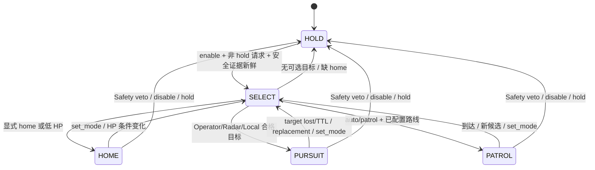
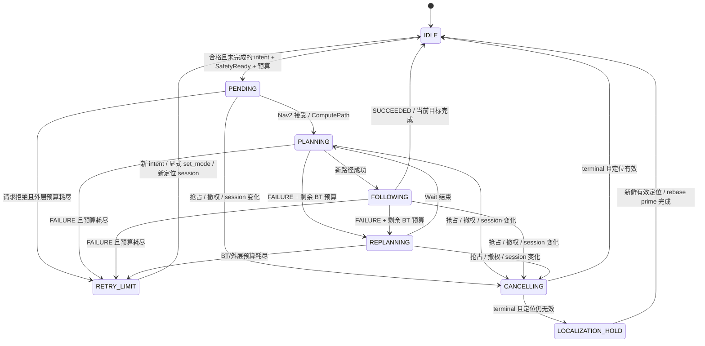
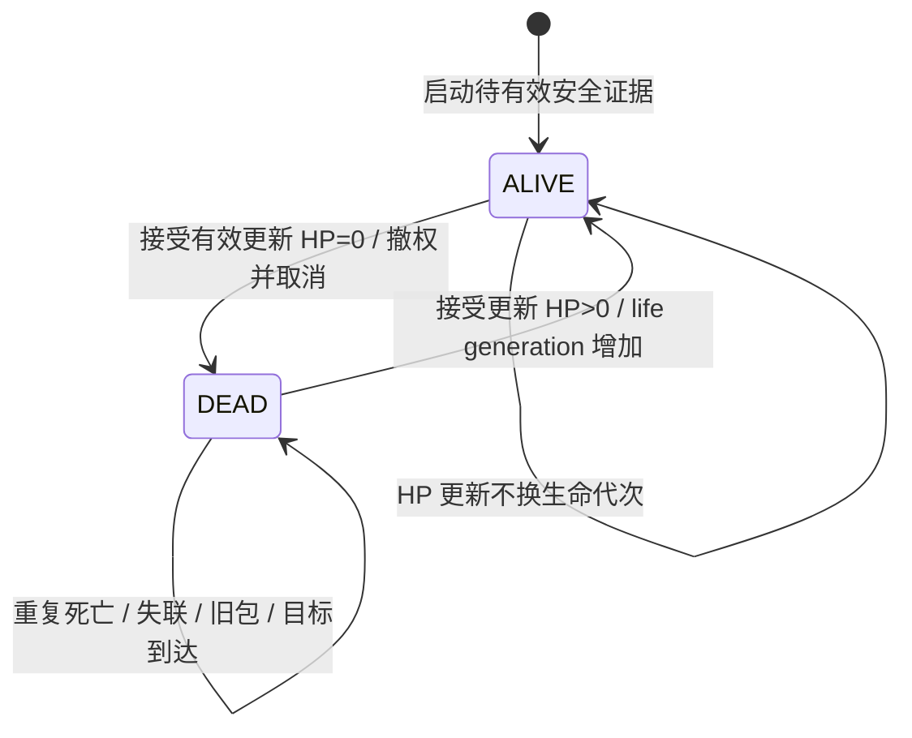

# 2027 Navigation Target Arbitration Contract

状态：Integration 软件候选；不授予硬件运动权限。适用于自动哨兵。

## Ownership Contract

`competition_mission_node` 复用现有 BT，每 tick 只产生一个 `desired_goal_`，并拥有
唯一任务级 `NavigateToPose` 客户端。pursuit 只产生候选，referee/serial 不发导航目标。
Nav2 自己的 BT 调用 controller 的 `FollowPath`；本仓任务层不直接调用它。

## Priority Contract

默认树的正式 priority table（从高到低）：

| 优先级 | 选择条件 | 抢占与后续行为 |
| --- | --- | --- |
| 1 SAFETY_STOP | DEAD、复活定位屏障、disable、hold、定位/裁判/底盘/guard 否决或过期 | 取消 Navigate/Spin，等待终态，不发替代目标 |
| 2 MANDATORY_HOME | 新鲜有效 referee 的低 HP、配置启用的低弹量条件，或显式 home | 覆盖所有 tactical source；缺 home 时 hold_missing_home |
| 3 OPERATOR | 最新有效 Operator TargetIntent | 高于 Radar / Local |
| 4 RADAR | 最新有效 Radar TargetIntent，或显式 track profile 的 pursuit 候选 | 高于 Local |
| 5 LOCAL | 最新有效 Local TargetIntent，否则 BT 本地巡逻点 | 本地 attack/defense 等只提供目标；巡逻保留 index |
| 6 IDLE/HOLD | 没有合格目标 | 不发 action |

`retreat_projectile_threshold=-1` 默认关闭低弹量返航；设为 0..65535 后，
新鲜有效 `/referee/state.projectile_allowance_17mm <= threshold` 选择 HOME。
单位是剩余 17 mm 可发弹量，不是自行推断的累计发弹数。未确认下位机字段语义与阈值前
保持关闭。HP=0 仍为 DEAD，不能变成 HOME。
`SetMissionMode` 是受信任的本地任务配置入口，不是串口 tactical source；显式 home/hold
覆盖三来源。独立 Competition Mission 临时 supply/recovery/special 候选没有迁入本分支，
本次不扩大其任务服务范围。

## TargetIntent 与三来源 latest-value 合同

数据流固定为 `Local / Radar / Operator -> TargetArbiter -> Selected Tactical Target ->
Mission -> Nav2 -> planner / avoidance / controller / chassis`。Arbiter 是 Mission 进程内的
小型 latest-value store/selector，不创建 ROS action client、不发路径、速度、底盘或姿态命令。
Mission 仍是唯一 NavigateToPose/Spin owner。

`/mission/target_intent` 使用 `rm_competition_interfaces/msg/TargetIntent`，volatile/reliable，depth 10。
每个 source 只能有一个受信任 producer；ROS source 标签不是 DDS 身份认证。

| 字段 | 合同 |
| --- | --- |
| `source` | LOCAL=1 / RADAR=2 / OPERATOR=3；NONE=0 仅用于未选择的输出 |
| `header.stamp` | 原始样本的 ROS 时钟时间；不能用收到重发包的时间覆盖 |
| `header.frame_id`, `pose` | 已确认的 map frame，米/弧度，有限 planar pose、单位四元数；不做未经确认的裁判坐标转换 |
| `sequence` | 每 source 严格递增 uint64；同 sequence 的完整重复或冲突包均无操作、不续租；旧 sequence 不得覆盖新值 |
| `target_id` | 有效目标的非空稳定逻辑身份；周期 fresh sample 可保持 ID；新 ID 即使同坐标也替换 |
| `ttl` | 从原始 stamp 起的持续时间，0 < TTL <= target_max_ttl_sec（默认 5 s）；不是从 RX 起算 |
| `valid` | false 表示源当前不可用，立即撤下该 source 的值并保留 sequence 水位 |
| `clear` | true 必须搭配 valid=false，表示显式撤销该 source；不是 ESTOP，不清除其他 source |

未收到目标没有状态更新；过期只使现有值不再 eligible；invalid 是源不可用通知；clear 是显式
撤销。三者都允许回退，只有 Safety/明确 hold 才是停止任务。clear/invalid 自身也必须有更新
sequence、合法 stamp 和非零 TTL，旧 clear 不能撤销新目标。它们的 pose/target_id 不参与执行。

接收前先验证格式、frame/pose、源 stamp 的未来容差（50 ms）及原始期限，再推进水位。
拒绝过期、畸形、非法未来数据，防止坏包占据排序水位。后续检查同时使用 ROS deadline 和
接收时剩余 TTL 对应的 steady deadline，重复包不能延长任何一个。时间回退触发既有
定位 hold；不在本轮新增自动 epoch 恢复。

源失效按 `Operator -> Radar -> Local -> 内建巡逻/hold` 确定性回退。
周期发送应区分两种行为：重传同一已生成样本保留 sequence/stamp/TTL；新的当前目标观测或
明确继续有效的最新状态，才递增 sequence 并给出新样本时间。建议每 100 ms 发一个新状态，
TTL 由 producer 明确给出（例如 500 ms），允许丢个别包；无 ACK/队列/握手。

`/mission/selected_target` 是每 tick 的只读 TargetIntent 快照（volatile/reliable，depth 1）。
没有 tactical selection（含 mandatory/hold）时 valid=false/source=NONE/clear=false；
不能把它桥接回输入。内建巡逻在仲裁的 Local fallback 端生成 map 目标，`target_id=patrol:<index>`；
其 sequence=index+1 是本地 waypoint 标识，不是可回灌到输入的传输序号。

所有普通目标在非 hold/home 且安全有效时参与仲裁。`allow_pursuit` 只约束旧 track-to-standoff
路径，不禁止已归一化的三来源高层目标。显式 patrol 仍禁止旧 track pursuit，但允许三来源
TargetIntent，Operator/Radar 不再被本地巡逻挡住。pursuit 专用模式无有效目标时 hold。

Mandatory/Home 或 Safety 结束后，**三来源缓存样本必须晚于最后一个 mandatory/hold tick**，
生命或定位 session 换代也推进此屏障；同时撤销缓存有效性但保留 sequence 水位，防止未来容差内的旧样本跨权限边界。最新 fresh sample 可重新参与，旧 action/path 不恢复。
无新外部观测则回到内建 Local 巡逻（或 hold）。普通 source TTL/clear 回退不推进此屏障，
仍新鲜的低优先级目标可立即恢复。取消期间只合并最新选择，必须等旧终态后才发送。
同 source/ID 的位置更新保留现有阈值及发送间隔，sequence 心跳本身不触发新 action。

## 两层状态与转换责任

以下图恢复当前代码语义，不新增 enum/state machine。Mission 图中的 AUTO 是请求模式，
实际分支仍为 home/pursuit/patrol/hold。`SetMissionMode` 改请求；输入租约、HP 和候选
改变每个 tick 的选择；执行层独立保留旧 action 所有权直到终态。

PLANNING/FOLLOWING/REPLANNING 是 Nav2 action/BT 观测，非 Mission 新增内部状态。
取消未被接受或未 terminal 时停留 CANCELLING；没有超时后并发发目标的 fallback。
非定位 Safety 关闭时同样停止发目标，恢复只重新选择当前 intent。patrol 保留未完成
索引，三来源 target 需要撤权之后的新观测，旧 action 从不直接 resume。

## Cancellation Contract

- 同一时刻最多有一个 pending/active 的 NavigateToPose 或 Spin。
- 分支或目标身份变化：立即请求取消；等待旧 action **终态 result**，再按最新有效决策发送。
  Cancel ACK 只是 CANCELING，不能据此交出 owner。
- pending 请求尚未返回 handle 时撤权：记录取消意图；迟到的 accepted handle 一到就取消。
- 等待取消期间的成功 result 不推进 patrol 索引，也不标记旧战术目标完成。
- 取消被拒绝或服务端不结束：保持等待，不并发发送替代目标。服务端执行取消及实际停车
  仍是下游合同；本层无法用重复发 goal 强迫服务端停车。
- Spin 同样必须结束后才允许 home。

## Resume Contract

patrol 被抢占后保留索引，只有未被撤销的成功到达才推进。恢复安全证据或新定位会话后，
Mission 重新仲裁当前请求并建立新 action，不直接恢复旧 action/path。
三来源 target 要求原始采样时间晚于最后一个 mandatory/hold/撤权 tick，不复活旧 tactical target。
显式 set_mode、新 intent 或新定位 session 可重置对应失败预算；相同失败目标不会无限重发。

## 原子 pursuit 候选

`/mission/pursuit_candidate` 使用 `PursuitCandidate`，由现有 planner 唯一生产：

| 字段 | 语义 |
| --- | --- |
| `header.stamp` | 原始 TargetTrack 采样时间，重复发布不得改为当前时间 |
| `header.frame_id`, `pose` | planner 转换后的 map standoff pose |
| `valid_until` | 原始采样时间 + 既有 `max_track_age_sec`（默认 0.3 s） |
| `track_id` | 稳定目标身份；非空；更换身份表示 replacement |
| `source` | planner 按输入策略填写 RADAR 或 RESEARCH，不由 TargetTrack 自报 |
| `valid` | 同一条消息内的质量/TF/观测有效性；false 表示 lost/不可用 |

Mission 独立检查 frame、有限值、单位四元数、来源、采样时间、deadline 和稳态时钟 lease；
`input_timeout_sec=0.5 s` 是上限，不能延长 planner 的 0.3 s 源期限。
同一采样时间重复出现不能刷新 Mission 或 planner 的稳态 lease；旧时间样本被忽略。
原始 track/candidate 的负数或越界 nanosecond、过期或超出当前未来容差的时间戳，
必须在更新排序水位之前拒绝；candidate deadline 也须结构合法。否则一条未来消息
可能永久排斥正常输入。非法消息不终止进程，也不延长旧目标的原始 TTL。

- **valid**：上述检查全部通过；才可参与仲裁。
- **stale**：采样年龄、valid_until 或稳态 lease 过期，包括 planner 退出。
- **lost**：观测 `valid=false`、质量不合格或 TF/计算失败。取消 pursuit，auto 回到同一 patrol 点；
  pursuit 专用模式回到 hold。
- **replaced**：新的 `track_id` 替代旧身份，即使坐标相同也取消旧 action 后重发一次。
- **same target update**：相同 ID；距离/yaw 变化不超过 0.35 m/0.35 rad 不重发；超过阈值后
  最短间隔 0.5 s，取消期间合并为最新候选。高优先级抢占不受此间隔限制。

原有 `/mission/pursuit_goal` 和 `_valid` 继续发布供研究工具和诊断使用，Mission 不再消费
这对无法携带身份/源期限的分离消息。研究自定义 producer 需要迁移至原子候选。

## 比赛与研究输入边界

- `competition_2027_navigation.launch.py` 默认 `radar_target_input:=serial_intent`：不启动 pursuit
  planner，Radar/Operator 从独立 V2 目标消息进入统一输入，Local 可由本地决策 producer 提供。
- 显式 `radar_target_input:=track` 保留已有 `/radar/target_track -> pursuit_goal_planner ->
  PursuitCandidate` 路径。Mission 把新鲜候选归一化为 Radar TargetIntent，再进入同一 selector；
  此 profile 拒绝统一输入中的 Radar，避免两种 sequence domain 同时写一个 source。
  Operator 和 Local 统一输入仍可用。RESEARCH 候选只在 radar_only=false 的独立研究组合接受。
- 2027 组合继续强制 radar_only=true、require_motion_guard=true、chassis gate、无 mock、
  Mission startup disabled。YAML 不得覆盖这些组合策略。它只启动 Mission 与可选 planner，
  不启动 Nav2、serial、定位、referee 或物理设备。
- `/operator/navigation_target_raw` 和历史 V2 0x84 仍只作诊断，无 Mission consumer。
  新 RADAR_TARGET=0x86 / OPERATOR_TARGET=0x87 是明确 map-frame 合同的软件扩展，
  不能声称现有 MCU 已支持；布局见 [V2 合同](../competition_v2_protocol.md#tactical-targets-0x86--0x87)。
- 目标消息不携带姿态字段。`PostureRequest/PostureState` 及其生命周期保持独立。

## Safety Contract：证据与运行边界

Mission 保留既有 LocalizationStatus 合同；对 referee/chassis/V2 guard 增加独立 0.5 s
采样及接收 lease，防止上游 gate 退出后缓存状态无限存活。看到任何 V2 guard 后，即使
旧调试配置未要求它，也不能忽略它的拒绝或失联。

`V2MotionGuardState` 是最终编码边界的只读观测；消费 PERMITTED 不创建 owner/session，
也不替代 AUD-003 的租约或最终逐帧检查。现有 guard 在 BLOCKED 后仍需重启并重新授权。
本轮没有连接真实 Mission 到该正准入租约，测试中的 guard 发布者只是受控 fixture。
2027 导航组合只启动 Mission/planner，不启动 Nav2、serial、定位、referee 或物理设备；缺少
外部安全证据时保持停止。不得与 dog-hole manager、手动目标工具或另一 Mission 同域共同控 Nav2。

## Life-State Authority Contract

生命状态独立于 Mission 请求模式和六态 `RobotPosture`。不增加姿态枚举、速度限制、gain
或新 mode。当前没有可消费的独立 referee DEAD/REVIVED event；使用唯一规范输入
`/referee/state` 的有效 HP：**HP=0 为 DEAD；DEAD 后更新且有效的 HP>0 为 REVIVED**。
这是本候选的明确软件策略，不是对未确认 MCU `life` 字节或 heartbeat 的解释。

输入必须 `valid=true`、时间结构合法、非零、年龄在既有 −0.05～0.5 s 窗口内，且源
时间戳严格大于已接受水位（上述为默认年龄窗口）。同 stamp 的重复或冲突包、乱序包不能改变生命状态或续租；
非法未来包不能推进水位。正常比赛组合还要求 `/referee/state_valid` 与其他 Safety
证据。不加 debounce：经 gate 确认的死亡立即生效；重复相同生命状态不重复换代。
失联只使现有证据过期，不构造死亡或复活事件；DEAD 保持锁存直到有效的新 HP>0。

- **DEAD**：在输入回调中撤销 Mission 导航授权，取消 Navigate/Spin，清除旧执行完成/
  失败记忆与 pursuit 候选有效性；保留请求模式和未完成巡逻索引。显式 HOME、低 HP、
  Operator/Radar/Local、pursuit、patrol、event replan 均不能绕过。取消中的 action 仍占 owner 直到 terminal，
  但已无 Mission authority；不把“尚未终态”错误解释成继续授权。
- **REVIVED**：增加 life generation，重新仲裁当前请求；每个新 Navigate 再取得新的
  goal generation。执行身份是 `(life_generation, goal_generation, localization session)`。
  不提前改旧 goal generation 丢失终态屏障；旧生命代次的成功/失败只能释放旧 handle，
  不能推进 patrol、完成新目标或消耗新预算。Spin 同样检查 life generation。
- **定位条件**：复活时定位有效，仍须通过所有 Safety 门并等旧 terminal 后重建。
  复活时定位无效，保持 HOLD，直到严格更新的定位 session 且状态新鲜有效；同一 session
  的 valid 心跳不足以放行。rebase 可以在 DEAD 中完成 drain/commit/prime，但不自动复活。
- **目标条件**：复活前缓存的 pursuit/temporary commitment 不恢复；须有撤权后新的源
  观测。新鲜目标可以在 DEAD 时作为输入到达，但不能获得导航授权。
- **Safety 关系**：ALIVE 只移除生命否决，不创建最终串口正授权，也不覆盖定位、guard、
  chassis、ESTOP 或操作员 hold。HP>0 仍可能因低血量选择 HOME。

该图与 HOLD/HOME/PATROL/PURSUIT/AUTO 请求模式正交；ALIVE **不等于已授权**。
复活等待新定位会话是一个条件，不引入第二套 REVIVING enum。
`MissionState.detail` 追加 `life_state`、`life_generation`、`mission_generation`（既有
Navigate 请求序号）、`localization_session`、`navigation_authority`，用于观察而非命令。
最后一项仅表示当前 Mission 执行承诺仍获软件授权，不表示 MCU 或车辆实际运动状态。

**输入边界**：RefereeState 没有 producer/session/sequence 字段。gate 保留 ROS 源 stamp，
上述排序保障只适用于同一受信任来源和时钟域。HPM 帧无源序号/源时间；V2 虽有 frame
sequence，当前 referee 接收路径未用它去重且会重新打 host RX stamp。旧线上包若被上游
重新打成新 stamp，本层无法识别。真实传输去重、MCU 重启、referee 延迟与生命字节语义
必须在硬件输入验收中确认；不能用这份规范声称已闭合 wire-level replay 或物理停车。
本轮没有修改这些协议，也没有新增自动切源/时钟复位恢复。

生命语义验证和系统线冻结决定见
[DEAD/REVIVED 最小闭合](../validation/mission_life_authority_20261029.md)。

[受控验证与审计](../validation/event_replanning_port_20261027.md) 给出证据和适用限制。

## Session Contract：定位会话与事件重规划

接受更大的 `LocalizationStatus.started_at` 表示新 session；同一 producer 的 sequence
可在新 epoch 重新从 1 计数。Mission 立即请求取消 NavigateToPose/Spin，清除旧完成与
失败记忆，并等待终态才允许新 session 的目标。旧 session 的结果仅释放旧 action，
即使结果为 SUCCEEDED 也不得推进巡逻或完成目标；计数记录在 MissionState.detail 的
`stale_results_rejected`。旧 epoch 状态仍按现有规则拒绝。

`navigation_policy:=event_driven` 仅在统一仿真中启用。Nav2 内部
`event_driven_replanning.xml` 每个目标先 ComputePathToPose，再 FollowPath；任一步 FAILURE
才进入 1.5 s Wait，然后重算，最多 3 次 recovery（初次 + 3 次尝试）。不清图、不
Spin/BackUp、不轮询 IsPathValid。任务层目标变化由上述取消/终态/替换流程处理，BT 不发
NavigateToPose。仿真 Mission 配置将外层目标尝试限制为 1，耗尽后保持 goal_retry_limit，
直到新的意图或受信任的显式 set_mode 重置预算。

此处约束的是失败后的重试次数，不是 NavigateToPose 或单次 FollowPath 的绝对时限。
第 4 次尝试仍 RUNNING 时，已无后续 retry，但尚未发生最终 FAILURE；RecoveryNode
继续等待当前 action。第 4 次 FAILURE 直接向上传播，不能再 Wait/Compute；已 terminal
的 Follow 无须再次 cancel。若 Mission 在它 RUNNING 时撤销意图，则由既有
Navigate cancel → BT halt → Follow cancel 链终止。当前候选的 SimpleProgressChecker
检查相对基准位置的平移，不保证目标距离单调减少。70 s 是 `no_route` 验证窗口，
不能从 3 次 recovery 和 3 s 进度 allowance 推导出该完成上限。具体证据及未闭合项见
[no_route 定向诊断](../validation/no_route_forensics_20261030.md)。

Nav2 自带的 `goal_pose` 订阅具有内部 self-client，不是第二个任务 owner；此 profile
把该订阅重映射至 `/simulation/unused_direct_goal_pose` 并移除 RViz GoalTool。
不允许测试工具、RViz 或 dog-hole manager 同时发目标。仿真探针只提供 Mission 输入。

显式 rebase 还必须等待配置的 Nav2 子 action 全部终止，然后由 bridge 提交 map→odom、
选择性失效 map 动态缓存并 prime，才能恢复有效性；见
[rebase 合同](../../src/rm_relocalization_bridge/README.md#explicit-map-only-rebase-transaction)。
它不重置 Mission 意图，不恢复旧 path/action，也不创建另一套 motion authority。

系统验证范围、两层状态图对应证据及未接入项见
[2026-10-29 系统验证](../validation/competition_mission_arbitration_system_20261029.md)。
