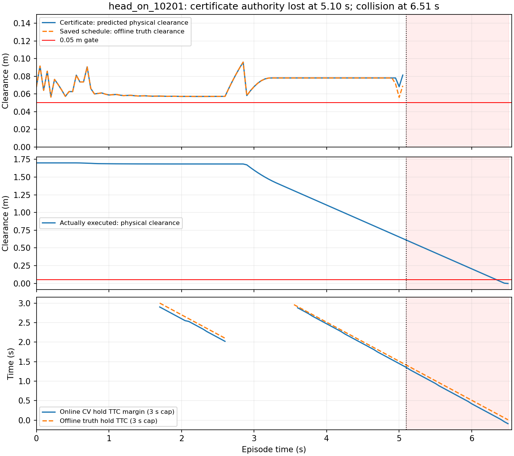

# Certificate failure forensics：31个剩余失败

**当前导航实现仍 Stop。建议 Go-to-next-hypothesis，仅限有界不确定性 / certificate coverage 的窄范围立项设计；本轮未实现新算法。**
主要瓶颈是“证书有效”只覆盖单条精确CV和当时可见actor集合，不能覆盖非理想输入中的真实运动。
这在25/31例中是主要可见机制；6个head-on还暴露预测条件变化后失去备份授权、推迟执行的机制。
不能把全部失败归为 prediction accuracy，也不能把普通净空下降直接当作需要惩罚的reserve erosion。

## Part A与范围

归档commit：`0633dc5a105cad751e602f6cbc19cd7f17b39090`，
“研究：归档证书修复后holdout结果”，分支`codex/dynamic-certificate-lifecycle`。
只提交上一轮9个轻量文件，最大574,711bytes；提交后working tree clean。
40,738,758bytes原始证据仍在仓库外。没有push、merge、修改main或production。
Runtime仍是lifecycle commit `e819e1002d938b5938447302d8a717ce8d49a57e`。
[原rerun结果与Stop](dynamic_certificate_holdout_rerun_20261027.md)不改写。

本轮只读取既有120-case/360-rollout结果，聚焦28次C1碰撞和3次低净空完成。
没有调用planner、certificate checker、backup生成器，没有运行任何新的闭环episode。
脚本用已保存的动作序列做**离线开环轨迹重建**，测量同一条证书在其CV和truth下的差异；
这不是新策略执行，不证明该替代动作能完成任务。原truth从未回灌决策。

另外选择7个既有成功对照：static_10000、crossing_10100、head_on_10200（与首个失败配对初态）、
stop_start_10304、sudden_turn_10400、stale_observation_10801、multiple_10900。
它们用于排除诊断量的明显假阳性，不构成独立holdout或新成功率统计。
模型误差统计读取全部120例C1，而非只选失败。

## 测量口径与可确定程度

[分析脚本](../../research/dynamic_state_time/forensic_certificate_failures.py)重建5,060个控制周期、4,612条不同证书，
逐条复核终端state和safe-rest原记录，误差均<1e-7；25,231个10ms真实执行步与原plant逐步一致，误差<1e-10。
记录中的state_deviation主要发生在授权丢失、原备份未执行之后，不能据此判定plant建模错误。
另检查解析ray的已知安全/碰撞几何例；未修改运行代码。

- **记录值**：source/receive timestamp、age、观测/CV actor、证书id/source version、validity、controls、cursor、safe-rest、proposal、接纳、queue、实际执行。
- **重建值**：完整certificate predicted clearance、proposal clearance/progress、remaining duration/lateral displacement、truth schedule clearance及truth hold TTC。
  planner没有记录其内部clearance/progress cost；重建数不是原cost，也不用于重排候选。
- 证书几何为膨胀半长宽0.355/0.330m；物理几何为0.325/0.300m。
  原`cv_ray_clearance_m`使用前者，不能直接与物理0.05m门槛比较。
  下文统一用物理几何；两种值在派生记录中分别保存。失败样本所有签发证书重建预测净空最小0.054782m。
- 原safe-rest是静止后的无限CV ray条件。truth对照使用原motion events分段、末段CV ray；
  不把有限3s取样当成无限安全证明。负穿透值仅作违规判断，深度不作碰撞严重度。
- `predicted_min_m`是该证书签发时完整序列的最小净空；持有期间不会伪装成一次新签发。
  当前实测起点的剩余序列另存为`retained_remaining_current_cv_min_m`与`retained_remaining_truth_min_m`。
- 每拍时间为控制周期起点；“本拍实际净空”取随后最多50ms实际执行的最小值。
  精确collision时间用原summary；TTC为3s截断的hold-command诊断，空值表示3s内未发现，不代表无限安全。
- 最后**构造成功**指日志中原策略确实生成的候选；未枚举被原策略拒绝的所有动作。
  “全动作库最后还能生成任何backup的时刻”“真正最后可逃逸边界”均为 **Unknown**。
- 旧保存序列的可执行性另要求前0.10s与不可撤销queue完全一致，不能假装立即改命令。
  5.15s之后才提出执行5.20s逃逸，不满足这个delay条件。

逐拍全部字段在仓库外`<case>_cycles.jsonl`；Git只保存轻量汇总、关键时间线和[manifest](../../research/dynamic_state_time/results/certificate_failure_forensics/dataset_manifest.json)。
每个episode的主要机制是解释性归因，不是消融得到的独立因果效应；各因素贡献比例为Unknown。

## 31例逐例分类

A：prediction / observation coverage mismatch。
E：模型条件变化、reserve授权/可执行性与晚逃逸共同作用。
没有以单纯动态库不足或execution mismatch作为主要原因的充分证据。
“乐观证书”指预测物理净空≥5cm，而**按该保存证书完整执行**的truth净空<5cm；不等同该动作实际全部执行过。

| case ID | 结果 | 主要机制 | 次要机制 / 限制 | 乐观证书数 | 首次乐观 s |
| --- | --- | --- | --- | --- | --- |
| head_on_10201 | 碰撞 | E | 小CV偏差、授权失效、停车/晚逃逸；backup unavailable；未发现乐观证书 | 0 | — |
| head_on_10203 | 碰撞 | E | 小CV偏差、授权失效、停车/晚逃逸；backup unavailable | 1 | 5.30 |
| head_on_10205 | 碰撞 | E | 小CV偏差、授权失效、停车/晚逃逸；backup unavailable | 4 | 4.95 |
| head_on_10207 | 碰撞 | E | 小CV偏差、授权失效、停车/晚逃逸；backup unavailable；未发现乐观证书 | 0 | — |
| head_on_10209 | 碰撞 | E | 小CV偏差、授权失效、停车/晚逃逸；backup unavailable | 2 | 5.15 |
| head_on_10211 | 碰撞 | E | 小CV偏差、授权失效、停车/晚逃逸；backup unavailable | 3 | 4.95 |
| stop_start_10300 | 碰撞 | A | 停止/重启、观测延迟；backup unavailable | 4 | 2.65 |
| stop_start_10301 | 碰撞 | A | 停止/重启、观测延迟；backup unavailable | 7 | 2.75 |
| stop_start_10302 | 碰撞 | A | 停止/重启、观测延迟；backup unavailable | 9 | 3.15 |
| stop_start_10303 | 碰撞 | A | 停止/重启、观测延迟；backup unavailable | 4 | 2.65 |
| stop_start_10305 | 碰撞 | A | 停止/重启、观测延迟；backup unavailable | 19 | 2.65 |
| stop_start_10306 | 碰撞 | A | 停止/重启、观测延迟；backup unavailable | 3 | 2.70 |
| stop_start_10307 | 碰撞 | A | 停止/重启、观测延迟；backup unavailable | 8 | 2.70 |
| stop_start_10308 | 碰撞 | A | 停止/重启、观测延迟；backup unavailable | 11 | 3.05 |
| stop_start_10310 | 碰撞 | A | 停止/重启、观测延迟；backup unavailable | 9 | 2.65 |
| stop_start_10311 | 碰撞 | A | 停止/重启、观测延迟；backup unavailable | 18 | 2.70 |
| occlusion_reappearance_10502 | 碰撞 | A | 丢失actor、集合变化；backup unavailable | 1 | 2.65 |
| occlusion_reappearance_10503 | 碰撞 | A | 丢失actor、集合变化；backup unavailable | 7 | 2.65 |
| occlusion_reappearance_10506 | 碰撞 | A | 丢失actor、集合变化；backup unavailable | 1 | 2.65 |
| occlusion_reappearance_10507 | 碰撞 | A | 丢失actor、集合变化；backup unavailable | 7 | 2.65 |
| occlusion_reappearance_10510 | 碰撞 | A | 丢失actor、集合变化；backup unavailable | 1 | 2.65 |
| occlusion_reappearance_10511 | 碰撞 | A | 丢失actor、集合变化；backup unavailable | 7 | 2.65 |
| id_switch_10608 | 碰撞 | A | 速度误关联（非纯换ID） | 12 | 2.10 |
| id_switch_10610 | 碰撞 | A | 速度误关联（非纯换ID）；backup unavailable | 6 | 2.10 |
| id_switch_10611 | 碰撞 | A | 速度误关联（非纯换ID） | 12 | 2.10 |
| prediction_error_10702 | 低净空完成 | A | 持续速度偏差、证书乐观 | 5 | 3.25 |
| prediction_error_10703 | 碰撞 | A | 持续速度偏差、证书乐观；backup unavailable | 13 | 2.65 |
| prediction_error_10706 | 低净空完成 | A | 持续速度偏差、证书乐观；backup unavailable | 13 | 2.80 |
| prediction_error_10707 | 碰撞 | A | 持续速度偏差、证书乐观；backup unavailable | 8 | 2.80 |
| prediction_error_10710 | 低净空完成 | A | 持续速度偏差、证书乐观；backup unavailable | 13 | 3.10 |
| prediction_error_10711 | 碰撞 | A | 持续速度偏差、证书乐观；backup unavailable | 11 | 2.70 |

主要机制：**A=25/31（80.6%），E=6/31（19.4%）**；这是上述证据分类，不是实验识别的因果百分比。
细分：stop/start 10、occlusion 6、ID误关联3、prediction error 6、head-on组合6。
29/31例在第一次物理违规前已有乐观证书；其中29例有当时观测/速度/可见集合不准确，
9例还出现“当时状态准确，但后续stop/start使CV条件失效”的证书，两项重叠不能相加。
只有head_on_10201和10207未发现乐观证书，却仍碰撞。

sudden-turn和stale类别本轮均为12/12安全完成，**不存在对应碰撞fixture**。
纯ID relabel的6例也安全完成；这里3个ID失败均为速度误关联，不能称“只换ID就撞”。

## Safety reserve erosion检验

事后诊断定义：连续0.5s（11个控制拍）的有效证书预测净空净下降≥2cm，至少80%相邻步不增加。
另保存0.25/0.5/1s × 0.5/2/5cm敏感性矩阵；不接入任何准入逻辑。

- 该模式出现在**30/31失败，也出现在7/7成功对照**。很多场景从t=0的正常接近就满足。
- 首个head-on反而没有满足这条0.5s/2cm诊断；其预测safe-rest长期平坦，却仍会失败。
- 逐例首次下降时刻、距离违规/碰撞多少控制拍，见[failure_mechanisms](../../research/dynamic_state_time/results/certificate_failure_forensics/failure_mechanisms.csv)
  的`first_worsening_window_s`和`sustained_decline_lead_cycles`。这些数不能解释为已验证的预警提前量。
- 同一实测起点下比较旧保存计划与新certificate：旧预测净空比新高≥2cm、前0.15s目标进度增益≤1cm，
  在31/31失败和7/7成功对照都存在。因为短控制拍本来进度就小，不能称其“无意义性能收益”。
- 若改看完整末端到goal的进度差，符合“小收益/大裕量损失”的失败只剩2例；成功stale对照仍会出现。
  原planner的静态cost未保存，不能断言新计划在任务目标上被旧计划严格支配。
- 31例中，涉及上述净空损失的**停车替换仅2例**；大多数下降来自正常前进。
  6个head-on在违规前累计接纳289个停车proposal，stop/start为21个、prediction-error为4个；
  停车是head-on中的重要时序现象，不是全部31例的共同主因。

因此目前不支持把“净空不得下降”或普通certificate dominance直接立项为通用修复。
首个head-on更接近**执行机会被推迟、随后授权丢失**，而不是safe-rest净空连续下降。



## Prediction / model mismatch

以下是各类别事件后、可见actor的误差分布（m）。完整0/0.25/0.5/1/2/3s horizon及pre/post/stale分组在
[model_error_by_phase](../../research/dynamic_state_time/results/certificate_failure_forensics/model_error_by_phase.csv)。样本来自已有120例，数量随episode长度不同。

| 类别/事件后（stale行仅过期时段） | h=0 m mean/p95/max | h=0.5 | h=1 | h=3 |
| --- | --- | --- | --- | --- |
| head_on | 0.001 / 0.006 / 0.006 | 0.004 / 0.036 / 0.036 | 0.008 / 0.066 / 0.066 | 0.023 / 0.186 / 0.186 |
| stop_start | 0.001 / 0.000 / 0.060 | 0.038 / 0.300 / 0.360 | 0.094 / 0.570 / 0.660 | 0.326 / 1.770 / 1.860 |
| sudden_turn | 0.000 / 0.000 / 0.060 | 0.006 / 0.000 / 0.660 | 0.011 / 0.000 / 1.260 | 0.033 / 0.000 / 3.660 |
| occlusion_reappearance | 0.000 / 0.000 / 0.000 | 0.000 / 0.000 / 0.000 | 0.000 / 0.000 / 0.000 | 0.000 / 0.000 / 0.000 |
| id_switch | 0.002 / 0.000 / 0.120 | 0.014 / 0.000 / 0.720 | 0.026 / 0.000 / 1.320 | 0.074 / 0.000 / 3.720 |
| prediction_error | 0.005 / 0.008 / 0.017 | 0.031 / 0.051 / 0.102 | 0.057 / 0.093 / 0.187 | 0.161 / 0.263 / 0.526 |
| stale_observation | 0.000 / 0.000 / 0.000 | 0.000 / 0.000 / 0.000 | 0.000 / 0.000 / 0.000 | 0.000 / 0.000 / 0.000 |

这些结果直接反驳“平均prediction error即可解释避障”：

- **occlusion**：可见actor的误差近零，但丢失目标被从证书世界中删除。
  此时预测净空反而跃升到约1.69m；实际障碍没有消失。
  缺失actor在独立列计数，未被当作零误差；可见目标误差曲线不能评价集合完整性。
- **ID misassociation**：可见位置仍近原位置，速度交换使误差瞬时达1.2m/s，1s预测可偏1.32m；
  source足够fresh、证书仍持续换代，不能抵消预测对象/运动语义错误。
- **stop/start**：当时测得停止确实正确，也不能据此承诺无限静止。
  9例出现当时无位置/速度误差但保存证书被后续运动变化破坏；10例均有当前错误输入期的乐观证书。
- **sudden turn**：可有较大未来误差而仍全部完成，本组转向把危险关系改变到可通过方向。
  误差大不充分推出碰撞，取决于相对几何和消费者行为。
- **stale**：本组目标本来就是恒速，旧状态外推的数值误差几乎为零；freshness仍按合同拒绝，最终全部完成。
  不能把此结果外推到“丢帧期间发生新运动”的场景。

A类“当时输入已错误/遗漏”、B类“当时合理但未来条件变了”、C类“模型合理而主动耗掉reserve”不是互斥episode标签。
A至少29例有直接证书反证，B至少9例；C作为**独立于模型变化的主要因果机制**未被本轮证据证明。
两个没有乐观证书的head-on提供的是授权/执行时机反证，不应改写为预测不准导致unsafe轨迹。

## Backup coverage与可逃逸窗口

全部31例episode开始都取得backup，所有初始保存序列也通过离线truth审计。
因此“动作库从来没覆盖这些场景”不成立；但这不证明它覆盖每个后来状态。
28个失败在首次物理违规前曾出现unavailable；另3例在边界违规时仍有有效证书。
两个ID误关联碰撞直到碰撞所在拍仍被授权，valid不是物理安全证据。

| case ID | 最后valid s | 最后构造 s | 最后记录的真值安全证书 s | 实际碰撞 s¹ | valid→碰撞窗口 s |
| --- | --- | --- | --- | --- | --- |
| head_on_10201 | 5.05 | 5.05 | 5.05 | 6.51 | 1.46 |
| head_on_10203 | 5.30 | 5.30 | 5.25 | 6.62 | 1.32 |
| head_on_10205 | 5.10 | 5.10 | 4.90 | 6.34 | 1.24 |
| head_on_10207 | 5.35 | 5.35 | 5.35 | 6.79 | 1.44 |
| head_on_10209 | 5.20 | 5.20 | 5.10 | 6.55 | 1.35 |
| head_on_10211 | 5.05 | 5.05 | 4.90 | 6.32 | 1.27 |
| stop_start_10300 | 2.80 | 2.80 | 2.60 | 3.57 | 0.77 |
| stop_start_10301 | 3.05 | 3.05 | 2.70 | 3.37 | 0.32 |
| stop_start_10302 | 3.55 | 3.55 | 3.10 | 4.49 | 0.94 |
| stop_start_10303 | 2.80 | 2.80 | 2.60 | 3.48 | 0.68 |
| stop_start_10305 | 3.55 | 3.55 | 2.60 | 4.31 | 0.76 |
| stop_start_10306 | 2.80 | 2.80 | 2.65 | 3.22 | 0.42 |
| stop_start_10307 | 3.05 | 3.05 | 2.65 | 3.51 | 0.46 |
| stop_start_10308 | 3.55 | 3.55 | 3.00 | 4.47 | 0.92 |
| stop_start_10310 | 3.05 | 3.05 | 2.60 | 3.96 | 0.91 |
| stop_start_10311 | 3.55 | 3.55 | 2.65 | 3.77 | 0.22 |
| occlusion_reappearance_10502 | 2.65 | 2.65 | 2.60 | 3.29 | 0.64 |
| occlusion_reappearance_10503 | 2.95 | 2.95 | 2.60 | 3.33 | 0.38 |
| occlusion_reappearance_10506 | 2.65 | 2.65 | 2.60 | 3.19 | 0.54 |
| occlusion_reappearance_10507 | 2.95 | 2.95 | 2.60 | 3.38 | 0.43 |
| occlusion_reappearance_10510 | 2.65 | 2.65 | 2.60 | 3.37 | 0.72 |
| occlusion_reappearance_10511 | 2.95 | 2.95 | 2.60 | 3.44 | 0.49 |
| id_switch_10608 | 2.65 | 2.65 | 2.05 | 2.66 | 0.01 |
| id_switch_10610 | 2.35 | 2.35 | 2.05 | 2.56 | 0.21 |
| id_switch_10611 | 2.65 | 2.65 | 2.05 | 2.67 | 0.02 |
| prediction_error_10702 | 3.45 | 3.45 | 3.20 | 未碰撞 | — |
| prediction_error_10703 | 3.25 | 3.25 | 2.60 | 3.63 | 0.38 |
| prediction_error_10706 | 3.20 | 3.20 | 2.75 | 未碰撞 | — |
| prediction_error_10707 | 3.15 | 3.15 | 2.75 | 3.54 | 0.39 |
| prediction_error_10710 | 3.45 | 3.45 | 3.05 | 未碰撞 | — |
| prediction_error_10711 | 3.20 | 3.20 | 2.65 | 3.57 | 0.37 |

¹ 低净空完成行的last-valid/last-constructed取首次低净空控制拍之前；不是最终到goal前最后证书。
完整保存`analysis_event_s`区分这两个事件。
最后valid至碰撞窗口范围：head-on1.24–1.46s、stop/start0.22–0.94s、occlusion0.38–0.72s、
ID0.01–0.21s、prediction-error碰撞0.37–0.39s。
这些不是可以自由等待的逃逸余量：queue delay、制动时间和模型错误已占用其中一部分。

特别地，head_on_10201和10207在撤销授权的某一拍，**保存的旧后续序列仍保持immutable prefix且truth安全**；
其余29例未发现这一特定证据。这不等于它们绝无其他可行动作，未做新动作搜索。
后续coverage丧失有两种情形：模型/可见集合改变使原条件证书不适用，或接纳主动作后未来备份变得过于乐观。
没有支持扩大backup library的独立证据，先扩库无法解决“证书世界漏掉障碍”。

## 五个失败时间线与无碰撞对照

下列truth schedule列只评价保存动作序列，非实际机器人未来轨迹。
每个序列的当时观测、source/receive time、queue、controls及cursor在外部逐拍记录；
[轻量代表时间线](../../research/dynamic_state_time/results/certificate_failure_forensics/representative_timelines.json)保存相同关键点。

### 1. Head-on：head_on_10201，6.51s碰撞

| 控制拍起点 s | 证书 | proposal | 预测全程净空 m | 保存计划的真值净空 m | 实际本拍最小净空 m | 旧证书检查 |
| --- | --- | --- | --- | --- | --- | --- |
| 2.10 | 有效 | 接纳 forward | 0.0573 | 0.0573 | 1.6848 | prediction_changed |
| 3.55 | 有效 | 接纳 stop | 0.0781 | 0.0781 | 1.3077 | prediction_changed |
| 4.50 | 有效 | 接纳 stop | 0.0781 | 0.0781 | 0.8802 | prediction_changed |
| 5.00 | 有效 | 接纳 stop | 0.0682 | 0.0561 | 0.6552 | prediction_changed |
| 5.05 | 有效 | 接纳 stop | 0.0813 | 0.0692 | 0.6327 | prediction_changed |
| 5.10 | 失效 | 拒绝 stop | — | — | 0.6102 | prediction_changed |
| 6.50 | 失效 | 拒绝 stop | — | — | -0.0018 | state_deviation |

2.10s开始，每拍0.5mm的位置外推不一致即可越过exact-CV的1e-7一致性条件；freshness并未过期。
3.55s停稳后，safe-rest净空约0.07809m保持平坦，backup switch始终约为当前时刻+0.15s。
实际物理距离及hold TTC持续缩小，是比safe-rest净空更早的危险趋势；但普通接近也有这个趋势，尚不是validated trigger。
从模型合同看最早信号是2.10s持续prediction_changed；从停车后几何看3.55s后持续闭合。
原在线TTC仅看3s，超出范围时为空，不能把空值当作无危险。

5.05s最后新证书：原定5.20s逃逸，预测净空0.081313m，truth净空0.069230m。
**5.10s**：新“主停车动作+backup”构造失败，旧授权因prediction_changed撤销。
但旧保存序列从真实5.10s状态继续，按新CV净空仍0.080936m、truth仍0.069230m，
而且前0.10s与不可撤销队列一致；可以在5.20s按原时刻开始。
软件没有基于这种轨迹可执行性恢复旧授权，而是停留在INVALID。
**5.15s**以后才想执行原5.20s命令就只剩50ms，已不满足100ms command delay；
不能把忽略delay的离线几何安全误称为可执行逃逸。
因此该例至少在5.10s仍有一个已保存的可执行安全后续，真实最后边界未搜索。
6.51s碰撞。这里缺的不是更大的beam，也不是一条未知新轨迹。

### 2. Stop/start：stop_start_10300，3.57s碰撞

| 控制拍起点 s | 证书 | proposal | 预测全程净空 m | 保存计划的真值净空 m | 实际本拍最小净空 m | 旧证书检查 |
| --- | --- | --- | --- | --- | --- | --- |
| 2.50 | 有效 | 接纳 forward | 0.1452 | 0.1452 | 0.7213 | valid |
| 2.60 | 有效 | 接纳 forward | 0.5648 | 0.0683 | 0.6876 | prediction_changed |
| 2.65 | 有效 | 接纳 forward | 0.5521 | 0.0435 | 0.6713 | valid |
| 2.70 | 有效 | 接纳 forward | 0.5399 | 0.0186 | 0.6305 | valid |
| 2.80 | 有效 | 接纳 forward | 0.5166 | -0.0282 | 0.5485 | valid |
| 2.85 | 失效 | 拒绝 stop | — | — | 0.5068 | prediction_changed |
| 3.55 | 失效 | 拒绝 stop | — | — | -0.0047 | state_deviation |

truth在2.50s停止、2.70s重启；2.65s当前停止观测是正确的，但证书把它延续到未来，
预测0.55205m，对保存动作做truth评价仅0.04349m。
2.80s source浮点值仍略小于2.70s事件边界，原冻结输入到2.85s才交付重启，等效多一个控制拍；
本轮保留原行为，没有修输入采样。freshness未过期不代表观察包含最新运动变化。
2.85s拒绝proposal、无backup；最后已提交运动target继续保持。逐步plant吻合，不能归因执行模型错误。

### 3. Occlusion/reappearance：occlusion_reappearance_10502，3.29s碰撞

| 控制拍起点 s | 证书 | proposal | 预测全程净空 m | 保存计划的真值净空 m | 实际本拍最小净空 m | 旧证书检查 |
| --- | --- | --- | --- | --- | --- | --- |
| 2.05 | 有效 | 接纳 forward | 0.3288 | 0.3288 | 0.9433 | valid |
| 2.10 | 有效 | 接纳 forward | 1.6792 | 0.3041 | 0.9040 | obstacle_set_changed |
| 2.60 | 有效 | 接纳 forward | 1.6948 | 0.0526 | 0.5004 | valid |
| 2.65 | 有效 | 接纳 forward | 1.6941 | 0.0276 | 0.4608 | valid |
| 2.70 | 失效 | 拒绝 stop | — | — | 0.4214 | obstacle_set_changed |
| 3.25 | 失效 | 拒绝 stop | — | — | -0.0007 | obstacle_set_changed |

2.10s收到缺失actor集合，换证合法，但“目标不可见”在表示层成为“没有该障碍”。
2.65s证书预测1.69415m、truth只有0.02756m。
2.70s目标重现后新backup unavailable，碰撞前已无足够已提交逃逸。
这不是更准确地估计一个仍可见目标的CV就能解决的问题。

### 4. Prediction error：prediction_error_10703，3.63s碰撞

| 控制拍起点 s | 证书 | proposal | 预测全程净空 m | 保存计划的真值净空 m | 实际本拍最小净空 m | 旧证书检查 |
| --- | --- | --- | --- | --- | --- | --- |
| 2.10 | 有效 | 接纳 forward | 0.5669 | 0.3127 | 1.0210 | prediction_changed |
| 2.60 | 有效 | 接纳 forward | 0.2477 | 0.0605 | 0.6269 | prediction_changed |
| 2.65 | 有效 | 接纳 forward | 0.2160 | 0.0355 | 0.5872 | prediction_changed |
| 3.25 | 有效 | 接纳 lateral | 0.0729 | -0.0340 | 0.1506 | prediction_changed |
| 3.30 | 失效 | 拒绝 stop | — | — | 0.1217 | prediction_changed |
| 3.60 | 失效 | 拒绝 stop | — | — | -0.0023 | state_deviation |

速度偏差向量范数0.169706m/s；2.65s首次保存计划已低于真实5cm，而预测仍0.21601m。
3.25s接纳lateral proposal的证书预测0.07286m，truth为−0.03398m；3.30s起unavailable。
有实际侧向动作也不能抵消错误预测，属于robust coverage问题。

### 5. ID switch：id_switch_10608，2.66s碰撞

| 控制拍起点 s | 证书 | proposal | 预测全程净空 m | 保存计划的真值净空 m | 实际本拍最小净空 m | 旧证书检查 |
| --- | --- | --- | --- | --- | --- | --- |
| 2.05 | 有效 | 接纳 forward | 0.0813 | 0.0813 | 0.3522 | valid |
| 2.10 | 有效 | 接纳 forward | 0.4568 | -0.1161 | 0.3252 | prediction_changed |
| 2.55 | 有效 | 接纳 forward | 0.1925 | -0.3663 | 0.0418 | prediction_changed |
| 2.65 | 有效 | 接纳 forward | 0.1166 | -0.4157 | -0.0062 | prediction_changed |

2.10s两个actor速度误关联，误差1.2m/s；接纳证书预测0.45676m，truth为−0.11605m。
2.65s仍有valid certificate，实际下一拍已经碰撞；该例unavailable为0。
它直接否定“只要始终有valid backup就足够安全”。

### Sudden-turn要求的处理：没有碰撞，不伪造

| 控制拍起点 s | 证书 | proposal | 预测全程净空 m | 保存计划的真值净空 m | 实际本拍最小净空 m | 旧证书检查 |
| --- | --- | --- | --- | --- | --- | --- |
| 2.50 | 有效 | 接纳 forward | 0.1174 | 0.7440 | 0.7459 | valid |
| 2.60 | 有效 | 接纳 forward | 0.7428 | 0.7428 | 0.7444 | prediction_changed |
| 2.65 | 有效 | 接纳 forward | 0.7428 | 0.7428 | 0.7433 | valid |

sudden_turn_10400在2.50s发生转向，瞬时速度误差0.848528m/s，但保存计划truth净空0.74401m，
旧CV反而保守；2.60s收到新方向并换证。此例最终安全完成，该类别12/12安全完成。
同样，stale类别没有碰撞，stale_observation_10801的逐拍成功对照也保留，未拼凑成失败时间线。

## 下一层瓶颈与立项建议

**Primary：B — Robust / uncertainty-aware certificate，限定为证书对真实运动的覆盖，而非提高点预测平均精度。**
当前证书把精确CV/当前可见集合当作安全前提；软件事务正确，只能保证“基于这个前提一致提交”。
25例主要失败由该覆盖问题解释；4个head-on也出现乐观证书。
输入fresh、ID/version递增、backup存在，均不能补上这个物理假设缺口。

**Secondary：模型条件变化时的reserve授权与执行时机。**
6个head-on显示此问题，2个有“已保存且当拍仍可执行的安全旧序列被撤销”的直接证据。
它不是D（execution dynamics错误），也不支持无证据地扩大C（backup library）。
A（quantitative reserve / dominance）值得保留为诊断问题，但普通净空下降在成功对照同样普遍，当前不足以直接实现。

唯一推荐的下一hypothesis，仍需单独预注册：

> 对持续CV偏差/速度误关联，使用只由截至当前的观测创新估计的有限运动误差包络，
> 检查**同一条现有certificate完整动作序列**，能否在不可撤销动作耗尽机会之前识别虚假安全证书，
> 同时保留对配对ideal输入的有效证书？

这与本轮exact-CV布尔合同不同；也不等同扩大margin、搜索树或动作库。
先限定现有prediction-error 6例、ID误关联3例，以及出现乐观证书的4个head-on，共13/31例的机制证据。
不声称该方法自动覆盖stop/start未来突变、遮挡消失或另外2个head-on授权反例。
不要把“未观察到的障碍”直接设成零不确定性；那些case需要明确out-of-scope，而非悄悄移出原holdout结论。

最小首门只读已保存快照，固定case和匹配ideal对照；包络只能使用过去观测创新，
不能按未来truth误差、失败case或最终标签挑参数。truth只作离线覆盖评价。
建议在执行前冻结：旧已知unsafe certificate的误接纳必须为0，true-safe对照额外拒绝≤5%，
且至少提前100ms不可撤销窗口识别；若包络无法达到预注册覆盖，或仅在碰撞已不可避免时拒绝，则Stop。
该门只是证书覆盖诊断，**即使通过也不证明导航安全**；后来还须独立证明拒绝时有可执行后续、完成率及原实时预算。
本轮没有估计包络、选择参数、实现checker或执行该测试。

**Go-to-next-hypothesis（窄范围研究设计），不是Go-to-prototype/集成。**
有主要机制、覆盖相当比例、可不依赖场景特判构造反证门，值得继续dynamic navigation research；
当前实现仍Stop，真实tracker/STVL/production integration仍不建议。
如果下一轮无法仅凭过去信息建立可审计的覆盖范围，就Stop该hypothesis，不能靠阈值调优延续。

## 资产、复核与Git状态

新增资产为一个只读分析脚本、逐例分类/覆盖CSV、模型误差分布、成功对照、轻量代表时间线、summary、manifest、
一张约百KB图和本报告。原始轨迹/日志未进入Git；本轮完整逐拍派生数据12,595,004bytes也在仓库外，
manifest记录文件名、大小、SHA256、来源与用途。没有搬运旧R1/R2/R3/R4资产或改动旧仓。

只重建分析，不运行算法：

```bash
PYTHONDONTWRITEBYTECODE=1 MPLCONFIGDIR=/tmp/rm2027-forensics-mpl \
python3 research/dynamic_state_time/forensic_certificate_failures.py \
  --data /path/to/dynamic_certificate_holdout_rerun_20261026 \
  --derived /tmp/rm2027_certificate_forensics_new \
  --output /tmp/rm2027_certificate_forensics_summary_new
```

运行入口会核对原protocol，逐步核对保存证书终点和plant执行；不启动planner或checker进程。
现有完整逐拍数据位于manifest的root；复现保留原raw不动。

最终branch/HEAD仍为`codex/dynamic-certificate-lifecycle @ 0633dc5`。
Part A提交后clean；Part B分析结果作为未提交WIP保留，没有自动第二个commit或push。
