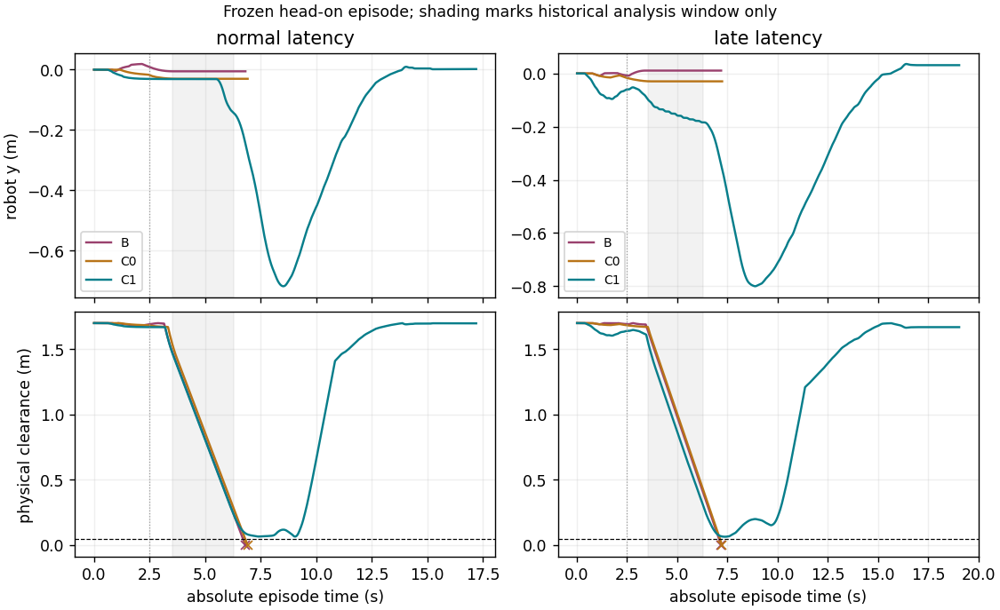

# Full-episode pre-acquired persistent backup

Research。**Go-to-36，仅通过原 head_on/seed13 的完整 episode 门；没有运行 36-episode。**
正常和注入迟到条件各做初试与一次不改参数复核，C1 四次均无碰撞完成任务，
最小物理净空 .065688/.064242 m，完整计算周期最坏 17.273 ms。
B/C0 在这两种条件下各两次碰撞。这个固定理想 CV 反例支持持久备份的价值，
不代表跨场景、真实跟踪、OS 实时执行或 Hardware Go。

## Part A 已归档

当前状态现场初始化负结果已作为唯一提交保存：
`62f74cba89fb1918ed99ec590d95edff731e5626`，`研究：归档持久备份初始化负结果`。
归档分支 `codex/dynamic-persistent-backup`；提交后已确认 working tree clean，未 push。
保留 t=2.50 s 的 INITIALIZING→UNAVAILABLE、九候选均失败、最近 .047640 m 小于 .05 m，
以及 C1 未执行不能计为零碰撞成功。那个 Stop 仅限现场建立第一条备份。

随后从该 commit 建立 `codex/dynamic-preacquired-backup`。没有修改 Part A 结果，
没有把本轮结果倒填为现场初始化成功。

## Hypothesis、冻结项与实现

在安全余量仍存在时取得备份；主动作替换必须保留可执行后路，直到新备份建立或旧备份执行。
唯一实验变化是从原 episode t=0 的 `(0,0,0,0)`、零目标速度、空队列/previous 开始，
不再加载 t=2.50 fixture 的运动状态。场景仍使用该 fixture 内原 head_on/seed13 定义。

冻结原 finite search 程序、beam=64、horizon=2 s、cost、9 个备份 primitives、
safe-rest certificate、CV 输入/模型、plant、限幅、checker、.10 s command delay、
.05 s control period、.01 s plant step、.05 m 物理净空门；原任务终止条件不变。
`search_consumer.cpp`、`world.py`、fixture 没有改动。B/C0/C1 的提案源均直接编译自
`21b9e56076b23f17f1140b9ed68bff5edce9b5b6`，没有继续逐节点 recourse。

为观察此前未进入的生命周期，补了时间线、实际命令归属、独立分项计时、
预测/队列版本回退和动力学签名检查。还补齐事务准备跨 deadline 时的私有草案回滚；
它不撤回已入队命令，本次没有触发该极窄的准备阶段超时分支。
这些是执行/记录边界，不改变动作库或选动作规则。

消费者没有 scene/seed/未来轨迹真值。碰撞评价与图表可以使用场景真值，
不把它回灌给 planner/checker。输入仍是旧实验的理想 CV，不是实际 tracking 测试。

## 初始 acquisition 与生命周期

t=0 成功取得初始备份：t=.10 开始目标 `(0,-.5)`，t=1.50 开始制动，
证书终点约 `(0,-.7,0,0)`，padded CV 驻留净空约 .07 m。第一条证书在主提案执行前建立。
独立 Python plant 逐步核对 C++ 证书参考状态一致；六个有意义的拒绝检查覆盖
stale source、状态偏差、不可撤销命令不一致、动力学变化、source/queue version 回退。

持久状态包含绝对执行事件、起始状态、实际不可撤销队列及版本、执行游标、
预测源时刻/版本、数值适用条件、safe-rest certificate。另分开记录：

- **plan revision：** 新主片段及其证书的事务版本；
- **backup lineage/acquired epoch：** 旧备份接入时保持，实际重新生成时才更新；
- **实际执行归属：** 随不可撤销命令入队，随后换计划也不能改写已入队命令的来源。

每周期只用测量状态、队列、源信息和 CV 假设一致性重验旧证书。数值容差仍为 1e-7，
不是实车误差包络。新主片段先尝试接入旧备份的剩余绝对时间事件；不成功才调用九候选库。
因此不是每周期无条件丢弃旧备份、从头求新备份。

| 实际状态事件，每次重复相同 | normal | late |
|---|---:|---:|
| INITIALIZING | 1 | 1 |
| HELD（含拒绝后继续持有事件） | 31 | 127 |
| REVALIDATED | 344 | 381 |
| REPLACED（通过证书的主计划事务） | 321 | 248 |
| 其中接入旧备份 / 新建备份 | 250 / 71 | 208 / 40 |
| EXECUTING_BACKUP 状态进入 | 7 | 55 |
| SAFE_REST 状态进入 | **0** | **2** |
| INVALID / UNAVAILABLE | 0 / 0 | 0 / 0 |

normal 在原任务结束前未实际进入 SAFE_REST；持有 safe-rest 证书不等于已经驻留。
late 在 t=16.90、17.20 s 的目标后观察段进入 SAFE_REST，由实际静止状态的 CV 驻留检查确认。
初始独立证书重放能到驻留，但不混算为 episode 生命周期事件。

## B/C0/C1 对照与原危险时间窗口

C0 使用同一提交处 checker，但丢弃证书，拒绝/迟到后执行未认证制动。
C1 可以接入此前持有的备份，拒绝时继续执行它。收益归因于这套“持有＋验证替换＋执行”合同，
不单独归因于一个缓存字段。C0/B 没有安全保证，均只在隔离 harness 评价。

| 条件 | 方法 | 两次碰撞 | 两次任务完成 | 最小物理净空 m | 到达 / 碰撞绝对时间 s |
|---|---|---|---|---:|---:|
| normal | B | 2/2 | 0/2 | -.001567 | 碰撞 6.82 |
| normal | C0 | 2/2 | 0/2 | -.001451 | 碰撞 6.92 |
| normal | C1 | 0/2 | 2/2 | **.065688** | 到达 **14.18** |
| late | B | 2/2 | 0/2 | -.000493 | 碰撞 7.19 |
| late | C0 | 2/2 | 0/2 | -.001628 | 碰撞 7.24 |
| late | C1 | 0/2 | 2/2 | **.064242** | 到达 **16.03** |

两次重复是相同 episode 的复核，不是两个独立场景。C1 到达后都继续完成原 3 s 观察条件。

normal 的关键时间线：

| 绝对时间 | 实际状态/提案与动作 | 备份状态 |
|---|---|---|
| 0 | 原静止初态，尚未执行主命令 | 初始证书先建立；首主片段接入该 lineage |
| .50 | 新主片段没有合格 continuation，拒绝 | 保留 .45 s 取得的备份，原切换时刻 .60 不向后滑 |
| .65 | 记录到实际备份命令归属 | 旧命令按原队列执行，之后的新计划不能改写它 |
| 2.50 | `(x,y)≈(1.0249,-.03074)`，不是旧 fixture 的同一个状态 | 备份始终存在，本拍通过新证书替换 |
| 3.55 | 速度约 .020 m/s，接近停稳 | 复用 3.45 s 取得的 lineage，证书重验有效 |
| 6.30 | 新 proposal 被拒绝，`reason=unavailable` | 6.15 s 已取得的备份仍有效，切换时刻仍为 6.30；实际执行西南侧让 |
| 9.05 | 最坏净空 .065688 m | 仍满足 .05 m 门，继续恢复任务 |
| 14.18 | 到达目标 | 未永久逃离或停车，后续观察通过 |

这些时刻只用于结果提取和图表，未写进控制触发逻辑。
原危险窗口确实得到利用，但不能说 C1 在旧 t=2.50 运动状态现场重新建立成功：
提前持有/执行已经改变了之后的实际状态。

late 的 t=3.55 proposal 超时，原备份保留；t=6.30 planner busy，仍持有此前证书。
随后按原切换时刻进入备份。详细 proposed/accepted/active backup/executed、
绝对事件和归属见 [timeline.json](../../research/dynamic_state_time/results/preacquired/timeline.json)。



## Persistence 与队列审计

逐周期检查原绝对时刻、备份 id、控制事件与实际执行记录，而不只看安全布尔值。

| 审计结果，每次重复相同 | normal | late |
|---|---:|---:|
| 拒绝/busy 后原备份 id、事件、切换时刻完全保留 | 23 周期 | 133 周期 |
| 接受新证书后才允许推迟切换 | 320 次 | 247 次 |
| 不可撤销队列项连续性检查 | 685 项 | 759 项 |
| 实际执行备份命令 | 115 个 plant 步 | 665 个 plant 步 |
| 其中发生在 late/busy 计算周期内 | 0 步 | 15 步 |
| 无条件推迟 / 撤回队列 / invalid 执行 | 0 / 0 / 0 | 0 / 0 / 0 |

队列有 .10 s 延迟，因此“迟到期间下发的备份”和“迟到周期内已实际生效的备份”不能混为一谈。
late 中 126 个 late/busy 周期下发备份目标，但不把这个数冒充同时刻实际执行数。
实际执行采用入队时保存的归属，按每个 .01 s plant 步核对。

## 正常、注入迟到与完整延迟

正常组通过初始 acquisition、持有、无碰撞、无 invalid 和实时门后，才执行 late 组。
注入规则沿用 Part A：每六个绝对控制时隙的第六个响应可用时间至少 80 ms，所有臂相同。
busy planner 跳拍，C1 executor 仍按 20 Hz 推进。它是离散事件执行模型，不是 OS 实时线程验证。

下表计入 planner IPC、revalidation、acquisition/replacement、事务和执行队列准备，
不包含物理评价、图表或日志序列化。初始化独立记录。全部分布还保留 min/p05。

| C1 条件/轮次 | mean | p50 | p95 | p99 | max（ms） |
|---|---:|---:|---:|---:|---:|
| normal 初试 | 13.061 | 13.290 | 15.205 | 15.390 | 15.563 |
| normal 复核 | 13.019 | 13.241 | 15.234 | 15.456 | 16.136 |
| late 初试，实际计算 | 10.908 | 12.726 | 15.070 | 15.307 | 15.700 |
| late 复核，实际计算 | 10.888 | 12.663 | 15.051 | 16.017 | **17.273** |

| C1 初试分项，mean / p99 / max ms | normal | late |
|---|---|---|
| 原 planner | 10.417 / 12.544 / 12.681 | 10.648 / 12.862 / 12.983 |
| revalidation | 1.040 / 1.658 / 1.692 | .974 / 1.597 / 1.642 |
| acquisition/replacement | 1.523 / 2.378 / 2.549 | .980 / 2.429 / 2.471 |

late 的分项均值含跳过 acquisition 的周期，不能拿均值下降当算法更快。
所有实际计算周期 deadline miss=0；normal 响应 miss=0。
**注入后的响应 p95/p99/max 为 80 ms，C1 每次有 63/318 次响应 miss，不能写成零。**
这些迟到提案被拒绝，但有效储备没有被 timeout brake 替换；C1 的 timeout_brakes=0。
B/C0 每次各有 24 次注入超时制动，仍然碰撞。次数不同来自 episode 长度不同，注入规则相同。

B/C0 的完整分布、每次最坏净空状态和全部分项见
[summary.json](../../research/dynamic_state_time/results/preacquired/summary.json)。
未把旧逐节点 77 ms 与本轮不同状态分布直接包装成同输入加速比。

## 任务、控制与系统限制

C1 normal 等待 4.13 s、实际命令符号翻转 14 次；late 等待 3.80 s、翻转 20 次。
normal 备份确实执行但未到驻留，late 在目标后观察段两次驻留；全部保留。
B/C0 碰撞提前终止，不能拿它们较少等待或翻转次数作等任务完成条件的性能比较。
unnecessary stop、deadlock 没有逐状态反事实标签，仍为 null。
summary 同时保留对齐时间的 sequence RMS、加速度/jerk 分布与 hold TTC margin。

C1 consumer CPU 为 normal 3.68–3.70 s、late 3.45 s；两个消费者进程的峰值 RSS 之和
约 8.11–8.16 MiB。该和不是同一时刻的联合峰值，也不包含 Python evaluator 内存。
harness CPU 另记；planner 更新率 normal=20 Hz、late≈16.69 Hz，executor 两组均为 20 Hz。

最坏净空仍离 .05 m 门不远：normal t=9.05 为 .065688 m，late t=7.40 为 .064242 m。
这只是精确 CV、精确状态和确定 plant 下的条件证书；未知加速度、遮挡、ID switch、
模型偏差和真实执行抖动没有在本轮获得证明。

## 裁决、复现与 Git 状态

**Go-to-36。** 固定 full-episode 门支持 persistent reserve 合同的研究价值：
正常组没有 timeout brake 干扰，C0 同类提交检查仍失败，C1 保留/执行旧备份完成任务；
迟到组也没有错误丢失有效备份。结论不是“任意危险初态都能现场获得 backup”，
也不意味着复杂动态预测生产化或 Hardware Go。没有自动开始 36 次对照。

```bash
export DST_DATA_ROOT=/tmp/rm2027_preacquired_backup_reproduce
bash research/dynamic_state_time/run_preacquired.sh normal_01
bash research/dynamic_state_time/run_preacquired.sh normal_confirmation
bash research/dynamic_state_time/run_preacquired.sh late_01 --condition late \
  --normal-proof "$DST_DATA_ROOT/normal_confirmation/results.json"
bash research/dynamic_state_time/run_preacquired.sh late_confirmation --condition late \
  --normal-proof "$DST_DATA_ROOT/normal_confirmation/results.json"
MPLCONFIGDIR=/tmp/rm2027_preacquired_mpl python3 research/dynamic_state_time/summarize_preacquired.py \
  --data "$DST_DATA_ROOT" --output /tmp/rm2027_preacquired_summary --plot
```

新 protocol/入口/汇总脚本和现有 checker/harness 的有限改动保留在本研究分支。
轻量 summary、timeline、CSV、图与
[manifest](../../research/dynamic_state_time/results/preacquired/dataset_manifest.json) 进入 Git 研究资产；
约 1.49 MB 的完整轨迹、生命周期和日志位于仓库外，manifest 记录来源/路径/大小/SHA256/用途。
没有恢复历史归档或把 build/cache/binary 放入 Git。

固定场景 Part B 以“研究：验证预持有备份固定场景”单次提交归档，父提交为
`62f74cba89fb1918ed99ec590d95edff731e5626`。分支为 `codex/dynamic-preacquired-backup`。
本报告记录固定场景门；后续获准的 36 次小试另存实验摘要，不回写此门的原始结果。
未 push、merge 或修改 main。
