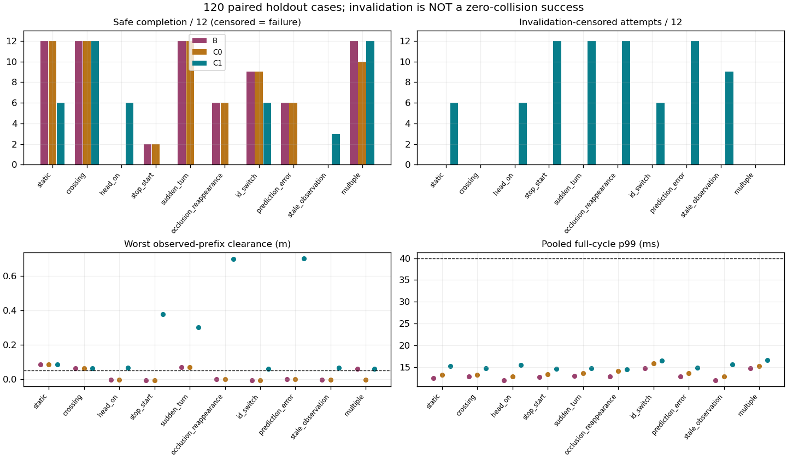

# Persistent backup：120-case causal holdout

Research 裁决：**Stop 当前冻结实现的 holdout / integration 推进**。
完整完成120个预先固定的配对场景，每个 B/C0/C1，共 **360 次 rollout attempt**。
另有原固定场景接口一致性验证1次和首个失败原样复核1次，均不计入360主统计。
没有修改核心算法、动作库、阈值、beam、horizon、cost，没有生产接入或实车测试。

## Part A 归档

Pilot 轻量资产已经单次提交：`7e04111f7fe8d9b0851bddfc0b8ef0eb68b684ea`，
标题“研究：完成持久备份36场景小试”，分支 `codex/dynamic-preacquired-backup`。
提交后、holdout改动前已确认 working tree clean。
约4.41 MB的pilot raw未进入提交，历史归档没有重新搬运。
本报告及 holdout source/config/分析/结果随后以单次轻量提交“研究：归档持久备份holdout负结果”归档。
该归档保存冻结实现的 Stop；后续软件合同修复必须从此归档另建研究分支，不改写本轮结果。

## 预注册、对照与冻结范围

历史 protocol 预先列出了十类场景，但没有冻结具体holdout seed/扰动幅度。
本轮在首次holdout运行前，用generator seed `20261026`生成并保存了
[120-case protocol](../../research/dynamic_state_time/preacquired_holdout_protocol.json)。
每类12个，episode seed为10000–10911各类别分段，完整初态与扰动在protocol，运行目录保存相同快照。
运行中没有更换seed、重抽扰动、删掉失败或调参数。

四类CV场景各6组新初态，每组配一个ideal和一个imperfect输入，共24 ideal +24 imperfect。
其余六类本身包含非CV或观测故障，各12条，共72 imperfect；总计 **24 ideal +96 causal imperfect**。
非CV场景没有一个能提前知道未来stop/turn的“理想oracle组”；不能把未来真值喂给决策来补一个对照。
这种分层不是120条均为ideal/imperfect双重重放；各组分母明确区分。

B 为原 `21b9e56076b23f17f1140b9ed68bff5edce9b5b6` finite action-sequence search。
完整保留C0诊断：提交处相同backup候选检查，但不持有/执行backup。
C1为已通过pilot的pre-acquired single backup lifecycle；主planner与B完全相同。
所有方法共享同一case的plant、初态、obs、CV传播、.05s控制、.1s命令延迟、.01s物理步长、
.5m/s速度/.8m/s²加减速、碰撞检查、.15m目标判定、40s超时和到达后3s观察。
单逻辑CPU顺序执行，C++17 -O3 -DNDEBUG；环境见summary。

`search_consumer.cpp`、`reserve_consumer.cpp`、`world.py`与Part A commit逐字未变。
`reserve_run.py`只增加观测源/真值评估接口和输入元数据记录。
真实source timestamp/version传入原检查器，没有伪造“每周期都是新观测”。
消费者不接收事件表或evaluation actor identity；未来truth只用于碰撞/误差统计。
1200项因果检查证明，修改源时刻之后的事件不会改变当前观测；原head_on_13经新接口复现原结果。

### 运行前固定的扰动

所有输入事件在source time=2.0s开始，stop/turn在truth time=2.5s发生；这些是环境脚本，非控制触发条件。
机器人初态仍为零状态和空队列；新初态通过障碍phase及位置生成，不调plant。

| 类别 | 12条结构/非理想因素 |
|---|---|
| static | 6 ideal；6在观测x上引入5/10/20 mm偏差 |
| crossing | 6 ideal；6固定观测延迟50/100/150 ms，按已知source age传播 |
| head-on | 6 ideal；6速度x偏差 .01/.03/.06 m/s |
| stop/start | 12 causal；停 .2/.5/1.0 s后恢复原速度，瞬时速度仅在过去source epoch可观测 |
| sudden turn | 12 causal；在固定事件时刻转−90/+90/180度 |
| occlusion/reappearance | 12 causal；首个目标从观测中缺失 .15/.30/.60/.90 s，之后重新出现 |
| ID switch | 6纯ID改名、物理状态不变；6错误交换两目标速度 .15/.30/.60 s |
| prediction error | 12 causal；vx增加ε、vy减少ε，ε=.01/.03/.06/.12 m/s，向量误差为√2ε |
| stale observation | 12 causal；冻结source update .10/.20/.40/.80 s，仍用旧观测CV传播并保留真实age |
| multiple movers | 6 ideal；6固定观测延迟50/100/150 ms |

对持续CV，准确的速度和source timestamp可补偿固定延迟，所以这些“causal imperfect latency”例子的状态误差仍接近零。
它们不代表有噪声tracking，也不构成unknown acceleration/uncertainty鲁棒性证明。
静态地图用于所有方法共同的静态启发；static观测偏差没有同时污染静态地图。

## 必须先解释的截断语义

冻结harness原有规则是：C1一旦本episode发生invalidation，就在当前控制周期结束时退出。
本轮没有偷偷移除这条规则，也没有新增恢复/fallback或延长运行来挽救结果。

因此75条C1在t≈2.15或2.65s提前终止是 **任务未完成、后续安全未观测（censored）**，
不是证明其后一定碰撞，也不是成功安全停车。不能将0个已观察碰撞包装成“120/120零碰撞安全”。
B/C0没有相同的证书终止门，运行到碰撞/完成；两者暴露时长不同。
完成率记录反映当前研究原型的端到端可用性，不能直接解释为pure backup算法内在效率下降。

其中66条在旧证书失效的同一周期其实生成并接纳了新的、source-age合规的条件证书，
但仍被原harness的invalidation终止规则截断。**这66条不是backup library取得失败**。
这也意味着本轮无法给出失效后恢复与完整非理想闭环的结论；不替它们推断后半程结果。
另9条存在独立的stale提交缺陷，见下文。

## 完整结果与ideal / imperfect比较

安全完成 = 完成任务 + 无碰撞 + 全部已执行净空≥.05m + 没有截断。
“低于5cm/碰撞”计入safety violation；C1截断另列，不能从分母删除。

| 输入 | 方法 | 完成 | 安全完成 | 已观察碰撞 | 截断 | 已观察safety violation |
|---|---|---:|---:|---:|---:|---:|
| ideal_cv | B | 18/24 | 18/24 | 6 | 0 | 6 |
| ideal_cv | C0 | 17/24 | 17/24 | 7 | 0 | 7 |
| ideal_cv | C1 | 24/24 | 24/24 | 0 | 0 | 0 |
| causal_imperfect | B | 60/96 | 53/96 | 36 | 0 | 43 |
| causal_imperfect | C0 | 59/96 | 52/96 | 37 | 0 | 44 |
| causal_imperfect | C1 | 21/96 | 21/96 | 0 | 75 | 0 |
| all | B | 78/120 | 71/120 | 42 | 0 | 49 |
| all | C0 | 76/120 | 69/120 | 44 | 0 | 51 |
| all | C1 | 45/120 | 45/120 | 0 | 75 | 0 |

C1总安全完成率37.50%，比B的59.17%低 **21.67个百分点**；非理想组21.875% vs B 55.208%，低 **33.33个百分点**。
Ideal CV下C1为24/24，相对B的18/24提升25个百分点，保持了pilot正信号；该优势没有扩展为本轮非理想输入的总体收益。
在双方均完成的配对中，无场景类别平均通行时间改善达到10%；最大单条改善也只有约1.69%。
没有剔除baseline失败来人为构造速度优势；失败配对的通行时间比较为null。

[trials.csv](../../research/dynamic_state_time/results/preacquired_holdout/trials.csv)包含完整360行、每条所有主指标；
[paired.csv](../../research/dynamic_state_time/results/preacquired_holdout/paired.csv)包含120个B/C1配对；
[summary](../../research/dynamic_state_time/results/preacquired_holdout/summary.json)保留场景/输入层级的分布与worst case。

### 场景级比较

每格为“完成 / 安全完成 / 碰撞”，分母均为12；C1另列截断数。

| 场景 | B | C0 | C1 | C1截断 |
|---|---:|---:|---:|---:|
| static | 12 / 12 / 0 | 12 / 12 / 0 | 6 / 6 / 0 | 6 |
| crossing | 12 / 12 / 0 | 12 / 12 / 0 | 12 / 12 / 0 | 0 |
| head_on | 0 / 0 / 12 | 0 / 0 / 12 | 6 / 6 / 0 | 6 |
| stop_start | 2 / 2 / 10 | 2 / 2 / 10 | 0 / 0 / 0 | 12 |
| sudden_turn | 12 / 12 / 0 | 12 / 12 / 0 | 0 / 0 / 0 | 12 |
| occlusion_reappearance | 9 / 6 / 3 | 9 / 6 / 3 | 0 / 0 / 0 | 12 |
| id_switch | 9 / 9 / 3 | 9 / 9 / 3 | 6 / 6 / 0 | 6 |
| prediction_error | 10 / 6 / 2 | 10 / 6 / 2 | 0 / 0 / 0 | 12 |
| stale_observation | 0 / 0 / 12 | 0 / 0 / 12 | 3 / 3 / 0 | 9 |
| multiple | 12 / 12 / 0 | 10 / 10 / 2 | 12 / 12 / 0 | 0 |

所有实际运行均无40s timeout；未做逐状态“非必要等待”或可恢复deadlock的oracle标签。
不能把75次实验提前退出称为物理死锁，也不能用较短的等待/CPU总量称为更高效率。
这些任务没有完成，实际等待/通行统计必须与截断状态一起读取。

## 所有失败、碰撞与worst case

[failures.csv](../../research/dynamic_state_time/results/preacquired_holdout/failures.csv)列出 **175条失败attempt**：
B 49、C0 51、C1 75。包括86次实际碰撞、14次未碰撞但低于5cm的完成、75次C1截断，均未删除。
[关键时间线](../../research/dynamic_state_time/results/preacquired_holdout/failure_timeline.json)
保留各类别代表失败/最坏净空、proposal/accept/backup/executed和不可撤销队列；完整逐步数据在仓库外manifest。

B与C0最坏均为 `id_switch_10608`：t=2.66s，净空 **−0.006175176m**，
robot state=[1.075234212, .095308983, .479560296, −.095273787]。
C0另外在 `multiple_10906/10907` 碰撞，B/C1完成；未弱化C0或从统计中剔除此对照失败。

C1已完成episode最坏净空为 `multiple_10910/10911` 的 **.058148040m**，t=3.70s，
state=[.818457323, .025192388, −.054558441, −.028284271]，相对5cm阈值只余 **8.148mm**。
这个值只支持当前CV模型条件下的已完成轨迹，不能证明足以承受非理想输入。

首个新失败 `static_10001_C1`：t=2.10s观测x从2.000变2.005，source age=.100s；
旧预测与新观测的差正好5mm，大于冻结的1e−7数值一致性容差。
没有单位/时钟/错误seed问题。该周期new_backup成功，t=2.15s因原invalid终止规则退出。
使用相同case/参数/二进制做一次confirmation，终止时间、原因、净空和任务结果一致；没有调参或追加救援实验。

## 生命周期、stale事务与执行归因

C1初始获取 **120/120**；共15755次证书替换、232次提议拒绝时保留旧有效backup，
实际执行非零backup共11.60s。没有增加第二条backup或扩大库。
75次失效原因为 prediction_changed=54、obstacle_set_changed=12、stale_observation=9。
66次随后取得fresh条件证书，9次没有fresh证书（虽然冻结consumer仍返回了certificate对象）。
这里的fresh条件证书仅表示接口/模型自洽，不是由未来truth验证的真实世界安全保证。

观测前缀上的active-valid ratio按episode均值为99.826%，但大量episode在首次失效后退出；
**不能将此值称为整个任务99.826%可用**。逐episode revalidated_ratio另存CSV，实际任务可靠性由45/120完成反映。
所有cursor、queue retention、不可撤销队列执行一致性检查通过；没有无条件平移backup。
全组timeout brake=0、intrinsic deadline miss=0。

### Stale下发现的直接合同违规

`stale_observation_10801/10802/10803/10805/10806/10807/10809/10810/10811` 均出现：

1. t=2.10s，source epoch=1.90s，age=.20s > 原最大允许age=.15s；旧backup被validate判为stale。
2. 同周期 `admit` 没有检查source age，用同一份过期输入生成new_backup，safe_rest.certified仍为true。
3. main proposal被接纳并进入未来不可撤销队列。**accepted without valid backup=9，stale active certificate claims=9**。
4. harness在t=2.15s终止；新主命令通常要到t=2.20s才执行，因此不能把退出后的命令执行结果当成已测安全。

实际记录的stale backup-owned plant step为0，新派发stale backup命令为0；
这不消除9次无有效证书的主计划提交，更不证明截断以后没有stale命令风险。
没有把旧不可撤销命令假装撤回，也没有将research退出当作安全fallback。
该缺陷可以从冻结source直接解释：年龄门在 `valid()`，`init/admit` 路径没有同等年龄前置检查。
本轮只报告与复现，未修改该机制或用更宽阈值掩盖它。

## Robustness边界与约1cm余量

- **Head-on：** 新6个ideal初态全完成，B/C0全碰撞。加入 .01/.03/.06m/s速度估计变化后，6条C1均在首次prediction_changed退出；没有完整非理想安全收益证据。
- **Stop/start、turn：** 当前source只能在事件发生后经.1s延迟得知速度变化，完全因果。C1全部在t=2.60检测到旧CV失效，随后退出；没有测到完整恢复过程。B/C0在stop/start各10次碰撞；turn则全部完成，说明并非所有非CV输入都注定无法导航。
- **Occlusion：** 缺少对象导致obstacle_set_changed，12条C1在重新出现前退出。不能声称完成了遮挡后重关联；其后新证书是对缺少对象的观测集建立的，未证明未知占据安全。
- **ID：** 6条纯改名完成，因为原消费者只消费有序数值状态，不读取ID字段；不构成真实ID连续性保障。6条速度误关联均使C1失效退出，原输入/identity语义需要明确。
- **Stale：** .10s冻结没有使离散控制时刻的age超过.15s，3条C1全完成；.20/.40/.80s各3条均触发上述stale提交违规并截断。这里未放宽.15s阈值。
- **Multiple：** 原两目标CV和有限延迟下C1 12/12完成；不等于有遮挡、错误关联或速度变化的多目标已通过。
- **保守性：** 无事件、准确CV可补偿延迟的已完成配对未显示明显额外等待；大量观测变化后的停止属于harness/invalidation边界，不能归纳成物理上的“普遍死锁”，也不能忽略其任务可用性损失。

Prediction-error类的B结果揭示余量下降，但C1的完整误差-安全曲线因提前退出**不可识别**：

| 速度向量误差 m/s | B安全完成 / 3 | B碰撞 | B最坏净空 m | C1 |
|---:|---:|---:|---:|---|
| 0.014142 | 3/3 | 0 | 0.059871 | 3条均截断 |
| 0.042426 | 3/3 | 0 | 0.051530 | 3条均截断 |
| 0.084853 | 0/3 | 0 | 0.033546 | 3条均截断 |
| 0.169706 | 0/3 | 2 | -0.002451 | 3条均截断 |

B在 .084853m/s误差时3条都跌破5cm，.169706m/s时2条碰撞；
遮挡 .60s时B三条低于5cm，.90s时三条碰撞。此处每档初态不同，只能作为预设分层结果，非固定同状态的纯单变量因果曲线。
C1的5mm位置变化即触发终止，反映证书条件变化和恢复语义问题，不能据此声称5mm必然造成物理碰撞。
没有足够证据认为8–10mm剩余余量能够承受真实tracking误差。
summary保存0/.25/.5/1/2/3s horizon error分布；这是离线evaluation，不返回planner。
没有引入uncertainty模型，因此没有伪造uncertainty calibration/coverage结果。

### 已完成C1的最小净空分布

仅45条完成episode；75条截断前缀的大净空不得混入此表抬高安全余量。

| n | min | p05 | p50 | p95 | p99 | max |
|---:|---:|---:|---:|---:|---:|---:|
| 45 | 0.058148 | 0.059022 | 0.064630 | 0.099768 | 0.120968 | 0.122083 |

## Latency、CPU、RSS与控制指标

完整周期包含输入生成、状态/队列准备、planner IPC、revalidation、acquire/splice、事务与命令准备。
evaluation、TTC诊断、raw写入不在周期时间内；初始化单列。顺序单逻辑CPU，normal planner latency，未新注入额外planner lateness。
本轮非理想观测latency是source delay，与wall-clock planner耗时不是一回事。

| 方法 | 周期数 | mean ms | p50 | p95 | p99 | max | >50ms |
|---|---:|---:|---:|---:|---:|---:|---:|
| B | 24412 | 11.423 | 11.934 | 13.998 | 14.452 | 18.197 | 0 |
| C0 | 23987 | 11.941 | 12.482 | 14.525 | 15.169 | 16.518 | 0 |
| C1 | 15987 | 13.856 | 14.025 | 16.047 | 16.352 | 21.233 | 0 |

C1最慢cycle为 `static_10004_C1` 的21.233151ms，所有已执行周期都在50ms内。
75条截断后没有测量后续计算；不得推断未执行阶段也一定符合预算。

CPU cores按消费者CPU秒/模拟前缀秒折算。RSS为消费者各进程peak之和，不是同一时刻联合峰值，也不包含Python evaluator。
每条CPU/等待总量受碰撞或invalidation提前结束影响，不能把C1更低CPU秒称为算法加速。

| 方法 | CPU cores mean / max | CPU秒 p50 / p95 / max | RSS MiB p50 / p95 / max |
|---|---|---|---|
| B | 0.196 / 0.247 | 2.435 / 3.311 / 3.420 | 4.129 / 4.184 / 4.195 |
| C0 | 0.200 / 0.270 | 2.500 / 3.381 / 3.650 | 7.934 / 8.004 / 8.059 |
| C1 | 0.227 / 0.265 | 0.540 / 3.680 / 3.710 | 7.973 / 8.117 / 8.156 |

每条结果还记录TTC margin、实际命令切换/总变化、sequence RMS、backup执行时长、rejection与CPU。
TTC是基于输入CV保持当前命令的3s探测诊断，不是面对未知运动的真实TTC保证。
没有timestamp回退、queue撤回、执行target与队列不一致或未来truth泄漏的记录。

## Go / Modify / Stop与下一步

**Stop 当前冻结实现进入integration。** 计算门和ideal CV的有效性通过，但以下必要门失败：

- 非理想完整安全证据缺失：75/96在首次invalidation后截断，不能声明“范围内零碰撞”。
- 任务完成45/120，低于B的78/120；安全完成率低21.67个百分点。
- 非理想安全完成率相对B低33.33个百分点，没有两个类别≥10%配对通行收益。
- 9次stale输入下没有有效backup却接纳主提议，直接违反提交合同。

不以投入工作量、低p99或ideal head-on成功降低门槛，也不调阈值/扩库/偷看future救结果。
本结论**不等于证明persistent backup思想普遍碰撞、物理死锁或无研究价值**。
尤其66条fresh重建后仍退出的情况限制了算法层面的因果判断：这是当前验证/执行边界的缺口，不能全部归咎于candidate搜索或prediction精度。
但在保持本轮冻结实现的条件下，继续扩大实证或接真实tracker/STVL并不值得。

尚不值得进入真实tracker/STVL integration；更不具备production/Hardware Go。
若以后另立项，必须先明确观测修正、缺失对象、freshness与invalid后接管的合同，再证明完整因果闭环；
本轮没有实现这些修改，没有重跑调参版本，也没有开始production integration。
原R1/R2/R3/R4负结果和STVL稳定baseline地位未被改写，本轮不是正式STVL A/B。

## 轻量资产、复现和Git状态

Git候选仅含输入adapter、固定协议生成/运行/分析脚本、source hook、CSV/JSON摘要、图和本报告。
[manifest](../../research/dynamic_state_time/results/preacquired_holdout/dataset_manifest.json)
列明dataset ID、命名、size/SHA256、origin、purpose、generated和required experiment。
**30,978,519 bytes**原始轨迹/生命周期/日志仍在仓库外：
`/home/qihei/.codex/visualizations/2026/10/25/01a1708d-d064-7252-86b0-5e92a75657dc/dynamic_preacquired_holdout_20261026`。
build_cache也在外部且不纳入证据manifest；没有复制旧R1–R4归档。
没有删除任何旧raw/WIP。CSV为每次attempt一行，summary为分布和worst，Git中没有完整轨迹。

```bash
export DST_DATA_ROOT=/tmp/rm2027_preacquired_holdout_reproduce
bash research/dynamic_state_time/run_preacquired_holdout.sh sanity --sanity
bash research/dynamic_state_time/run_preacquired_holdout.sh holdout_120
bash research/dynamic_state_time/run_preacquired_holdout.sh confirm_static_10001 \
  --confirm static_10001 C1
PYTHONDONTWRITEBYTECODE=1 MPLCONFIGDIR=/tmp/rm2027_holdout_mpl \
  python3 research/dynamic_state_time/analyze_preacquired_holdout.py \
  --data "$DST_DATA_ROOT" --output /tmp/rm2027_holdout_summary --plot
```

已冻结protocol直接用于复现。生成器可将同一配置写到新的外部路径核对，不覆盖已冻结文件。
预期核心结果：ideal C1 24/24，nonideal C1 21/96 +75截断，9次stale非法提交；
B/C0实际碰撞与所有低净空记录均保留。墙钟latency/CPU/RSS随主机变化，出现尾部异常时不得删除重抽。
所有source修改均经原fixture行为一致性、1200项因果检查和360次直接实验验证；首个失败做了一次不改参数复核。
归档分支为 `codex/dynamic-preacquired-backup`，父提交为 `7e04111f7fe8d9b0851bddfc0b8ef0eb68b684ea`；
归档 commit 可由本报告的 Git 历史定位。没有 push、merge、修改 main 或 production navigation。


