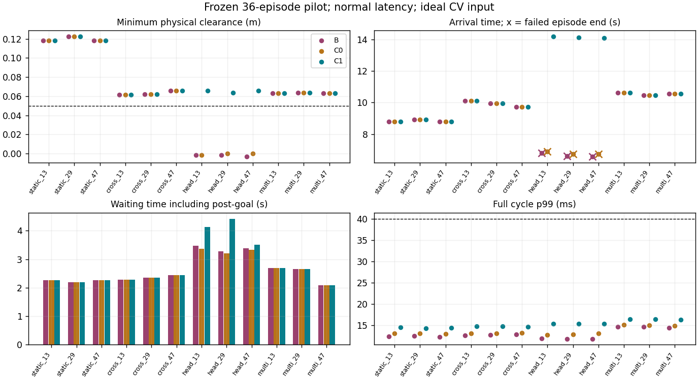

# Pre-acquired persistent backup：36-episode pilot

状态：Research，**Go-to-holdout**。已完成预注册 36 次；**120-episode 未运行**。
本裁决仅允许下一阶段研究，不是 production / Hardware Go。

## 归档与实验边界

本次 Part A（上一轮固定 full-episode gate 的 Part B WIP）已单次提交：
`612eb7edcb7cdff754f17cafeef087be304a3cff`，标题“研究：验证预持有备份固定场景”。
提交后、开始 pilot 改动前已确认 working tree clean。
分支 `codex/dynamic-preacquired-backup`，父提交 `62f74cba89fb1918ed99ec590d95edff731e5626`。
本轮 pilot 入口、统计与结果以“研究：完成持久备份36场景小试”单次提交归档；
父提交为 `612eb7edcb7cdff754f17cafeef087be304a3cff`，未 push 或 merge。

原 finite search 基线为 `21b9e56076b23f17f1140b9ed68bff5edce9b5b6`。
B 编译该提交的原 search 源码；C0/C1 使用同一 B main planner。
`reserve_consumer.cpp`、`search_consumer.cpp`、`world.py` 均未改变；
`reserve_run.py` 只增加显式 scene config/wall 传入，不改变生命周期或控制逻辑。
没有扩大 backup library、beam64、horizon2s，没有修改 cost、安全阈值或 production navigation。

[运行前固定的 protocol](../../research/dynamic_state_time/preacquired_pilot_protocol.json)
保存完整 12 个场景参数。四类仍为 static/crossing/head_on/multiple；
每类 seed 13/29/47 对应原 phase −0.2/0/+0.2 s，
不是 12 个随机抽样，也不是每种初态独立重复三次。
完整 36 次的顺序为场景→seed→B/C0/C1，单逻辑 CPU 顺序执行。
所有场景均从 t=0、state=[0,0,0,0]、target=[0,0]、空队列开始。

三方法共享 .01 s plant、.05 s control、.1 s command delay、vmax=.5 m/s、amax=.8 m/s²、
原 acceleration-limited plant、碰撞检测、原场景 goal、.15 m 到达半径、40 s 超时与 3 s 到达后观察。
obs age=.1 s，全部为完整已知的理想 CV 障碍；预测、身份和状态误差在该生成数据中为零。
消费者只接收当前状态、不可撤销队列和相同的 CV observation，不读取 evaluator 的未来 truth。
无限 CV ray safe-rest certificate 依赖“障碍继续 CV”的条件，不能外推为未知运动下的安全保证。
本轮为 normal latency；固定门的 injected lateness 结果保持原归档，没有追加另一套 36 次。

## 方法与判定

- **B**：原 finite action-sequence search，直接执行当前提议。
- **C0**：提交处检查 immutable prefix + 下一拍主动作 + 现有小 backup 库；证书用后丢弃，拒绝后制动。
- **C1**：episode 开始先取得 backup，每周期实测 revalidate；主动作只有可接入旧 backup 或取得新 backup 才提交；
  拒绝/忙/迟到保留有效 reserve，executor 按 absolute events/cursor 推进。
  已入队命令不撤回；未取得有效初始 backup 必须返回 unavailable。

C1 相对 C0 的唯一算法差别是已验证的 persistent lifecycle，包括旧 backup 的继承与执行。
未恢复逐节点 recourse、没有新增候选生成、完整 viability kernel 或场景特判。

Go 门沿用用户要求：C1 零碰撞且每条净空≥.05 m、完成率不低于 B/C0、无新增 deadlock、
reserve 稳定取得/维持、完整周期 p99≤40 ms / max≤50 ms / intrinsic miss≤.1%，
并在原 fixture 以外多个初态出现稳定安全或任务收益。
运行前另记录非迎面场景重复 >10% 完成时间恶化为保守性警示，未用该警示替换任何安全门。
核心机制未失败，所以没有为了统计显著性额外重复，也没有调参救结果。

## 36 次完整结果

到达时间只给最终完成且通过到达后观察的 episode；“—”代表未完成。
等待定义为实际速度<.03 m/s 的时间，包含到达后的观察段。
B/C0 迎面碰撞提前终止，其等待/翻转较少不能解释为任务效率更高。
拒绝列是有 proposal 但未 accepted 的次数；备份秒数按实际 plant step 的命令 owner 统计。

| 场景 | seed | 方法 | 结果 | 最小净空 m | 到达 s | 等待 s | 拒绝 | 实际备份 s | 周期 p99 / max ms |
|---|---:|---|---|---:|---:|---:|---:|---:|---:|
| static | 13 | B | 完成 | 0.117978 | 8.79 | 2.27 | 0 | 0.00 | 12.36 / 13.68 |
| static | 13 | C0 | 完成 | 0.117978 | 8.79 | 2.27 | 0 | 0.00 | 13.01 / 13.06 |
| static | 13 | C1 | 完成 | 0.117978 | 8.79 | 2.27 | 0 | 0.00 | 14.48 / 14.60 |
| static | 29 | B | 完成 | 0.122535 | 8.91 | 2.20 | 0 | 0.00 | 12.53 / 12.66 |
| static | 29 | C0 | 完成 | 0.122535 | 8.91 | 2.20 | 0 | 0.00 | 13.11 / 13.29 |
| static | 29 | C1 | 完成 | 0.122535 | 8.91 | 2.20 | 0 | 0.00 | 14.22 / 14.37 |
| static | 47 | B | 完成 | 0.117978 | 8.79 | 2.27 | 0 | 0.00 | 12.26 / 12.35 |
| static | 47 | C0 | 完成 | 0.117978 | 8.79 | 2.27 | 0 | 0.00 | 12.94 / 13.03 |
| static | 47 | C1 | 完成 | 0.117978 | 8.79 | 2.27 | 0 | 0.00 | 14.44 / 14.58 |
| crossing | 13 | B | 完成 | 0.061648 | 10.11 | 2.28 | 0 | 0.00 | 12.55 / 12.82 |
| crossing | 13 | C0 | 完成 | 0.061648 | 10.11 | 2.28 | 0 | 0.00 | 13.07 / 13.15 |
| crossing | 13 | C1 | 完成 | 0.061648 | 10.11 | 2.28 | 0 | 0.00 | 14.70 / 14.81 |
| crossing | 29 | B | 完成 | 0.062250 | 9.94 | 2.35 | 0 | 0.00 | 12.68 / 12.78 |
| crossing | 29 | C0 | 完成 | 0.062250 | 9.94 | 2.35 | 0 | 0.00 | 13.02 / 13.12 |
| crossing | 29 | C1 | 完成 | 0.062250 | 9.94 | 2.35 | 0 | 0.00 | 14.70 / 15.00 |
| crossing | 47 | B | 完成 | 0.065523 | 9.72 | 2.45 | 0 | 0.00 | 12.86 / 12.90 |
| crossing | 47 | C0 | 完成 | 0.065523 | 9.72 | 2.45 | 0 | 0.00 | 13.22 / 13.29 |
| crossing | 47 | C1 | 完成 | 0.065523 | 9.72 | 2.45 | 0 | 0.00 | 14.56 / 14.62 |
| head_on | 13 | B | 碰撞 | -0.001567 | — | 3.47 | 0 | 0.00 | 11.83 / 11.91 |
| head_on | 13 | C0 | 碰撞 | -0.001451 | — | 3.37 | 46 | 0.00 | 12.66 / 12.83 |
| head_on | 13 | C1 | 完成 | 0.065688 | 14.18 | 4.13 | 23 | 1.15 | 15.37 / 15.71 |
| head_on | 29 | B | 碰撞 | -0.001480 | — | 3.27 | 0 | 0.00 | 11.81 / 11.84 |
| head_on | 29 | C0 | 碰撞 | -0.000041 | — | 3.21 | 48 | 0.00 | 12.82 / 12.91 |
| head_on | 29 | C1 | 完成 | 0.063513 | 14.11 | 4.41 | 22 | 1.10 | 15.35 / 15.52 |
| head_on | 47 | B | 碰撞 | -0.003066 | — | 3.39 | 0 | 0.00 | 11.80 / 12.16 |
| head_on | 47 | C0 | 碰撞 | -0.000139 | — | 3.33 | 48 | 0.00 | 13.08 / 13.17 |
| head_on | 47 | C1 | 完成 | 0.066006 | 14.09 | 3.50 | 22 | 1.10 | 15.34 / 15.39 |
| multiple | 13 | B | 完成 | 0.062916 | 10.62 | 2.70 | 0 | 0.00 | 14.61 / 14.80 |
| multiple | 13 | C0 | 完成 | 0.062916 | 10.62 | 2.70 | 0 | 0.00 | 15.08 / 15.28 |
| multiple | 13 | C1 | 完成 | 0.062916 | 10.62 | 2.70 | 0 | 0.00 | 16.42 / 16.85 |
| multiple | 29 | B | 完成 | 0.063501 | 10.46 | 2.65 | 0 | 0.00 | 14.59 / 14.72 |
| multiple | 29 | C0 | 完成 | 0.063501 | 10.46 | 2.65 | 0 | 0.00 | 14.96 / 15.10 |
| multiple | 29 | C1 | 完成 | 0.063501 | 10.46 | 2.65 | 0 | 0.00 | 16.39 / 16.49 |
| multiple | 47 | B | 完成 | 0.063348 | 10.56 | 2.08 | 0 | 0.00 | 14.36 / 14.44 |
| multiple | 47 | C0 | 完成 | 0.063348 | 10.56 | 2.08 | 0 | 0.00 | 14.85 / 14.93 |
| multiple | 47 | C1 | 完成 | 0.063348 | 10.56 | 2.08 | 0 | 0.00 | 16.34 / 16.38 |

完整数值与分布保存在 [CSV](../../research/dynamic_state_time/results/preacquired_pilot/trials.csv)、
[summary](../../research/dynamic_state_time/results/preacquired_pilot/summary.json)。
summary 包括每条 TTC、加速度/jerk、sequence RMS、command variation、资源与生命周期统计。

## 按场景聚合

每格完成率的分母为 3；“净空最差”取三条最小值。
完成时间/等待为该组均值；失败组不填完成时间。延迟为该组所有周期合并后的 p99。

| 场景 | 方法 | 完成 | 碰撞 | 净空最差 m | 完成时间均值 s | 等待均值 s | pooled p99 ms |
|---|---|---:|---:|---:|---:|---:|---:|
| static | B | 3/3 | 0 | 0.117978 | 8.830 | 2.247 | 12.450 |
| static | C0 | 3/3 | 0 | 0.117978 | 8.830 | 2.247 | 13.015 |
| static | C1 | 3/3 | 0 | 0.117978 | 8.830 | 2.247 | 14.429 |
| crossing | B | 3/3 | 0 | 0.061648 | 9.923 | 2.360 | 12.746 |
| crossing | C0 | 3/3 | 0 | 0.061648 | 9.923 | 2.360 | 13.119 |
| crossing | C1 | 3/3 | 0 | 0.061648 | 9.923 | 2.360 | 14.646 |
| head_on | B | 0/3 | 3 | -0.003066 | — | 3.377 | 11.830 |
| head_on | C0 | 0/3 | 3 | -0.001451 | — | 3.303 | 12.980 |
| head_on | C1 | 3/3 | 0 | 0.063513 | 14.127 | 4.013 | 15.352 |
| multiple | B | 3/3 | 0 | 0.062916 | 10.547 | 2.477 | 14.570 |
| multiple | C0 | 3/3 | 0 | 0.062916 | 10.547 | 2.477 | 15.009 |
| multiple | C1 | 3/3 | 0 | 0.062916 | 10.547 | 2.477 | 16.385 |

总计 B=9/12 完成、3 碰撞；C0=9/12 完成、3 碰撞；C1=12/12 完成、0 碰撞。
所有完成 episode 都满足 .05 m 净空门。全组无 timeout；C1 全部完成，未观察到新增 deadlock。
没有逐状态反事实证据将具体等待标为“不必要”，故 unnecessary_stop/deadlock 的原始分类字段仍为 null；
不把 null 当成测得的零。

## 失败、最坏情况和基线复核

六个失败均为 B/C0 head-on。下列状态、时间和净空在 summary/timeline 保留，完整队列和 proposal 在外部 raw 中。

| ID | 碰撞时刻 s | 最小净空 m | 当时 robot x / y m |
|---|---:|---:|---|
| head_on_13_B | 6.82 | -0.001566722 | 1.397567 / -0.005521 |
| head_on_13_C0 | 6.92 | -0.001450629 | 1.352451 / -0.030308 |
| head_on_29_B | 6.62 | -0.001479691 | 1.397480 / -0.007720 |
| head_on_29_C0 | 6.76 | -0.000041337 | 1.333041 / -0.019232 |
| head_on_47_B | 6.59 | -0.003065663 | 1.322566 / -0.004163 |
| head_on_47_C0 | 6.73 | -0.000139008 | 1.256639 / 0.029224 |

这六次均在静止状态被迎面障碍撞击；不是计算超时导致，也没有将它们排除于统计。
B 的全部 12 条碰撞、完成、到达时间与最小净空逐条匹配原已归档 search 结果（数值容差 1e−9）。
因此未悄悄弱化 baseline。最坏 B 为 head_on_47，净空 −.003066 m。

C1 最小净空为 crossing_13 的 **.061648309 m**，t=3.83 s，
state=[1.321859806, .055983993, −.143634660, −.075218610]。
离阈值只有约 **11.65 mm**；这是模型边界，不是实机余量已经足够的证明。
C1 最长到达为 head_on_13 的 14.18 s；等待最长为 head_on_29 的 4.41 s。
C1 最低 held-command TTC margin 为 head_on_13 的 .57 s；另外两个迎面初态为 .58/.59 s。
TTC 是包含 queued commands 后保持当前命令的反事实诊断，有限 3 s 探测范围，非整条计划的形式化 TTC 保证。

C1 最慢周期为 multiple_13，16.852612 ms（完整精度见 summary/timeline），没有隐藏尾部超时。
本轮没有 C1 核心门失败，因此不触发失败后一次复核；仅六个已知 baseline 失败无需追加新实验。

## Backup 生命周期与收益归因

C1 12/12 初始取得；3332/3332 周期持有且 revalidate 成功，availability=100%。
INVALID=0，UNAVAILABLE=0，accepted without valid backup=0，timeout brake=0。
3265 次证书替换中 3053 次 splice_old、212 次 new_backup；替换计数是证书 revision，
不等同于完整重建 emergency plan。67 次拒绝全部保留旧有效 backup。
每次后移 switch 都对应新主动作+后续 backup 的完整重新认证；没有无条件平移。
审计未发现 queue retraction、cursor 回退、stale/invalid backup 继续执行或错误标为安全。

| C1 初态 | 拒绝/保留 | splice / new | 实际非零备份 s | 执行阶段进入数 | action switches | command 总变化 m/s | sequence RMS 均值 m/s |
|---|---:|---:|---:|---:|---:|---:|---:|
| static_13 | 0 | 236 / 0 | 0.00 | 0 | 151 | 9.287 | 0.1170 |
| static_29 | 0 | 239 / 0 | 0.00 | 0 | 156 | 9.763 | 0.1183 |
| static_47 | 0 | 236 / 0 | 0.00 | 0 | 151 | 9.287 | 0.1170 |
| crossing_13 | 0 | 262 / 1 | 0.00 | 0 | 146 | 9.741 | 0.1179 |
| crossing_29 | 0 | 258 / 1 | 0.00 | 0 | 145 | 9.634 | 0.1211 |
| crossing_47 | 0 | 255 / 0 | 0.00 | 0 | 159 | 12.918 | 0.1063 |
| head_on_13 | 23 | 250 / 71 | 1.15 | 7 | 159 | 16.609 | 0.1395 |
| head_on_29 | 22 | 253 / 68 | 1.10 | 7 | 181 | 18.148 | 0.1336 |
| head_on_47 | 22 | 252 / 68 | 1.10 | 7 | 184 | 18.320 | 0.1375 |
| multiple_13 | 0 | 273 / 0 | 0.00 | 0 | 132 | 9.732 | 0.0955 |
| multiple_29 | 0 | 270 / 0 | 0.00 | 0 | 125 | 9.050 | 0.0961 |
| multiple_47 | 0 | 269 / 3 | 0.00 | 0 | 160 | 10.568 | 0.1200 |

三个 head-on 各进入备份执行阶段 7 次，共实际执行非零 backup 335 个 .01 s plant step，即 **3.35 s**。
其余九条没有实际备份执行，也没有 proposal rejection。
SAFE_REST 共 11 次阶段进入，不等于 11 次 emergency 执行；head-on 三条均未进入驻留阶段。
本轮没有 planner busy/lateness；固定门中对应语义的原证据仍保留，但本轮没有重新验证所有场景的 injected lateness。

三个 head-on 的第一个事件一致：

| t s | proposal → admission | active backup | actually executed |
|---:|---|---|---|
| .45 | 上一拍成功建立 | id10，acquired=.45，absolute switch=.60 | 先前入队主命令 |
| .50 | [ .5, 0 ] → unavailable，拒绝 | 保留 id10，switch 仍=.60 | [ .48, 0 ]，owner id9 |
| .60 | [ .499295, −.026536 ] → new_backup，接纳 | 当前证书 id12，switch=.75 | **[ 0, −.5 ]，owner 为旧 id10 的 backup** |

最后一行说明“当前接受的 plan”和“现在执行的 command”不同：新主命令还受 .1 s queue delay，
原 backup 已真正进入不可撤销队列并执行。不能把它错误记成新 proposal 当即产生的安全动作。
更多开始/拒绝/实际备份/最坏净空/最慢周期事件见 [timeline](../../research/dynamic_state_time/results/preacquired_pilot/timeline.json)。

C0 三条分别拒绝 46/48/48 次，仍然碰撞；C1 只拒绝 23/22/22 次且实际执行备份完成。
因此正信号不能解释为“只要更严格地拒绝 proposal 就够了”，也不来自 timeout brake。
本对照识别的是“继承+持有+执行”的 lifecycle 整体；没有额外消融去单独分离 splice 和执行各自的因果份额。
不能据此声称其他备份方法一定无效。

## 保守性与等效范围

static/crossing/multiple 共 9/12 初态，三方法**每个 .01 s plant step 的时间、target 和 state 完全相同**。
完成时间、等待、实际动作切换和 command 总变化也相同；paired traversal/wait delta 全部为零。
未发现 backup 取得/更新阻塞这些通行，也未出现预先定义的 >10% 保守性警示。
这同时意味着 B 或 C0 已在这些场景给出等效行为，C1 增加了计算和内存开销，并无通行性能优势。

sequence RMS 比较各方法自身的绝对时间控制计划变化。
C1 的 schedule 包含 reserve，B/C0 是原 nominal search schedule；因此跨方法的数值差不能直接称为
同一种 nominal 轨迹的更平滑/更不平滑。实际执行 target 统计和逐步轨迹相等才是非迎面场景无退化的依据。

## 延迟和资源分布

下面按每个控制周期合并统计，单位 ms；不是对 episode 的 p99 再取均值。
包含观测/状态准备、proposal IPC、backup revalidation、acquire/splice、事务和命令队列准备；
不包含 evaluator、TTC 诊断、统计和 raw 序列化。初始化单列；全部 intrinsic response/完整周期 deadline miss 都为 0。
逻辑 executor 模拟20 Hz，不是 Linux/DDS/硬件调度的实时性证明。

| 方法 | 周期数 | mean | p50 | p95 | p99 | max | >50 ms |
|---|---:|---:|---:|---:|---:|---:|---:|
| B | 2705 | 11.483 | 11.793 | 13.878 | 14.265 | 14.798 | 0 |
| C0 | 2713 | 12.044 | 12.394 | 14.449 | 14.825 | 15.284 | 0 |
| C1 | 3332 | 13.654 | 13.809 | 15.846 | 16.205 | 16.853 | 0 |

C1 初始化 mean=.445、p99=.729、max=.731 ms；每个 episode 的 p99/max 也分别低于 40/50 ms。
逐节点 recourse 的约77 ms负结果仍保留；这里状态分布和实现均不同，不把两者称为严格同输入加速比。

consumer CPU 按各 episode 的 CPU 秒 / 模拟秒折算；下表统计12条episode分布。
RSS 是 B 单进程或 C0/C1 两个消费者各自 peak RSS 的和，并非同一时刻联合峰值，不含 Python evaluator。
Python harness CPU 在每条 summary 单列；不能把这里约8 MiB宣称为整个运行环境总内存。

| 方法 | CPU cores mean / p50 / p95 / max | 每 episode CPU s mean / max | RSS MiB p50 / p95 / max |
|---|---|---|---|
| B | 0.200 / 0.206 / 0.239 / 0.240 | 2.333 / 3.250 | 4.135 / 4.181 / 4.191 |
| C0 | 0.206 / 0.212 / 0.245 / 0.245 | 2.406 / 3.340 | 7.957 / 8.029 / 8.070 |
| C1 | 0.232 / 0.227 / 0.260 / 0.261 | 3.203 / 3.690 | 8.049 / 8.140 / 8.148 |

C1 全部 planner/executor 均20 Hz；碰撞提前终止的 B/C0 最后一段不足 .05 s，
按 calls/elapsed 算出的略大于20 Hz不是更高更新性能。编译器/CPU affinity/Python版本见 summary.environment。

## 裁决与限制

**Go-to-holdout；本轮停在此处，120 次未启动。**

1. fixed head_on_13 的正结果扩展到 head_on_29/47：全部完成且净空 .0635–.0660 m；B/C0 六次全部碰撞。
2. static/crossing/multiple 无新增保守性：九组实际执行轨迹相同。
3. 初始取得12/12、有效持有100%，没有 unavailable 阻塞或新增 deadlock。
4. head-on 的有效性涉及实际备份执行和安全承诺继承；C0更频繁拒绝仍失败，timeout brake贡献为零。
5. 计算门持续通过：C1 pooled p99=16.205 ms、max=16.853 ms、miss=0/3332。
6. B/C0 在多数（9/12）场景已经等效；本轮收益跨迎面初态，**尚未跨不同动态故障类型**。

以上足以进入后续研究门，但样本是确定的 phase variation，不能作置信区间充分的统计泛化结论。
没有真实 tracking、uncertainty、stop/start、突然转向、遮挡、ID switch、stale观测或动作扰动测试；
也没有在本轮加入 STVL / production Nav2。旧 R1/R2/R3/R4 Stop 和本轮初始现场获取负结果未被推翻。
B 在这里指原多段 finite search，不是历史 simple one-segment 方法；本轮没有重新比较后者。

## 资产与复现

本轮 Git 候选只包含 source/入口/config、轻量 summary/CSV/timeline、manifest、图和本报告。
原始轨迹、完整生命周期、日志共 **4,413,359 bytes**，全部保留在仓库外：
`/home/qihei/.codex/visualizations/2026/10/25/01a1708d-d064-7252-86b0-5e92a75657dc/dynamic_preacquired_pilot_20261026`。
[manifest](../../research/dynamic_state_time/results/preacquired_pilot/dataset_manifest.json)
记录 dataset ID、路径命名、大小、SHA256、来源、用途、generated 属性和必要实验。
没有移入 raw、build/cache/binary 或旧历史资产；没有删除旧唯一数据。

```bash
export DST_DATA_ROOT=/tmp/rm2027_preacquired_pilot_reproduce
bash research/dynamic_state_time/run_preacquired_pilot.sh pilot_36
PYTHONDONTWRITEBYTECODE=1 MPLCONFIGDIR=/tmp/rm2027_pilot_mpl \
  python3 research/dynamic_state_time/summarize_preacquired_pilot.py \
  --data "$DST_DATA_ROOT" --output /tmp/rm2027_preacquired_pilot_summary --plot
```

预期：36条完整记录、B/C0各9/12完成并在三个head-on碰撞、C1全部完成；
精确模拟的安全/任务值应一致，墙钟延迟和CPU/RSS依主机而变，不把后续超时运行丢弃。
唯一编译 warning 来自冻结源 main 被重命名成未调用普通函数后缺少return，不影响实际 checker入口；未为消除此旧warning改写原基线。

已验证：12个B结果历史一致；9个非迎面配置三方法逐步轨迹相同；12个C1持有/队列/执行审计通过；
完整36次直接覆盖场景参数化修改；summary/manifest与raw对应；脚本语法、差异和数据边界检查通过。
本报告与 pilot 轻量资产归档为一个 commit；提交后检查 working tree clean。
没有 push、main修改或merge。后续获准的120场景研究另存结果，不覆盖本轮证据。


