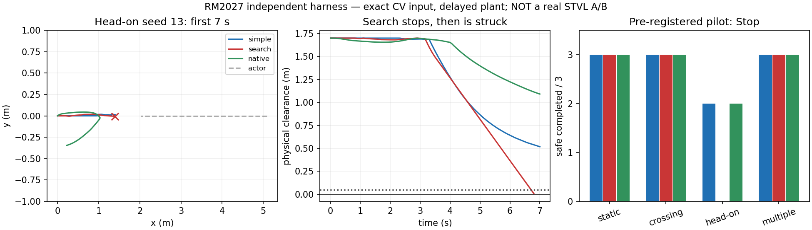

# 动态导航状态—时间搜索研究

Research，2026-10-25。**最终裁决：Stop。** Phase 4A 的 36 次小试已完成；
多步搜索在三个迎面相位全部碰撞，两个对照均零碰撞。一次不改算法的最小重复和
固定输入重放确认失败。不展开十类 holdout，不接 production navigation，无 Hardware Go。

唯一假设：同观测、同简单 CV、同执行约束下，多段动作搜索比简单单段避让和原生
时间评分消费者产生稳定安全/任务收益。R3 已有时间约束、左右/等待参考和执行重验；
本轮差异是静态自由空间中的多段动作组合搜索，而不是再次给局部 QP 增加时间约束。
历史 R1/R2/R3/R4、Temporal Gate 的失败/Stop 和 STVL baseline 地位不改写。

代码入口：[research/dynamic_state_time](../../research/dynamic_state_time/)。
预登记参数和扩展门：[protocol.json](../../research/dynamic_state_time/protocol.json)。
Phase 1–3 详细立项稿保留于仓库外
`/home/qihei/.codex/visualizations/2026/10/25/01a1708d-d064-7252-86b0-5e92a75657dc/rm2027_dynamic_phase1_3_20261025.md`。

## 实现范围与来源

- 从 main `d37f8d6` 建立 `codex/dynamic-state-time-search`；不修改正式模块。
- C++ 有限 beam search，固定 yaw、全向平移、64 宽度、2 s/10 段；有限刹停尾段
  不保证 horizon 后安全。没有候选不等于物理不可避免。
- 单段对照和搜索共享输入、碰撞检查、静态距离场、动作库、执行队列及限幅。
- native 直接调用已安装 Nav2 MPPI 1.1.20；只适配多对象输入、共同静态参考、
  研究固定 yaw/统一限速配置。原生优化/聚合/滤波不改。
- 复用新仓 `research_snapshots/prediction_value` 的 native wrapper 结构、冻结
  R2 逐时惩罚、`vendor/geometry.hpp` 和 `scenes.py::clearance`。
  PVT 的来源/许可证沿用其 README；Nav2 为 Apache-2.0，未引入新第三方实现。
- 不复制 tracker：本阶段先隔离消费者，使用显式标记的理想源状态。只有通过门才
  复用 canonical tracker；不能将理想 ID 和零预测误差冒充感知成果。
- 当前 native occupancy 是 proxy grid，不是 STVL；历史 STVL 结果不混入本轮 A/B。
- 三组有相同外部加速度/队列 plant；native 内部无加速度和排队模型仍是明确差异。
  H 对 native 的差异不能单独归因“聚合”；H 对 simple 才直接隔离多段搜索价值。

## 时序澄清（首次实验前固定）

未知实际计算时间无法提前精确用作搜索起点，采用所有组共同的预留执行时隙：
request + 50 ms 计算窗口 + 50 ms 传输。plant 持续推进；100 ms 以前已经排队
的命令不能撤回。实际 call >50 ms 拒绝结果，按真实耗时推进后进入共同制动提案。
这与初稿“50 ms + 实际计算时间”有显式区别；没有给搜索组理想无延迟执行，
也不是 DDS 或车载延迟测量。记录实际调用耗时、超时和更新间隔。

初始四类 × 三相位 × 三组，共 36 episodes；先完成模型、几何、队列 sanity 和
独立可行 schedule。搜索必须在至少两个动态类别相对两个对照分别重复改善安全
完成，或 ≥10% 安全到达时间，且 ≥2/3 配对同方向、静态无新失败，才展开十类
holdout。否则一次最小错误复核后 Stop；不因已有代码继续增加场景和预测模型。

## 运行与资产

前置检查记录：迎面场景的手工见证最初用三个稀疏角点，最近点跟随往返而不到达；
仅将见证折线等距采样后，三个迎面见证均安全完成，原失败保留。候选未因此修改。
原生固定 yaw 配置的 `wz_std=0` 产生非有限命令（单周期反例已保存）；改为
`wz_std=1e-6`、`wz_max=0`，保持零角速度输出并避免零方差归一化，随后复核。
这些是正式小试之前的夹具/配置修复，不算候选优于 baseline 的证据。

复用已有 `rm2027_navigation:humble` 镜像；网络隔离、无设备、源码只读，无速度
publisher，无串口。build 和完整日志/轨迹均放仓库外，`COLCON_IGNORE` 隔离构建。

```bash
bash research/dynamic_state_time/run.sh build
bash research/dynamic_state_time/run.sh checks checks_01
bash research/dynamic_state_time/run.sh witness witnesses_01
bash research/dynamic_state_time/run.sh sanity sanity_01
# 前置检查通过后：
bash research/dynamic_state_time/run.sh pilot pilot_01
```

`DST_DATA_ROOT`、`DST_BUILD_ROOT` 可指定仓库外目录；输出目录存在即拒绝覆盖。
Git 仅保留源码/配置、小型 summaries、失败 fixture 和 dataset manifest；不保存
raw traces、full logs、build、镜像或恢复的历史归档。

## Phase 4A 实测结果

所有结果使用已冻结配置，固定 yaw、完整已知 disk、准确 source state/CV、100 ms
观测年龄、100 ms 统一命令承诺窗口、共同 .5 m/s 与 .8 m/s² plant。原生 MPPI 是
实际库调用，但 proxy current grid 不包含 STVL voxel/lifecycle/BT，不是实车或 Gazebo。

每格为 **安全完成数/3；安全完成的到达时间均值 [min,max]，秒**。到达后继续运行
3 s；碰撞立即终止，失败经过时间不当到达时间。n=3 是小试，没有统计普遍性声明。

| 场景 | 简单单段 | 多步搜索 | 原生时间 MPPI |
|---|---|---|---|
| Static | 3/3；9.77 [9.72,9.88] | 3/3；8.83 [8.79,8.91] | 3/3；10.35 [9.87,11.16] |
| Crossing | 3/3；10.90 [10.65,11.33] | 3/3；9.92 [9.72,10.11] | 3/3；12.52 [11.80,13.73] |
| Head-on | 2/3；26.20 [24.18,28.21] | **0/3；三次碰撞** | 2/3；26.41 [25.81,27.01] |
| Multiple | 3/3；11.36 [11.11,11.52] | 3/3；10.55 [10.46,10.62] | 3/3；13.04 [12.26,14.38] |

总计：simple 11/12 安全完成、0 碰撞；search 9/12、3 碰撞；native 11/12、0 碰撞。
两个对照的 head_on/29 都在 40 s 超时，保留为失败；不能称 baseline 已解决全部工况。
搜索相对 simple 的配对到达时间改善中位：static 9.57%、crossing **8.73%**、multiple
**7.81%**；动态两类均未达到 10% 门。相对 native 的 crossing 19.13%、multiple
15.38% 不能抵消迎面安全倒退，也不能说明复杂搜索优于简单避让。

| 净空，米 | simple 的最坏值 | search 的最坏值 | native 的最坏值 |
|---|---:|---:|---:|
| Static | .0552 | .1180 | .2183 |
| Crossing | .0620 | .0616 | .3228 |
| Head-on | .0682 | **-.0031** | .2129 |
| Multiple | .0645 | .0629 | .3187 |

碰撞处即截断，负净空不是完整碰撞侵入量或撞击严重度。搜索迎面最坏 hold-TTC margin
为 **-.08 s**，相对已不可撤回的命令窗口也已没有余量；该反事实 TTC 不是完整策略安全证明。

控制质量也未形成一致优势：crossing 的命令符号翻转均值/最大值为 simple 9.67/14、
search **24.33/30**、native 2.33/3；multiple 为 14/16、23/24、3/3。
最大 jerk 分别约 160、160、88.4 m/s³，基于 10 ms plant 速度差分；没有宣称实车 jerk。
`.5 s / .15 m` 阈值下 trajectory churn 均为 0，此粗阈值不能推翻上述振荡证据。
重算节拍均为 20 Hz，搜索总共 32 次 `no_verified_action`。等待统计包含目标后的观察段，
碰撞组又被提前截断，不能把其较短耗时/等待当任务效率收益。

完整逐试次指标和分布：[trials.csv](../../research/dynamic_state_time/results/trials.csv)、
[summary.json](../../research/dynamic_state_time/results/summary.json)。覆盖 mean、p5/p50/p95、
min/max，逐周期时延另报 p99；原始轨迹在 manifest 指定的外部目录。

## 决定性失败与最小复核

`head_on_13_search`：

1. t=2.50 s，beam 搜索第一次没有新合格候选，转为复用旧序列。
2. t≈2.80 s 开始进入制动提案，最终停在 x≈1.3976 m、y≈-.0055 m。
3. t=6.30 s，连有限刹停/保持检查也失效，进入 `no_verified_action`。
4. t=6.82 s，静止机器人被迎面目标撞上。其余两个相位同类失败。
5. 对首例不改任何候选参数做一次重跑：再次 t=6.82 s 碰撞，最小净空
   -.0015667 m，11 次 `no_verified_action`，deadline miss=0。

以已记录命令队列离线重放共同 Python plant，逐周期状态最大差 **0**；该重放复用
plant 实现，另有 C++/Python 几何和单步积分的 100 组交叉校验。没有发现这次失败
来自执行队列提前生效或积分不一致。固定 t=2.50 s 输入再次得到 `viable=0`、复用旧序列。
独立构造同一九动作库内的十段侧让序列，包含同一承诺前缀、2 s 动作与刹停/保持尾段，
最小物理净空 **.7851 m**。它只作为事后存在性见证，不回灌候选、不计入收益。
完整检查含承诺前缀共约 3.03 s；不证明更远未来安全。

直接支持的结论：**有可行的动作序列，但这个有界搜索没有保留/选出它；有限时域内
检查通过和停车，均未保证后续继续可避。** goal-distance 排序、beam 合并/截断、
末端才检查刹停尾段构成可能解释；本轮没有进一步消融，不能给其中某一项唯一归因。
这已经重遇历史“有限候选无解不等于物理无解”和“停车仍可能被撞”的问题。
不扩大 beam、不修改打分或增加终端安全框架来挽救本轮。

固定失败输入：[failure_fixture.json](../../research/dynamic_state_time/results/failure_fixture.json)；
重放与可行见证：[failure_diagnosis.json](../../research/dynamic_state_time/results/failure_diagnosis.json)。



## 系统、输入指标与未验证项

主机 i9-13900HX，消费者和 harness 固定同一个 logical CPU；无 GPU。下面是本机
离线进程测量，不是车载调度或 DDS 测量。时延包含 JSON 调用往返。

| 指标 | simple | search | native |
|---|---:|---:|---:|
| 时延 mean / p95 / p99 / max，ms | 2.58 / 2.70 / 2.75 / 3.04 | 12.86 / 15.37 / 15.71 / 16.09 | 3.89 / 5.46 / 5.67 / 5.92 |
| 消费者 CPU/离线 wall 均值，核 | .330 | .779 | .554 |
| CPU 按 20 Hz 实时运行折算均值/最大，核 | .031/.032 | .228/.266 | .076/.102 |
| 消费者 RSS peak，MiB | 3.95 | 4.31 | 33.57 |
| deadline miss | 0 | 0 | 0 |

本机资源门通过，没有证据把本次碰撞归因 CPU deadline。whole-harness peak RSS 未采集，
不能用消费者 RSS 冒充整条系统内存；harness CPU 与 offline wall 已逐试次保留。
全过程速度/加速度符合 .5/.8 上限（浮点舍入量级误差）。

预测方面，.25/.5/1/2/3 s 的零位置误差、零速度误差、零 stale/invalid、ID 连续和
支持覆盖均为 **ideal CV fixture 的构造属性**，不是 tracker 性能测量。正因为此处输入
准确仍失败，本轮没有继续感知、uncertainty 或复杂预测。遮挡、stop/start、突然转向、
ID switch、预测误差、stale 注入及更广多目标 holdout 均未运行，明确不是通过。
unnecessary stopping 和局部 deadlock 缺少逐状态反事实见证，保持 null；保留实际等待、
40 s timeout 和失败轨迹，不以 null 当 0。

## 保存状态与复现

- 分支 `codex/dynamic-state-time-search`，本轮归档前的代码基点为 main `d37f8d6`；本次提交保存本轮研究源码与轻量证据。
  本次源码、配置、报告与轻量结果由本次提交归档；未 push/merge。
- 正式 src/config、旧仓历史、legacy_archive、已有分支/WIP 未修改或清理。
- 约 4.83 MiB 原始证据位于仓库外；build cache 同样在外部且不进入 manifest。
  [dataset_manifest.json](../../research/dynamic_state_time/results/dataset_manifest.json) 登记
  dataset ID、路径命名、size、SHA256、origin、purpose、generated/real 与 required experiment，
  并记录正式小试开始前的未提交源文件身份。没有恢复完整历史归档。
- 保留全部 36 次小试、失败 sanity、12 个场景见证（迎面失败及修正另列）、一次首例
  重复和固定输入诊断；没有删除唯一证据。临时 `/tmp` 构建缓存续轮时已不在，后续
  同源码重建到外部数据目录的 `build_cache`，未修改镜像或安装依赖。

最短重跑（输出目录名必须未存在）：

```bash
export DST_DATA_ROOT=/tmp/rm2027_state_time_reproduce
bash research/dynamic_state_time/run.sh build
bash research/dynamic_state_time/run.sh repeat head_on_confirmation --scene head_on --seed 13 --arm search
```

预期 search 在约 6.82 s 碰撞；资源时间随机器变化。原始数据已保留时，可只运行
`diagnose.py --build <build_cache/cmake> --data <dataset/pilot_01> --output <new_directory>`
重放首例，并用 `analyze.py` 从原始试次重建轻量统计。

**是否继续：不继续当前有界搜索方案。** 若以后重新立项，至少要有区别于简单扩大
beam/调权重的新假设，先解释并跨过该固定输入的可行分支丢失和后续失去避让能力。
本结论限定本轮实现；没有推导出所有时空规划都不可行。
