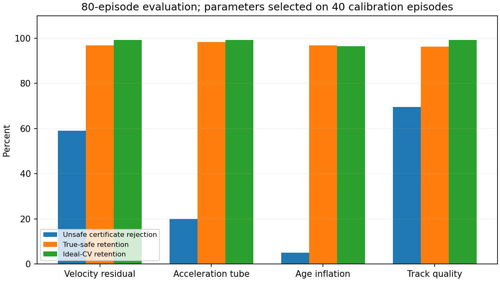

# 因果历史 uncertainty certificate：离线分类

**Stop：当前单一包络不进入闭环 prototype。**
预先选中的 velocity-residual 方法有判别力，但在 evaluation 中仍放过66/161张不安全证书，
遮挡覆盖为0，且四个非理想head-on episode仅保留39%–41%的真安全证书。
总体数值初筛为Modify；按用户的严重保守性Stop条款，最终裁决为Stop。
没有改变参数、改选方法、组合方法或修改闭环算法。
原persistent-backup holdout的Stop结论保持有效；这也不等于停止全部动态导航/uncertainty研究。

## Part A：取证归档

已形成一个commit：`80c10a1f6b8b4c6ff3bbfd5240bde92604e36874`，
标题`研究：归档动态证书失败取证`，分支`codex/dynamic-certificate-lifecycle`。
提交9个轻量文件，最大332,853 bytes；提交后工作区clean。
没有push、merge、修改main或production。
[失败取证报告](dynamic_certificate_failure_forensics_20261027.md)及其原始数据manifest随该commit归档。
本轮后续离线研究作为独立未提交WIP保留，没有自动形成第二个commit。

## 问题、范围与数据边界

问题是：只用证书生成前已经收到的观测，能否拒绝CV证书中的假安全，同时保留真安全？
研究对象是certificate validity，不是预测精度排行榜。
本轮读取既有120例C1证据，不调用planner、backup生成器或闭环executor，不增加episode。
沿用原plant、保存的绝对时间命令、不可撤销queue、物理几何与5cm标签门槛。
以原10ms开环重建及分段truth运动评价保存的完整证书，含终端无限静止ray。
`safe`定义为该保存序列truth replay最小物理净空≥0.05m；否则为`unsafe`。
**证书序列的反事实安全标签不等于该episode实际执行结果。**

每个唯一签发C1 certificate取一次，包含初始化，不重复采样持有期间的同一ID，不按结果筛样本。
共26,540张：26,420次replacement和120张初始化证书。
保存字段含predicted/truth clearance、horizon、观测age、速度、最近残差/速度变化、track IDs、集合变化age与障碍数。
丢失track只能由已观察到的ID集合变化表示，没有向方法提供真实遮挡事件或真值actor身份。
Git中只保留80张代表性小样本；全量压缩派生样本2,746,737 bytes仍在仓库外。

## 四个独立候选

令`h`为证书签发后时间，`age=t-source_epoch`；历史窗口为最近5次不同source timestamp的差分。
各方法独立作用于同一保存序列，不组合；数值零为1e-7。乘数0是关闭方法的原CV对照。

| 候选 | 因果定义 | 关键限制 |
| --- | --- | --- |
| velocity residual | `e=max ||v_reported-Δposition/Δsource_time||`，`rho(h)=k e(age+h)` | 各向同性线性管；过去残差不能证明未来误差上界；冷启动拒绝 |
| acceleration tube | `a=max ||Δv_reported||/Δsource_time`，`rho(h)=k a(age+h)^2/2` | 正加速度管与原无限safe-rest不相容，不能截断尾部伪造安全；冷启动拒绝 |
| age inflation | `rho=k ||v_reported|| age`，整条序列及尾部使用该固定半径 | 只表达旧观测位置不确定性，不声称覆盖未来加速/转向 |
| track quality | 观测ID集合改变或报告速度跳变>0.3m/s后拒绝`d`秒 | 是质量abstention，不是几何误差界；不结合residual；冷启动拒绝 |

velocity管的无限rest尾部求解析ray最小值；误差膨胀速度大于目标CV速度则不能签发。
acceleration候选只要观察到正`a`，其无界二次膨胀最终覆盖任何静止终点，直接拒绝。
因此它的正乘数在这些样本上等效；选中0.5不代表已校准出物理加速度上界。
本轮没有实现conformal或神经网络，也没有把历史最大残差包装成统计覆盖保证。

## 封存、划分与选择

[协议](../../research/dynamic_state_time/uncertainty_certificate_protocol.json)在提取/校准前封存：
SHA256 `f1199971dc835fe86bd4e995517aac2a98b34be2373d08aefc694f4eede30a73`。
按episode划分，`paired_initial_key % 3 == 1`进calibration，其余进evaluation；
相同初态的ideal/imperfect配对保持同组。每类4/8例，两组没有共享episode或配对初态。

| split | episodes | ideal / imperfect | certificates | safe / unsafe |
| --- | --- | --- | --- | --- |
| calibration | 40 | 8 / 32 | 8,936 | 8,865 / 71 |
| evaluation | 80 | 16 / 64 | 17,604 | 17,443 / 161 |

**全部120例此前已用于failure forensics。** evaluation只对本轮校准未使用，
不是从未看过的独立新holdout；本轮结果只能作为回顾性证书分类证据。
校准只加载calibration标签；选定各方法参数和唯一方法后才提取evaluation，evaluation只计算选定参数。

| 方法 | calibration选定参数 | 拒绝unsafe | safe retention | ideal retention |
| --- | --- | --- | --- | --- |
| velocity residual | k=1 | 39/71，54.93% | 96.56% | 99.27% |
| acceleration tube | k=0.5 | 14/71，19.72% | 98.22% | 99.27% |
| age inflation | k=0.25 | 6/71，8.45% | 97.39% | 98.04% |
| track quality | d=1s | 38/71，53.52% | 96.24% | 99.27% |

选择规则：safe与ideal retention≥95%、crossing/multiple safe retention≥90%时最大化unsafe rejection；
并列取小参数，方法并列按协议顺序。
唯一选中**velocity residual，k=1**。它在calibration只比track-quality多拒绝1张相关证书，
不构成其科学上优于后者的证据。
校准阶段已经出现低episode retention；整体指标未约束该最坏值，这是本轮选择规则的限制。
[完整19组校准结果](../../research/dynamic_state_time/results/uncertainty_certificate/calibration_grid.csv)、
[封存选择](../../research/dynamic_state_time/results/uncertainty_certificate/selected_calibration.json)。

## Evaluation结果

false-safe rate=`仍接纳unsafe / 全部unsafe`；safe retention=`接纳safe / 全部safe`。
不能用接纳集合中unsafe占比很小掩盖漏检；证书间相关，也不能把17,604张视为独立episode。
原CV对照的false-safe为100%，safe/ideal retention均100%。

| 方法 | unsafe rejection | false-safe（张 / rate） | safe retention | ideal retention |
| --- | --- | --- | --- | --- |
| **velocity residual，预选** | 95/161，59.01% | 66 / 40.99% | 16,892/17,443，96.84% | 99.27% |
| acceleration tube | 32/161，19.88% | 129 / 80.12% | 98.26% | 99.27% |
| age inflation | 8/161，4.97% | 153 / 95.03% | 96.84% | 96.57% |
| track quality | 112/161，69.57% | 49 / 30.43% | 96.35% | 99.27% |

track-quality在evaluation较好，不据此改选；它漏检全部head-on和prediction-error unsafe，仍未跨类别通过。
没有做“两个方法取并集”的事后组合。
[方法统计](../../research/dynamic_state_time/results/uncertainty_certificate/evaluation_methods.csv)、
[逐episode四方法统计](../../research/dynamic_state_time/results/uncertainty_certificate/evaluation_episodes.csv)。



### 类别覆盖与保守性

下表为预选velocity residual；其余方法的40行类别结果见
[完整类别CSV](../../research/dynamic_state_time/results/uncertainty_certificate/evaluation_categories.csv)。
没有unsafe样本的类别标N/A，不能解释为已证明能拦截该类风险。

| 类别（各8例） | unsafe张数 | 拒绝unsafe | 剩余false-safe | safe retention |
| --- | --- | --- | --- | --- |
| static | 0 | N/A | 0 | 98.11% |
| crossing | 0 | N/A | 0 | 99.23% |
| head-on | 7 | 100% | 0 | 85.37% |
| stop/start | 72 | 30.56% | 50 | 94.91% |
| sudden turn | 0 | N/A | 0 | 96.89% |
| occlusion/reappearance | 16 | **0%** | 16 | 98.75% |
| ID switch/misassociation | 24 | 100% | 0 | 98.01% |
| prediction error | 42 | 100% | 0 | 94.88% |
| stale observation | 0 | N/A | 0 | 99.37% |
| multiple movers | 0 | N/A | 0 | 99.27% |

总体96.84%掩盖了显著保守性。80例safe-retention的episode均值94.36%、p05=81.24%、
中位98.89%、最差39.18%；有unsafe的20例，unsafe-rejection宏平均61.89%、中位100%、最差0%。

| 最差真安全保留episode | safe retention |
| --- | --- |
| head_on_10211 | 39.18% |
| head_on_10201 | 39.60% |
| head_on_10205 | 39.80% |
| head_on_10207 | 41.41% |
| prediction_error_10703 | 83.33% |
| prediction_error_10711 | 83.64% |
| stop_start_10308 | 88.71% |
| stop_start_10302 | 89.06% |

四个非理想head-on的多数真安全证书被误杀；同类ideal约99%的保留率不能替代这个检查。
一个解释是各向同性管把主要沿运动方向的误差也扩到狭窄侧向净空，且无限rest进一步限制可签发范围。
这属于几何解释，不是已做闭环消融的因果结论。
全部历史方法的初始证书因观测不足会abstain，理想组约0.73%的拒绝主要含此冷启动；
本轮没有证明prototype能完成初始化backup acquisition。

遮挡时丢失actor从当前列表消失，没有residual tube可膨胀；加大residual乘数无法修复集合覆盖。
stop/start中当前静止可能是正确观测，过去5次残差也不能预知下一次启动，已观察突变还会随窗口退出。
track-quality对这两类有覆盖，但safe retention在occlusion降至87.61%、最差episode75.93%，
且对head-on/prediction error完全漏检。age-inflation不能替代运动变化，acceleration与无限rest合同冲突。

## 原29个假安全失败与风险时间

原29例按既定划分为10 calibration、19 evaluation；
[known29_coverage.csv](../../research/dynamic_state_time/results/uncertainty_certificate/known29_coverage.csv)
保存全部29例×4方法，明确split、unsafe数量、首次正确拒绝、物理事件、旧计划可执行性/授权状态。
calibration中的velocity方法覆盖8/10，只作拟合侧描述，不混入evaluation成绩。

| evaluation方法 | 检出原19例 | 提前≥0.1s且旧保存逃逸序列仍物理可执行 | 当时旧backup仍获原授权 | lead最小 / 中位 / 最大 s |
| --- | --- | --- | --- | --- |
| velocity residual | 13/19 | 13/19 | 5/13 | 0.20 / 0.87 / 1.66 |
| acceleration tube | 7/19 | 7/19 | 5/7 | 0.52 / 0.83 / 1.66 |
| age inflation | 2/19 | 0/19 | 0/2 | 0.10 / 0.15 / 0.20 |
| track quality | 13/19 | 13/19 | 11/13 | 0.52 / 0.79 / 1.66 |

velocity方法13例的lead均值0.884s、p05=0.392s、p95=1.498s、p99=1.628s。
首次风险只计**拒绝真正unsafe的保存证书**，不把更早冷启动/误拒绝当作有效预警。
提前量对齐原碰撞或首次低净空事件，并检查同一实际起点下前一条保存backup的truth安全与前0.10s不可撤销queue兼容。
这是评价侧反事实证据，不是闭环实际避让成功；**全局最后可逃逸时刻仍Unknown**。
13例中8例虽仍有物理可执行的旧序列，但原授权已撤销；只增加screen不证明能利用这个窗口。

预选方法evaluation逐例覆盖：

| case ID | 拒绝unsafe / unsafe | 首次正确拒绝 s | lead s |
| --- | --- | --- | --- |
| head_on_10205 | 4/4 | 4.95 | 1.39 |
| head_on_10211 | 3/3 | 4.95 | 1.37 |
| stop_start_10300 | 4/4 | 2.65 | 0.92 |
| stop_start_10302 | 0/9 | — | — |
| stop_start_10303 | 4/4 | 2.65 | 0.83 |
| stop_start_10305 | 4/19 | 2.65 | 1.66 |
| stop_start_10306 | 3/3 | 2.70 | 0.52 |
| stop_start_10308 | 0/11 | — | — |
| stop_start_10311 | 3/18 | 2.70 | 1.07 |
| occlusion_reappearance_10502 | 0/1 | — | — |
| occlusion_reappearance_10503 | 0/7 | — | — |
| occlusion_reappearance_10506 | 0/1 | — | — |
| occlusion_reappearance_10511 | 0/7 | — | — |
| id_switch_10608 | 12/12 | 2.10 | 0.56 |
| id_switch_10611 | 12/12 | 2.10 | 0.57 |
| prediction_error_10702 | 5/5 | 3.25 | 0.20 |
| prediction_error_10703 | 13/13 | 2.65 | 0.98 |
| prediction_error_10706 | 13/13 | 2.80 | 0.55 |
| prediction_error_10711 | 11/11 | 2.70 | 0.87 |

另外stop_start_10309原本安全完成，但有4张保存证书的反事实truth标签不安全，velocity方法全部漏检。
因此evaluation共有20例出现unsafe证书，不能把它们都称作原失败episode。

## Head-on授权/时序：独立剩余问题

对head_on_10201，重评保存suffix而不重新签发或恢复授权：

| t s | 原授权 | 前0.10s queue兼容 | 当前CV物理净空 m | truth m | residual管净空 m | 管检查 |
| --- | --- | --- | --- | --- | --- | --- |
| 5.05 | 是 | 是 | 0.081313 | 0.069230 | 0.065042 | 接纳 |
| 5.10 | 否 | 是 | 0.080936 | 0.069230 | 0.065171 | 接纳 |
| 5.15 | 否 | **否** | 0.080560 | 0.069230 | 0.065300 | 几何接纳但不可再接回 |

5.05签发的旧计划首个侧逃动作在5.20；5.10仍可按不可撤销delay接入，却因`prediction_changed`丢失授权。
到5.15其几何仍可安全，但queue已不兼容；原episode最终6.51碰撞。
四种screen在这三时刻都几何接纳，不能据此越过授权与queue合同。
本例所有保存certificate的truth标签均安全，不能用unsafe筛查声称修复它。
[12行四方法诊断](../../research/dynamic_state_time/results/uncertainty_certificate/authorization_diagnostic.csv)。
结论：uncertainty对部分风险能提前拒绝，但授权/执行时间仍独立存在，本轮未修复。

## 成本、因果性与验证

单位ms/certificate；输入为已经存在的certificate reference states，计时不含轨迹重建、truth标签、IO。

| 方法 | mean | p50 | p95 | p99 | max |
| --- | --- | --- | --- | --- | --- |
| velocity residual | 0.03676 | 0.03307 | 0.06275 | 0.14990 | 0.18316 |
| acceleration tube | 0.02544 | 0.02519 | 0.04495 | 0.05402 | 0.11042 |
| age inflation | 0.02448 | 0.02457 | 0.04499 | 0.05261 | 0.09373 |
| track quality | 0.00256 | 0.00252 | 0.00312 | 0.00374 | 0.06122 |

因果特征更新单独计18,145拍：mean0.01605、p50=0.01491、p95=0.02253、p99=0.02725、max0.10143ms。
增量screen计算轻量，数据只依赖最近5次source历史和当前certificate；未测完整在线cycle/CPU/RSS，
不宣称20Hz实时验收通过，也不把两个p99直接相加当成完整周期p99。

[分析脚本](../../research/dynamic_state_time/offline_uncertainty_certificate.py)的`History`与`screen`不接收case/category、
事件表、truth indices、未来运动、结果标签。所有score先算，再调用truth projection生成标签。
相关验证通过：速度残差恒等例、未来观测不修改已生成prefix特征、隐藏truth元数据隔离、
100个固定seed ray解析/密集取样对照、静止目标膨胀管的无限尾部拒绝。
证书终态及原nominal预测重建误差断言<1e-7；两组sample ID唯一、配对组不交叉，
evaluation仅含校准选定参数；封存协议与样本hash复核一致。

## 裁决与唯一推荐

本轮补充数值门：unsafe rejection≥90%、每个有unsafe类别≥75%、safe/ideal retention≥95%、
crossing/multiple≥90%、19例中提前且有已保存逃逸证据≥80%、screen p99≤10ms。
Modify数值初筛为unsafe rejection≥50%且safe retention≥90%。
预选velocity方法总体符合Modify初筛，却同时违反类别覆盖、提前覆盖和用户的严重保守性Stop条件。
因此summary分别保留`numerical_gate_verdict=Modify`及`verdict=Stop`，没有回写参数或隐藏初筛。

**唯一预选方法仍为velocity residual k=1，仅保留为诊断工具；不推荐任何本轮方法进入闭环。**
age/acceleration单独方案判别力不足；track-quality虽能覆盖不同事件，但仍漏掉核心类别，
不能在evaluation后改选或组合来声称过门。
值得保留的知识是：集合缺失、未来行为变化、几何误差和授权时序是不同合同问题；
一个各向同性CV residual包络不能统一解决。
下一轮若重新立项，需要独立的新假设和新评估证据；本轮不自动开始prototype或integration。
这不是STVL A/B、real tracker、实车验证或Hardware Go。

## 资产与复现

[轻量summary](../../research/dynamic_state_time/results/uncertainty_certificate/summary.json)、
[代表性样本](../../research/dynamic_state_time/results/uncertainty_certificate/representative_samples.json)、
[数据manifest](../../research/dynamic_state_time/results/uncertainty_certificate/dataset_manifest.json)。
原holdout证据40,738,758 bytes、原forensic派生12,595,004 bytes均保持原位置，不复制进Git。
新样本目录位于仓库外`/home/qihei/.codex/visualizations/2026/10/25/01a1708d-d064-7252-86b0-5e92a75657dc/dynamic_uncertainty_certificate_20261027`。
manifest保存dataset ID、文件约定、大小、SHA256、来源、用途、synthetic属性及所需实验。

最小验证：

```bash
PYTHONDONTWRITEBYTECODE=1 python3 research/dynamic_state_time/offline_uncertainty_certificate.py test
```

完整重建顺序为`prepare --split calibration` → `calibrate` → `prepare --split evaluation` → `evaluate`。
`--raw`指向manifest的origin，`--data`为仓库外新空目录，`--output`为新的轻量输出目录。
脚本拒绝覆盖封存sample及既有校准选择；复核既有派生结果只运行`evaluate`，不要覆盖封存样本。
`evaluate --decision Stop --decision-reason ...`只记录人工裁决，不改变score、参数或标签；
省略该参数时会输出数值初筛Modify。

当前branch为`codex/dynamic-certificate-lifecycle`，HEAD仍`80c10a1f6b8b4c6ff3bbfd5240bde92604e36874`。
Part B source/config/results及本报告作为轻量未提交WIP保留，工作区因此不clean。
闭环runtime仍为`e819e1002d938b5938447302d8a717ce8d49a57e`，无production修改，无push或merge。
