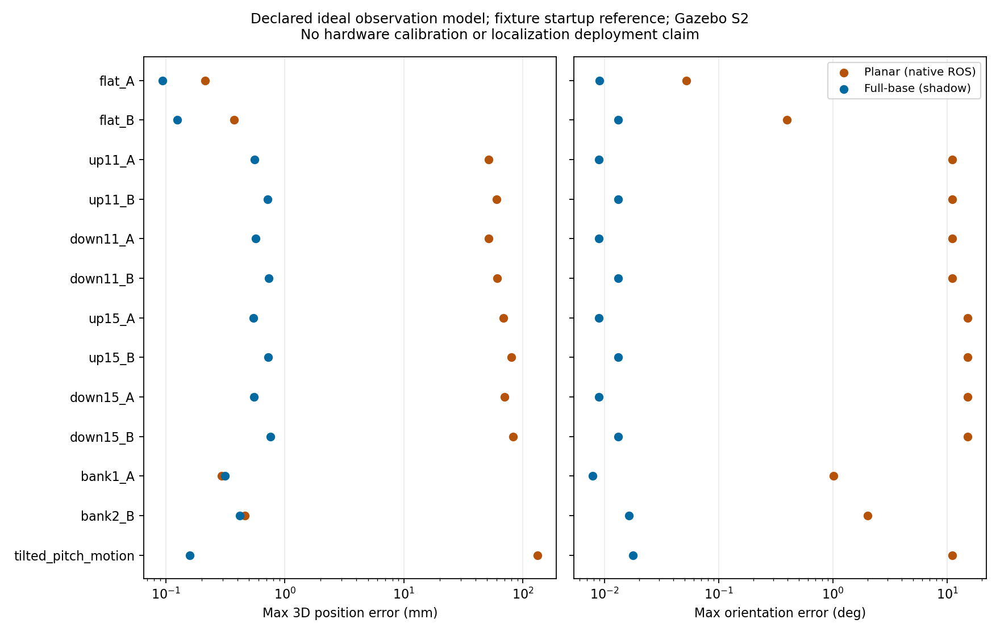

# Full-base heading adapter：新统一仿真 shadow system validation

2026-10-07（Asia/Shanghai）。本报告只验证 pose adapter，不接管定位、TF 或控制。

> 2026-10-08补充：[输入合同修复与研究冻结](full_base_input_contract_20261008.md)。
> 本文保留 `6c5e8227` 的系统验证及历史证据；后续修复、复测和不可观测限制见补充报告。

**判定：Simulation Go，限定为声明理想观测、完整预声明启动参考和有效同步输入的 shadow pose conversion。**
正常几何明显改善；多解/近奇异正确拒绝。真实输入、标定、时钟与部署仍未 Go。

## 版本、隔离与来源

- 验证分支 `experiment/full-base-simulation-validation`，从新统一仿真
  `d5673e3a1cfe6937e4126e1df894ee6d66e63e07` 派生。
- 原 full-base 数学来源 `5733f126b71b52e7f4ddd2340b226c1589b4419b`，其父基线
  `origin/main-new-car@bd6cf689d3d5aca5c8edd430ff760ca5ceb27496`。
  **只复制 adapter.py，字节一致**；本轮重新实现独立观测、ROS shadow 输入桥、状态 wrapper 和评分器。
  未 merge/cherry-pick 研究分支；没有迁移 graph、covariance 或动态控制代码。
- 仿真模型、驱动、production planar `lio_adapter.cpp` / `canonical_odometry.cpp` 均与
  `d5673e3a` 一致。模型沿用 S2 的四轮接触、数值柔顺支撑、full-SE(3) 与 CAD A/B。
- 原工作目录存在他项 dirty 文件，本轮没有修改它们。
  本验证 worktree 为 `/home/qihei/rm2027_navigation/build/full_base_simulation_validation`。
  main/main-new-car/main-old-car、NEU、covariance、冻结动态/MPC refs 不变，未 push。

[源码身份](full_base_simulation_validation/evidence/source_identity.json)、
[复现入口](../../experiments/full_base_simulation_validation/README.md)、
[自动检查与系统结果](full_base_simulation_validation/evidence/summary.json)。

## 输入合同与 truth 防火墙

物理系统实际运行：Gazebo S2 模型 → 独立 research 观测插件 → ros_gz_bridge → shared ingress →
**原生 C++ planar ROS 节点 + Python full-base shadow ROS 节点** → 独立评分器。
这不是仅用 Python 重写 planar 或只跑离线数学测试。

| 信息 | 两路接收到什么 | 证据边界 |
|---|---|---|
| raw sensor pose | 同一个 `/shadow/input/raw`；sensor epoch 中的完整 SE(3)，理想模拟观测 | 由独立模拟观测插件读取 sensor 实体产生；没有真实 FAST-LIO、IMU、Livox pattern 或点内时间，不证明 LIO 性能 |
| heading | 同一个 `/shadow/input/heading`；固定重力世界中 base +x 的 azimuth、源 stamp、rate、boot/reset | 理想模拟 heading 测量；不同于真实 MCU heading 语义已经对齐 |
| calibration/home | S2 同一轴链 F Rz(q) K、A/B geometry revision；q0=0，明确 home | 仅声明的 CAD 代理模型，没有实车 A/B 外参或内部 IMU 原点认证 |
| startup attitude | full-base 明确提供预先配置的平地/1°/2°横坡/11°坡面 roll/pitch，yaw 由 heading 输入 | **不读 base truth 补齐或校正**。实际接触倾角与参考的误差保留；缺失参考必须拒绝 |
| actual q / base truth / sensor truth | 只进评分器 | candidate 没有 joint 参数，不能选根、提供 home 后的 joint 或 continuity prior |

插件没有订阅 truth topic；它提供的是上述明示的**完美模拟观测模型**，不是另一个真实 estimator。
没有将 `/simulation/ground_truth/odom` 或 `/simulation/sensor_truth` 直接送到 adapter。
没有从 truth 产生 startup attitude。没有从 truth 判断根或 ambiguity。
该实验回答“正确的声明输入能否正确转换”，不回答“真实输入源是否能提供这些信息”。

节点图读回确认 adapters/ingress 都不订阅 truth 或 `/joint_states`。
最终frame故障复测还读取运行中planar参数：`publish_tf=false`、`output_odom_topic=/shadow/planar/odom`、
`base_frame=shadow_planar_base`、raw parent与heading route均为声明输入。
full-base 不创建 TF/command 发布器；原生 planar 使用 `publish_tf=false`，其 TF publisher endpoint
由既有构造函数创建，但未收到任何 shadow TF payload。public map→odom / odom→base_link
继续由 baseline oracle 配置为唯一 owner，RSP 只负责实际 joint 链。未启动 Nav2 localization，
没有 candidate cmd_vel；只有隔离 runner 发送 open-loop 场景命令。

输出数值合同独立：full O 重力对齐、原点在启动 base 位置；planar B0 为水平、yaw=h0。
评分只按合同加 startup heading/origin，不拟合轨迹、roll/pitch，也不在 candidate 内使用评分原点。
若用实际 full startup rotation 对 planar 输出做 truth 对齐，会隐藏其水平假设，本轮没有这样做。
full 输出为 research pose carrier，twist/covariance 未验证；negative sentinel 仅是本实验约定，
不是可部署的标准 covariance 合同。

## 系统级 A/B 结果

19组物理系统场景共14,454个运动/故障评分样本，另有4组解析 ROS transport边界；
217项检查通过。下表为**最大值**，箭头为 planar → full-base；全部正常运动段 full-base 100% `SOLVED`。
数值筛查只针对理想输入，不是统计置信度或硬件精度。

| 场景 | 输入样本 | position error mm | orientation error ° | dynamic lever error mm |
|---|---:|---:|---:|---:|
| flat_A | 1424 | 0.214 → 0.094 | 0.0522 → 0.0090 | 0.194 → 0.041 |
| flat_B | 1227 | 0.374 → 0.125 | 0.3952 → 0.0132 | 0.291 → 0.073 |
| up11_A | 883 | 51.425 → 0.554 | 11.0708 → 0.0089 | 51.522 → 0.041 |
| up11_B | 883 | 60.345 → 0.721 | 11.0472 → 0.0131 | 60.576 → 0.073 |
| down11_A | 894 | 51.685 → 0.568 | 11.0568 → 0.0089 | 51.518 → 0.041 |
| down11_B | 883 | 60.710 → 0.735 | 11.0343 → 0.0131 | 60.576 → 0.073 |
| up15_A | 893 | 68.552 → 0.547 | 15.0883 → 0.0089 | 68.661 → 0.041 |
| up15_B | 894 | 80.148 → 0.725 | 15.0694 → 0.0131 | 80.378 → 0.073 |
| down15_A | 883 | 70.387 → 0.554 | 15.0849 → 0.0089 | 70.216 → 0.041 |
| down15_B | 894 | 82.733 → 0.759 | 15.0658 → 0.0131 | 82.606 → 0.073 |
| bank1_A | 496 | 0.293 → 0.315 | 1.0120 → 0.0079 | 4.704 → 0.037 |
| bank2_B | 496 | 0.462 → 0.418 | 2.0176 → 0.0164 | 11.152 → 0.091 |
| tilted_pitch_stationary | 196 | 0.075 → 0.000 | 11.0258 → 0.0177 | 50.912 → 0.082 |
| tilted_pitch_motion | 294 | 131.898 → 0.160 | 11.0468 → 0.0177 | 50.794 → 0.082 |

平地主要体现几何一致性，roll/pitch 微小接触变化与固定启动参考误差均保留。
full-base 不保证每一个平地/横坡位置指标都更低；1°横坡中 planar 的最大 position error
约 .29 mm，full 约 .32 mm。其明显收益是坡道完整姿态、倾斜启动、杆臂世界方向与拒绝状态。
上下坡中的 position error 包含 z 和完整三维平移，不能只比较 XY 来隐藏 planar 高度/杆臂误差。

动态杆臂评分使用**评分端**实际 joint q：比较估计姿态下推导的 world base→sensor vector 与
真实 vector；不把 q 提供给任何候选。连续性采用相邻 SE(3) 增量残差，避免 Euler/yaw wrap
数值跳变被误判为运动。多圈 q 与 wrap 只按模 2π 可辨识，candidate 不估计累计圈数。

- flat_A：actual q -0.000..23.555 rad（3.75圈）；full相邻增量误差最大 0.000 µm / 0.000000°，未强行unwrap根。
- flat_B：actual q 0.000..23.570 rad（3.75圈）；full相邻增量误差最大 0.000 µm / 0.000000°，未强行unwrap根。

## ambiguity / ill-conditioning

正常 CAD 单轴模型的本轮姿态域没有产生 ambiguity 或 ill-conditioning。
为覆盖已知边界，另做 **3组几何 + 1组时间回退实际 ROS 消息传输反例**，使用明示解析输入；不声称是
正常 S2 四轮物理车姿态或新车可执行动作。

- 90° sideways roll：`AMBIGUOUS`，连续根，无 pose 输出；恢复可辨识水平姿态后 `SOLVED`。
- 89° roll：`ILL_CONDITIONED`，无 pose 输出；恢复水平后 `SOLVED`。数学来源的 heading 增益约
  57.3 rad/rad 已保留，默认门不放宽以制造输出。
- joint axis tilt 60°：两个 directed-heading 根，`AMBIGUOUS`；后续水平姿态仍可有双根，
  **不能仅因回到水平就声称恢复唯一**。没有读取 q 或沿上帧选根。

对应：[continuum](full_base_simulation_validation/evidence/continuum.json)、
[near singular](full_base_simulation_validation/evidence/near_singular.json)、
[two roots](full_base_simulation_validation/evidence/two_roots.json)。原生 planar 在 90°/89°样例仍输出，
orientation error 分别 90°/89°，没有对应数学可辨识状态。该比较不等于正常姿态下 planar 必然失效。

## 时间错配、缺失与状态

严格数学 policy 保持来源版本：max source skew=1 ms；**没有称它是硬件可接受偏差**。
full ROS wrapper 允许最多 60 ms 墙钟等待 exact-stamp transport，仍保留原 stamp；超时再按
nearest heading 调用严格解算，既不 rate-propagate，也不 retimestamp。
planar 保留 production 的 30 ms nearest match + rate propagation。这是不同的 transport policy，
必须把输出可用性与数学正确性分开比较。

| 故障/条件 | full-base 实际表现 | planar 实际表现 |
|---|---|---|
| latency20ms | {'SOLVED': 148, 'INVALID_TIME': 1}；输出148/149 | 输出149/149 |
| latency60ms | {'INVALID_TIME': 117, 'SOLVED': 31}；输出31/148 | 输出147/148 |
| missing | {'INVALID_TIME': 100, 'INVALID_INPUT': 49}；输出0/149 | 输出0/149 |
| invalid_heading | {'INVALID_INPUT': 99}；输出0/99 | 输出0/99 |
| hidden_skew20ms | {'SOLVED': 149}；输出149/149 | 输出149/149 |
| offset05ms | {'SOLVED': 98}；输出98/98 | 输出98/98，max姿态误差0.0148° |
| offset1ms | {'SOLVED': 98}；输出98/98 | 输出98/98，max姿态误差0.0249° |
| offset2ms | {'SOLVED': 1, 'INVALID_TIME': 97}；输出1/98 | 输出98/98，max姿态误差0.0468° |
| offset5ms | {'INVALID_TIME': 98}；输出0/98 | 输出98/98，max姿态误差0.1150° |
| offset10ms | {'INVALID_TIME': 99}；输出0/99 | 输出99/99，max姿态误差0.2294° |
| offset20ms_alias | {'INVALID_TIME': 1, 'SOLVED': 97}；输出97/98 | 输出98/98，max姿态误差0.4585° |
| offline | {'SOLVED': 1, 'INVALID_INPUT': 97}；输出1/98 | 输出0/98 |

时段标签按评分器发送fault请求定义；异步到达和缓存可在边界保留1个此前输入，表中没有
把边界的 SOLVED 帧隐藏掉。60 ms transport恰处于墙钟等待边界，输出率受调度/仿真时速影响，
不是固定源skew拒绝门，也不承诺真实时钟/延迟覆盖。

20 ms stamp offset 恰好与50 Hz周期相同，可与另一时刻消息形成 exact-stamp alias；
full接受97/98帧，两路max orientation error约0.4585°。hidden old-heading/current-stamp负例同样
两路误接受。2/5/10 ms非周期偏移由full保留INVALID_TIME；planar rate propagation则把虚假
header偏移转换成约0.0468/0.1150/0.2294°偏差。

另对实际flat_A观测trace做固定rate时间扰动（离线，不是新物理试次）：

| 真实heading值延迟 ms | 严格source stamp状态 | 隐瞒stamp后增量姿态误差 ° |
|---:|---|---:|
| 0 | SOLVED | 0.000000 |
| 0.5 | SOLVED | 0.011459 |
| 1 | SOLVED | 0.022918 |
| 1 | INVALID_TIME | 0.022918 |
| 2 | INVALID_TIME | 0.045837 |
| 5 | INVALID_TIME | 0.114591 |
| 10 | INVALID_TIME | 0.229183 |
| 20 | INVALID_TIME | 0.458366 |
| 60 | INVALID_TIME | 1.375097 |
测得方位角rate约0.400000 rad/s；20/60 ms隐瞒时差的full姿态响应约.4584°/1.3751°。正确stamp拒绝超过1 ms；同stamp的数值谎言无法靠这个adapter发现。

缺 heading 后 full 先 `INVALID_TIME`，缓存完全耗尽后 `INVALID_INPUT`；invalid/offline heading
输出 `INVALID_INPUT`；没有输出最后一帧冒充当前位姿。missing startup attitude 为
`INVALID_CALIBRATION`，保持拒绝，即便评分器有完整 base truth。状态不是静默零姿态。

实际同步不能由 stamp 相等证明。伪造当前 stamp 的旧 heading、50 Hz 周期整数偏移的 alias，
以及内部一致但错误的启动重力/标定，都可能通过形式门。它们限定 Simulation Go 的输入前提。

## 新 TF / frame / epoch 发现

1. **raw epoch 返回旧 frame 名后的 planar 恢复**：epoch2 时两路都不输出；返回 epoch1 名称后
   planar 恢复输出，而 full wrapper 继续 `INVALID_TIME`、要求显式 restart/re-home。
   这是实际 ROS 输入故障证据，不能把 frame 名当永久连续基准。
2. heading boot/reset change：两路都锁定拒绝，返回旧 reset 标识也不能继续。
3. **planar sensor frame未严格检查**：改成`wrong_sensor`时planar仍输出98/98帧；
   full返回`INVALID_INPUT`、零pose，恢复正确frame后继续。因为数值本身未变，planar误差看似很小，
   但frame语义错误不能因此接受。production heading-fusion路径本轮不修。
   独立ROS时间回退反例中full锁定`INVALID_TIME`，后续时间再次前进也不自动解锁。
4. 本轮没有发现额外 public base TF payload 或候选 command owner。full/planar 数值 parent
   必须保持独立；full startup attitude 缺失时不能自动把 B0水平或地图 TF当作参考。
5. 评分器尝试获取 DDS TF publisher GID，但本机 Jazzy rclpy message-info 没有该字段。
   所以不宣称做了逐消息 GID owner 归属证明；保留 endpoint 图、实际 edge payload与 launch配置证据。
   这属于记录接口限制，不是重复 TF 已出现。

[raw epoch](full_base_simulation_validation/evidence/raw_epoch.json)、
[heading reset](full_base_simulation_validation/evidence/heading_reset.json)、
[frame fault](full_base_simulation_validation/evidence/frame_fault.json)。本轮没有修正式 planar 节点。

## 判定、适用域与硬件门

**Simulation Go**：在当前新车仿真模型、single-axis CAD链、正确heading/gravity语义、
已确认home、预声明完整启动参考、稳定epoch及真实同时间输入下，full-base比planar更完整，
上下坡和倾斜启动的orientation/position/动态杆臂正确性明显改善；正常域连续，拒绝状态通过。
平地/横坡位置不宣称逐项更优。19组物理系统场景、4组解析ROS边界、217项检查均保留。

**Modify / 等硬件输入**：60 ms等待和1 ms源skew policy仅演示，真实transport/clock门要实测；
严格heading-only姿态不可辨识区域保持拒绝，不是“全姿态所有条件Go”。周期stamp alias、
错误但内部一致的启动参考/校准不能自证正确；正式接口迁移还需独立epoch/frame与pose/twist/covariance设计。
本轮没有触发要求放弃数学候选的Stop，未解冻其他研究。

Simulation Go 仅允许作为后续硬件验证候选保留，不 merge 到 main-new-car，不授予
localization Deployment Go。下列情况仍为有界拒绝/未验证：缺完整 startup reference、未知/错误
calibration、heading 离线或错误时间、raw/heading epoch change、多根与 near-singular。
若业务需要这些状态下持续定位，必须增加独立可观测信息；不能沿历史根强行输出。

必须等新车实测：A/B 实际 F/K 与 home/yaw axis/符号/回差、内部 IMU 原点与 LiDAR链、
MCU heading 是否为固定重力世界 azimuth、倾斜启动重力/attitude 来源、真实 raw epoch与
重启/home合同、MCU/LiDAR/ROS 时钟同步与延迟、真实 LIO/deskew质量、高角速与实车上下坡。
仿真不能替这些项目补齐证据，也不证明真实完整机械包络或新车导航部署。

## 检查与保留的失败

- 隔离 Release 构建 4 packages 成功；原 native canonical 15 个 gtest通过，S2 geometry 3组通过。
- Python 编译、固定 trace 重评分、source byte identity、拒绝帧无输出、正常域同步覆盖、
  A/B geometry/continuity 和 epoch latch 检查见 summary。5 mm / .15° 为理想观测研究域的工程筛查，
  不是硬件实测阈值，也不是预注册统计实验。
- 第一次 default colcon test 搜索全工作区时引用未构建的 exec dependencies，失败；随后在实际
  已构建 package 目录运行 CTest通过。零 test-result 不能算成功，保留原失败日志。
- 早期沙箱网络/ROS日志目录限制、评分器 GimbalState字段、TF metadata与参数服务 API错误、解析双根后
  “回到水平应唯一”的错误预期，都保留为 harness 失败；修正后完成复测，不当作算法通过或失败。
- 日志中的 SIGINT/SIGTERM 是 runner结束本次进程组；不把退出清理文本当导航运行失败。
  同时启动的早期失败记录器造成日志交叠，仅作基础设施失败，不作为有效测量证据。

证据分为实际 Gazebo/ROS physics轨迹、解析 ROS状态反例、固定轨迹离线时间扰动三类；
不把后两者写成新的物理/实车试次。所有数字可以从保存的 input/output/scoring trace复核。
生成器原manifest冻结的是添加观测插件前的world；本轮保存原SHA，并重新冻结实际启动world及bridge SHA，
以免把baseline文件hash误作shadow场景hash。此provenance修正不改任何测量或评分数值。
