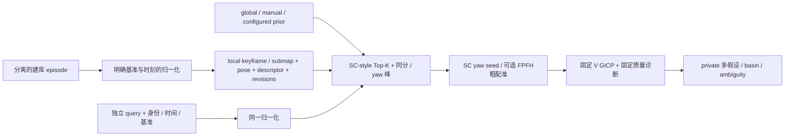

# 新车 L2 全局候选离线研究

2026-10-07，Research；沿用 [L1 / L1-M](neu_localization_l1_baseline_20261007.md) 的新车源码与参数基点。用户明确授权推进离线 L2，不表示 L1-M 的真实输入缺口已解决。

后续已按[串行路线](neu_serial_research_route_20261007.md)调整：prototype 冻结在 `976b249e`，不继续 toy 调参；当前仅 Task 1 后端，真实输入到位后再作为 Task 2 的 LOST / initialization 候选入口。以下保留原阶段结论。

当前 Task 1 状态为 **Modify / waiting for real vehicle evidence**；统一[到位检查表 / 接口核对 / 恢复入口](neu_factor_graph_task1_20261007.md#8-实车到位检查表与恢复入口)。L2 文件接口可以复用，但须 Task 1 Go 并进入 Task 2 才恢复检索；数据到位不自动解冻本 prototype。

**结论：Modify。** 离线软件已能从无 seed 输入生成、精配准并保留多个 global basin；重复地点的低 fitness / 高 overlap / 满秩 H 仍不能消歧。FPFH 粗配准改善一个较大位移的 basin capture，但没有提高本组实验的端到端合格召回。A 雷达真实数据与坐标基准仍缺，不能宣布实车效果或进入 Integration。

**比赛工程判断：优先采用经现场确认的出生区域 / 人工 coarse pose + candidate verification，保留无 prior 搜索作为 LOST / fallback。** 这是基于既有错误匹配机制的工程建议，尚未由新车实测验证。仅靠配置文件里的旧出生区不能证明机器人在那里；错误 prior 下的单候选必须带条件，不能直接生效。

## 1. A 线：真实输入闭合进度

用户明确回答没有新车 A 实车记录。受限本地检索发现的 4 个 PCD 是测试 / tampered 资产，83 个 bag metadata 没有所查 lidar / registered-cloud 话题；本轮可用的新车建库 episode、独立 query、真实 occupancy / PCD bundle 均为 **0**。检索范围和清单见 [real_input_inventory.json](../../experiments/neu_localization_l2/evidence/real_input_inventory.json)，不外推其他机器。

| 项目 | 已知依据 | 当前状态 / 缺口 |
| --- | --- | --- |
| 当前主雷达 | 用户授权 A 作软件研究主雷达；[A/B CAD 基线](../../experiments/neu_localization_l1/new_car_cad_baseline.yaml) 完整保留 | A 为研究选择，实车主副选择未定；B 不需重复实现算法 |
| A 真实 topic / IP / role | V 配置候选 left `.3`、right `.166`、host `.50`（均 `192.168.1.*`）；single profile 用 `/livox/left/lidar`、`/livox/lio_imu` | **UNKNOWN**：没有 A/B→left/right、序列号 / IP / 现场参数回读证据；配置地址不能填成 A 实际地址 |
| lidar / IMU / gimbal / base | 合同树 `base_link→gimbal_yaw_link→mid360_* / lio_imu_link`；MID 内部 IMU 用于 LIO | sensor RPY、CAD origin→Livox origin、internal IMU→lidar、joint Z、home / yaw 符号未标定 |
| CAD 机械平移 | A `[.13776,-.09151,.14112]`，B `[-.17344,.16021,.14621]` m，以 CAD 轮中心平面为基准；地面基准 Z 分别 `.20761/.21270` m | 可信暂定机械值，不能直接充当完整传感器外参；与 URDF `±.12` / joint `.115` 等占位值冲突已在 L1-M 记录，不修改正式配置 |
| home / heading | heading fusion 要求确认 home，`initial_alignment_confirmed:false`，nearest heading 最大 `.03 s`，boot / reset 改变后失效 | MCU→ROS 时钟、heading 来源时刻、gimbal 源时刻与 home 保持未实测 |
| 点时序 / LIO | native `offset_time/1e6` 转为 curvature ms；bundle cloud / odom 使用同一个 publish lidar time；profile zero-start 等待 40 scans | 源碼单位约定已复核；真实点 offset / timestamp 类型、deskew、单/双雷达时间基准与运行 profile 未核验 |
| raw registered cloud vs canonical odom | raw cloud 在 FAST-LIO 的 R 基准；heading fusion 重建 B0 基准；GICP 对 header=odom 的 cloud 直接使用点值 | 同名不保证同数值基准，风险仍存在，详见下式；不是已确认的现场故障 |
| 真实地图 / 建库-query 分离 | V 只有 test-only toy bundle；本轮新库是 6 个解析局部子图 | 真实 map origin / yaw / PCD↔occupancy、map revision、独立建库与留出 query 均缺 |
| 源码 / profile | V `bd6cf689d3d5aca5c8edd430ff760ca5ceb27496`，`src/` 无差异；T 质量 pin `e374894a7a713ea84b82de9e92479a37041f39ff` 被动使用 | 部署 commit / launch / 参数 / owner graph **UNKNOWN**；当前只是固定源码离线 probe |

源码依据：`rm_localization_adapters/src/canonical_odometry.cpp` 的 heading fusion、`lio_adapter.cpp` 的初始化与 reset 逻辑；`rm_lio_bringup/config/fast_lio_multi_single_mid360.yaml` 与 `lio_adapter_chassis_heading_fusion.yaml`；`rm_gicp_relocalization/src/gicp_relocalization_node.cpp` 的同名 frame shortcut。只读复核的 FAST-LIO / Livox submodule 与 V gitlink 一致，没有更新子模块。

对于原始 registered cloud 的 R 坐标，融合初始化时：

```text
T_B0_R = T_B0_S_home * inverse(T_R_S_at_fusion_start)
p_B0 = T_B0_R * p_R
```

需先将点与 canonical `/odometry/lio` 变换到同一 B0 / epoch，再做描述子。prototype 要求显式 `T_odom_input`、`T_odom_base` 与 numerical-basis revision，并归一化到当时的重力对齐 base 原点。重力、deskew、时钟与 home 均是上游证据前提，程序不替代标定。已知模拟外参下 gimbal 0 / π/2 / π 的点值最大恢复误差约 `7.1e-9 m`、描述子距离 0；仅证明矩阵实现，不证明新车标定。

## 2. 最小架构与数据库



[实现与复现入口](../../experiments/neu_localization_l2/README.md)。Python 与两个 standalone CLI 无 ROS 通信，`COLCON_IGNORE` 隔离。未改 `src/` 或导航合同。唯一旧文件修改是在 L1 私有 probe 增加 full SE(3) seed 参数；原 19/20-argument 行为和 17-case L1-M 数值回归保持一致。

每个 keyframe 保留 place / keyframe ID、source-frame ID、时间、map pose、**局部** gravity-base 子图、20×60 height descriptor、ring key、输入 hash、map / DB / numerical-basis revision。没有对整张合并地图做一个 SC。当前 6 条目小库穷举 circular shift cosine distance，ring key 只记录诊断，不实现大库 KD-tree；不是 SC++，也不是作者源码的逐位复现。

默认 K=3，边界 `.02` 近似同分继续保留，最多 8 个 keyframe；yaw 最多两个分离峰。SC 距离上限 `.35`、basin 分组 2 m / `.5 rad` 是**实验前固定的研究策略**，未经真实数据标定，未因某个结果调门。T overlap `.30`、min-eigen `.001`、condition `1e5` 只作为额外研究资格判定；新车 V 的原 GICP 参数与位姿门完全保留。

## 3. 三种入口与多假设语义

| 模式 | 当前实现 | 限制 |
| --- | --- | --- |
| Global / No Prior | 全库 retrieval，SC coarse yaw，候选 local origin seed，可选粗配准 | 不读人工 pose / query GT；搜索过的 Top-K 也不等于全场唯一性证明 |
| Manual Initial Pose | 离线 JSON 等价输入；XY search center、半径、可选 yaw / range；增加 prior-center seed，仍跑 GICP / 质量验证 | 长期保留人工 fallback 的设计入口；本轮没有 ROS `/initialpose` 接入或正式 pose 覆盖 |
| Configured Coarse Prior | `config.yaml` 的 `expected_start_pose` / `xy_search_radius` / `yaw_search_range` / region IDs | 本例固定 `[12,0]`、3 m、yaw unknown；关闭 prior 就变为 global；没有源码硬编码出生地点 |

prior 附近没有合格候选时扩大全局；不允许扩大时返回 LOST。空 prior 的负例已验证 `prior→global→ambiguous`。但 prior 附近若错误地点拟合良好，局部门不能发现 prior 错误，不能靠“附近有解”证明 prior 正确。

输出保留每个 candidate ID、place / keyframe、SC score / rank / coarse yaw、粗配准 seed / 指标、fine map pose、GICP / T quality、有效 / 唯一对应点数、query identity / timestamp、map / DB revision，以及第一二候选差距和**不同 basin**间差距。FPFH 增加一个 seed，保留已有 SC seed；没有用第一名覆盖其他候选。

- `ambiguous`：存在多个相隔的局部合格 basin，包括同地点不同 yaw。
- `single_hypothesis`：已搜索候选内单 basin，仍为 `global_uniqueness=NOT_ESTABLISHED`。
- `prior_conditioned_single`：仅在 prior 内单 basin，显式保留 prior 条件。
- `incomplete_search`：同分候选组被预算截断；不能宣称单一。
- `LOST` / `REJECTED_INPUT`：无合格候选 / 输入身份或基准无效。

所有输出始终 `active_accept=false`，没有 authoritative `best_pose`。

## 4. 数据、评分与最小比较

6 个解析局部场景：corner、相隔 12 m 的 repeat_A/B、shelves、irregular、floor。8 个 query 使用不同随机种子的独立表面采样及 `.006 m` 噪声，包含大位移、部分解析 mask、平面观测。重复数据库位置故意使用相同几何采样；**query 与数据库从未复用同一帧 / 同一点样本**。这不是 MID360 回波 / 遮挡模型，也不是独立真实建图与回访 episode。

两种粗配准 × 三种入口 = **48 个配置，只有 8 个解析 query**。manual 使用预先列出的粗中心（其中 repeat_B 故意使用旧出生区）；configured 对所有位置使用同一出生区，包含正常与 stale-prior 压力条件，不能将混合比例当出生区成功率。GT 只在 scoring 文件中；正确 basin 容差为 XY / Z 各 `.1 m`、yaw `.1 rad`。

来源调研：原始 Scan Context 的 ring / sector 高度与 circular matching 适合提出地点和 yaw 假设；SC++另讨论 lateral variation，本实现仅 SC-style。[作者仓库](https://github.com/gisbi-kim/scancontext_tro)、[作者论文](https://arxiv.org/abs/2109.13494)。Quatro 针对地面平台重力 / quasi-SO(3) 的 robust coarse registration，可改善错误 correspondence 下的旋转估计；它不提供重复地点唯一性。此轮仅调研，没有实现或测量 Quatro。[论文](https://arxiv.org/abs/2203.06612)、[作者仓库](https://github.com/url-kaist/Quatro)。

只比较 **SC yaw + GICP** 与 **额外 FPFH + SACPrerejective seed + GICP**，复用已有 PCL，目的明确为平移 / yaw 错 seed 的 basin capture，不新增多套算法。[PCL 官方教程](https://pointclouds.org/documentation/tutorials/alignment_prerejective.html)。URL / 版本 / commit / license / scope / removability 在 [source_intake.json](../../experiments/neu_localization_l2/evidence/source_intake.json)；没有复制 SC 或 Quatro 作者代码，PCL 是既有 BSD API 依赖。

## 5. 结果与边界

[逐配置 CSV](../../experiments/neu_localization_l2/evidence/results.csv)、[summary / 输入负例](../../experiments/neu_localization_l2/evidence/summary.json)、[评分标签](../../experiments/neu_localization_l2/evidence/scoring_labels.json)。下面“fine 正确”只表示评分容差；“合格正确”还需通过全部固定研究策略。两者均没有 active ACCEPT 权限。

| 方法 / 模式 | fine 正确 / 8 | 合格正确 / 8 | ambiguous / LOST / prior single | shadow 错误单候选 | 每 query 新建 engine 的中位耗时 |
| --- | ---: | ---: | --- | ---: | ---: |
| SC / global | 6 | 5 | 6 / 2 / 0 | 0 | 454 ms |
| SC / manual | 5 | 4 | 2 / 2 / 4 | 1 | 242 ms |
| SC / configured | 2 | 1 | 2 / 2 / 4 | 3 | 124 ms |
| +FPFH / global | 7 | 5 | 6 / 2 / 0 | 0 | 2011 ms |
| +FPFH / manual | 6 | 4 | 2 / 2 / 4 | 1 | 799 ms |
| +FPFH / configured | 3 | 1 | 3 / 2 / 3 | 2 | 591 ms |

global recall@1=3/8、@3=6/8、@5=8/8；这是 6 条目玩具库的**地点 rank**，包含不可定位的 floor，不能换算实车初始化成功率。近似同分扩展让部分 rank 4/5 也进入候选。global SC 有 3–11 个 pose hypotheses，FPFH 6–17 个；先验正常缩小到 1 keyframe，但全局退回或多个 yaw 会增加数量。manual recall@1/3/5 为 5/8、6/8、7/8；configured 为 1/8、2/8、3/8（包含错误旧先验条件）。延迟为单机单次 query，包含候选子进程启动 / PCD 加载 / 全部配准，没有跨 query 结果 cache；数据库 descriptor 预载与建库耗时未计入。不是大库或实车实时性能。

**重复地点**：query `q_repeat_A` 正确全局 pose 约 `[12.1,.15,.73]`。两个地点均被检索：

| 地点 | SC distance | fine XY | fitness m² | overlap | min eigen / condition | 有效 / 唯一对应 |
| --- | ---: | --- | ---: | ---: | --- | --- |
| repeat_A 正确 | .208132547358 | [12.099962,.149848] | .01653294 | 1 | .182853 / 12.37 | 1479 / 833 |
| repeat_B 错误 | .208132547329 | [24.099952,.149908] | .01651541 | 1 | .182696 / 12.28 | 1479 / 833 |

错误地点的 SC / fitness 略更优，差别是数值 / 采样扰动，不是可信 global margin；两组位置相隔约 12 m。该 query 还保留 corner 的另一组良好匹配，共 4 basin，状态 ambiguous。H 仍是 T 的 target-normal 平均点面近似 `JᵀJ`，不是 GICP 优化器真实 weighted Hessian。[完整多假设](../../experiments/neu_localization_l2/evidence/sc_only_global_q_repeat_A.json)。

**错误 prior**：真实 repeat_B pose 约 `[24.1,.15,.73]`，configured 只检索 repeat_A；最终约 `[12.100331,.150436]`、fitness `.01548082`、overlap 1、min eigen `.185041`、condition 11.88、1489 有效 / 838 唯一对应全部很好，但错 12 m。输出 `prior_conditioned_single`，没有扩大搜索（附近已有合格解），也没有 ACCEPT。[证据](../../experiments/neu_localization_l2/evidence/sc_only_configured_q_repeat_B_wrong_birth.json)。因此“先验无解才扩大”只能处理显性失败，不能处理 stale prior + alias。

**coarse capture**：2.5 m 位移 query 的正确地点 rank=5，SC 最优 yaw 偏离 1.794 rad，另一个峰偏离 1.27 rad；SC+GICP 最接近标签的输出仍错约 3.529 m / 1.571 rad。FPFH seed+GICP 最终 `[2.501037,-.400255]`，XY error `.001068 m`、yaw error `.0000501 rad`、fitness `.01533836`、overlap 1，V/T 局部质量通过；但 SC distance `.50305` 超过预注册 `.35`，所以最终保持 LOST。[证据](../../experiments/neu_localization_l2/evidence/fpfh_ransac_global_q_corner_large_offset.json)。不能仅放宽一例阈值宣布成功；需要真实 lateral / submap coverage 数据决定检索和评分策略。

**退化观测**：floor 在 floor 地点的点面 H 识别退化，但在其他局部地图的错误对应可借到不同 target normals，使 H 满秩，仍留下错误 ambiguous 候选。该样本没有正确合格 basin；“目标 H 有信息”不能等同于“query 实际观测完整、地点正确”。[floor 多假设](../../experiments/neu_localization_l2/evidence/sc_only_global_q_floor.json)。部分解析 mask 的 fine pose 正确，但 SC 分数不合格，同样返回 LOST。

`false_active_accept=0` 是**输出权限策略**，不是实车零错误率。另报 shadow_false_single 与 naive-best 错误；global 没有单候选错误，却包含 naive-best 的错误重复地点。7 个 query 负例（未知基准、map / basis revision、age、frame / cloud 泄漏、transform-time mismatch）正确拒绝；另外 2 个 database hash 不符负例在加载时拒绝。空 prior 扩大与模拟 gimbal normalization 检查通过。代表 4 个结果复跑 pose 矩阵与原结果相同；旧 L1-M 的 17-case historical parity / H eigen / fitness denominator 检查通过，没有扩大生产验证范围。


## 6. 本阶段十个问题

| 问题 | 本轮可回答的结论 |
| --- | --- |
| 正确地点能进入 Top-K 吗 | 玩具库 @3=6/8、@5=8/8，不能外推真实库 |
| K 需要多大 | 本组 raw rank 最多 5；K=3 + tie expansion 可保留部分后续地点，真实 K UNKNOWN；不强制按 rank 切掉重复地点 |
| SC yaw 足够吗 | 小位移多个样本足够；大位移 yaw 错，SC+GICP 失败；部分观测 yaw 约 `.126 rad` 仍能配准正确 |
| 对称地点同时进入吗 | repeat_A/B 同时进入，SC / fitness 不能区分 |
| SC 分数区分度 | 重复地点几乎同分；不同共享墙面也可拟合；大位移 / partial 正确地点得分反而变差；不能当概率 |
| robust coarse 有改善吗 | 已有 PCL comparator 改善一个 raw fine basin（6→7/8），端到端合格仍 5/8，约 4.4 倍中位延迟；Quatro 尚无实测结论 |
| 多个 GICP 都好时怎么办 | 保留全部 pose / 指标 / basin 和间隔，ambiguous，不提交 |
| manual 缩小多少 | 正常 coarse 中心附近从 6 条目缩至 1；错误旧 prior 能排除真地点，不能只报节省数量 |
| configured 出生区稳定吗 | 正常 repeat_A 能恢复，但仅一个解析正常 query；repeat_B 搬移反例揭示同分错地点，不能宣称稳定 |
| 有无 prior 效果差距 | 正常 prior 降候选数 / 耗时；错误 prior 隐藏竞争 basin、产生 shadow 错单候选；应分别报告可信出生区与 stale-prior 条件 |

fitness 拒绝明显局部残差但忽略 cutoff 外点；overlap 拒绝低覆盖但重复几何可满对应；H / eigen / condition 衡量**假定对应下**的局部可观测性，不能识别全局地点；temporal consistency 可拒绝跳变但固定平移 alias 的连续相对运动也一致（L1-M 已证）。SC 增加地点竞争证据，却没有改变这些指标的能力边界。

## 7. 决策与后续最小问题

**Modify，继续 Research。** 软件最小链已形成，值得保留；没有真实输入 / 地图 / 留出 query 时不进入 L3 正式验证、Integration 或 Deployment。FPFH 保留为可选对照，不默认必选；目前不引入 Quatro，先区分“检索漏掉地点”“yaw/translation seed 坏”“局部优化成功却无法消歧”三个失败层。

比赛优先 known-spawn / 人工 coarse prior 的理由是减少候选和初始化负担，但必须有现场出生区 / 搬移 / home 与 map revision 的独立证据。若 prior 存在疑问，应挑战 prior、扩大搜索或保持 LOST / ambiguous，而不是根据漂亮的局部指标自动提交。完全全局搜索保留作为 fallback，亦不能用 ambiguous 中的第一名推进正式导航。

下一轮有价值的问题：prior 缩小搜索时隐藏了多少竞争 basin；K 边界同分截断是否仍明确保留不确定性；小范围 query yaw / lateral perturbation 是否导致 candidate rank 或 basin 跳变。继续离线、先登记假设与对照，再保留最小证据；真实 A 数据出现后优先闭合数值基准和独立数据集。

## 8. 补充对照：prior challenge、K 边界与小扰动

[followup.json](../../experiments/neu_localization_l2/evidence/followup.json) 与 [复现脚本](../../experiments/neu_localization_l2/run_followup.py)。沿用 2a914151 的 baseline 输入与阈值，没有新增接受规则。

1. 同 query 的 global / prior 结果对照：8 个 prior_conditioned_single（manual / configured 配置计数）全部存在被先验结果排除的 global 合格 basin，分别隐藏 2–4 组。这并不证明每个 prior 都错误；若出生区已由外部证据确认，排除其他地点可以合理。但局部门与 prior 自己不能产生这份外部证据。
2. K=1、允许保留同分组时选出 repeat_A/B 与 corner，4 个 pose hypotheses，ambiguous；预算硬截为 1 时只留 repeat_B，明确输出 incomplete_search，仍无 active ACCEPT。K 的名义数不能替代竞争假设是否已查全。
3. 两份新的 holdout 解析表面，各作 4 个位姿扰动，共 8 **配置而非 8 独立观测**。x=.1/.6/1.6 m、同一 yaw；另有固定位置 +π/2 yaw。6 个配置正确合格但保持 ambiguous；x=1.6 m 的两例最终 fine XY error 约 `.001018/.000710 m`，全部局部质量通过，SC distance `.41738/.42033` 超 `.35`，均 LOST。+π/2 时描述子与 pose 结果基本一致。再次区分 descriptor 策略和局部 registration：不能把这些 LOST 全部归因为 GICP 不能 capture，也不能直接调高阈值。
4. 模拟 A/B 机械杆臂 × 0/π/2/π 的 6 次归一化保持相同点值 / 描述子，只证明算法接口可复用；实际 A/B 视野、遮挡、内 IMU / sensor 旋转与时钟没有证明。B 的真实标定仍需独立保留，换传感器时不能只改 IP。

另补一个已知模拟车身 pitch=.25 rad 的坐标检查：Q 是 **gravity-aligned base origin**，不总是 `base_link`。`T_query_base` 明确保留这项旋转，归一化点最大误差约 `7.3e-9 m`；公开 pose 应由 `T_map_base=T_map_query*T_query_base` 得到后再验证。当前 probe 的位姿门输入是 keyframe-local Q pose，**不是正式 public map/base 接受验证**；本轮平面 baseline 的 map / keyframe Z=0、只含 yaw，故数学评分不受此区别影响。

source age 是记录的 receipt-source 时差，未累加离线算时。尤其 FPFH query 约 2 s 的结果不能因输入 age=.01 s 就宣称满足在线 `.5 s` 门；在线结果年龄、公共 map/base 校验与 covariance 均留待 Integration 的明确验证，本轮不接该链。

结论仍 **Modify**。后续最小问题：单独呈现所有“局部 registration 良好”的 basin 与 descriptor 策略合格的 basin，避免 descriptor 拒绝掩盖几何歧义；复盘 floor 错配的 target-normal H 来源，不据单例新增门。真实 A 数据与地图缺口继续保留。

## 9. 分层不确定性与 floor 质量来源

§5 表格 / CSV 保留 **2a914151 的 v1 策略结果**。当前 schema v2 分开呈现：

- `registration_basins`：通过固定 V / T 局部诊断的全部 basin，无论 SC 策略分数；保留代表候选、全部 ID 与不同 basin 的分数 / 位姿间隔。
- `basins` / `policy_status`：再通过原 `.35` SC 策略的 basin 与原状态，便于保持对照。
- 顶层 `status`：多个局部可信解释时优先 ambiguous；截断同分组时保留 incomplete_search。SC 策略未通过不再遮蔽已经发现的几何歧义。单个局部 fit 仍不能产生 active ACCEPT 或 global uniqueness。

没有改变 Top-K、SC / GICP / overlap / H 门或已算出的 pose。49 个保存结果（48 配置 + 空 prior 对照）重新分层，12 个原 LOST 都存在 3–7 个局部配准 basin，现在顶层为 ambiguous、`policy_status=LOST`；合格 basin / pose / quality 保持不变。这是**信息呈现修正，不是成功率提升**。[uncertainty_audit.json](../../experiments/neu_localization_l2/evidence/uncertainty_audit.json)；repeat_A 与 partial query 直接复跑姿态矩阵差为 0，partial 的合格 basin=0、局部 registration basin=4。

floor 来源检查没有新增分类阈值：750 个归一化、未 voxel 的 source 点，其坐标协方差 eigen 为 `[3.39e-5,2.856,3.067] m²`，符合本构造的近水平面。floor 地图匹配的 target-normal 二阶矩 eigen 约 `[0,0,1]`，H 退化；错误 corner 匹配的 target-normal 二阶矩约 `[.02991,.03551,.93458]`，H min eigen `.02719`，满秩。shelves / irregular 也有来自不同方向 target normals 的非零小 eigen。

因此该 H 的约束来自 **当前假定对应的 target normals（PCL K=12）**，不能用它证明 source 本身有独立 3D 结构、对应正确或地点唯一。source PCA 只是输入几何描述，也不能直接替代 pose observability 或 global uniqueness 门。保留诊断即可，本轮不添加 source-PCA 阈值或 normal gate 修这一个 floor 样本。

**当前整体判断仍 Modify。** 三轮证据支持继续保留隔离链与分层多假设；真实 A 基准 / map / 独立 query 与真实 candidate rank / 延迟 / 错误先验效果未闭合。下一步优先把真实输入的证据契约与接入检查点整理成可填的数据清单；有实测数据后再决定检索覆盖、SC 分数策略及 coarse 算法，不继续用 toy 精调接受阈值。

## 当前进度与继续入口

- 工作区：`/home/qihei/rm2027_navigation/build/neu_localization_baseline`，分支 `experiment/neu-localization-baseline`；不改 main，不上传。
- 实现：`experiments/neu_localization_l2/`，完全离线，无 ROS publishers。48 配置比较、§8 对照和 §9 分层歧义 / floor 来源审计已完成；精选证据保留在 evidence，完整生成输入与诊断可复建。baseline checkpoint `2a914151`，先验 / 坐标检查点 `2eea50bd`。
- 稳定源码：新车 V `bd6cf689d3d5aca5c8edd430ff760ca5ceb27496`；历史 T `e374894a7a713ea84b82de9e92479a37041f39ff` 质量代码仅供研究资格判断。没有将 T 的门描述为新车已部署功能。
- 最小实验：6 个局部 keyframe、8 个独立采样 query；含重复地点、2.5 m 位移、部分观测、平面退化、错误出生区。GT 只进入评分脚本。
- 用户确认没有新车 A 实车记录。受限本地检索也没有获得可用真实数据，见 `experiments/neu_localization_l2/evidence/real_input_inventory.json`。
- 用户先要求持续推进，随后回到聊天并允许在必要检查点收尾。本轮在 Modify 的 Research 检查点结束；2026-10-07 已将本聊天自动续跑暂停，后续按用户新指示恢复。没有消耗额度重置券或购买额度。

待后续授权 / 数据：A 实际 topic / IP / role、完整 lidar/internal-IMU/gimbal/base 外参、home / heading / point-time / clock 与数值 odom 基准；真实 PCD / occupancy bundle 与独立建库-query。到位后先验证输入，再决定检索覆盖、SC 分数策略和 coarse 方法。只继续能改变结论的工作，避免相同 toy / 阈值扫描。所有输出 `active_accept=false`，不会写入 `/initialpose`、`map→odom`、active global pose、`cmd_vel` 或 recovery。
