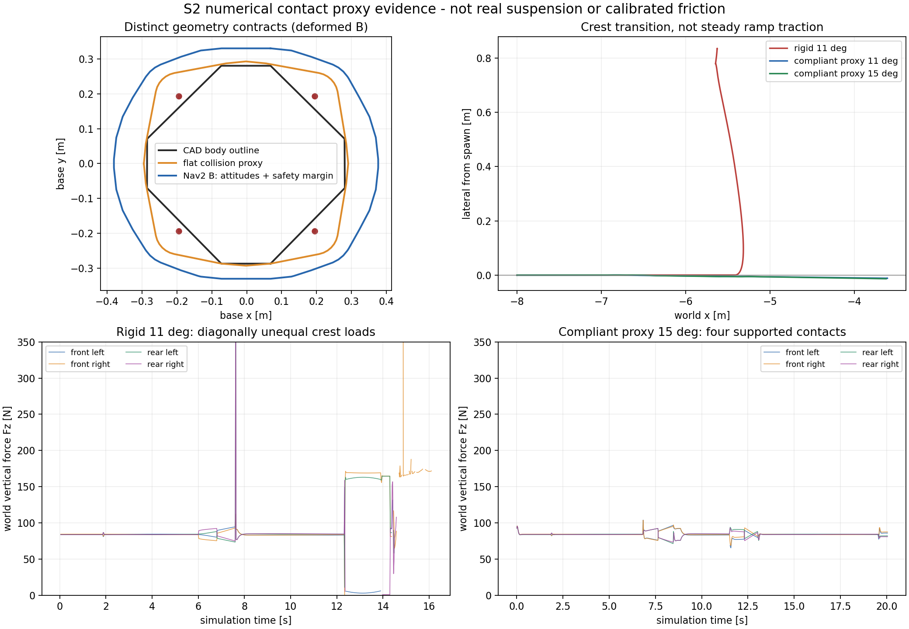

# S2：碰撞、通行与坡道模型收口

2026-10-07；继续 `experiment/new-car-simulation-baseline@89e2e9fa`，不新开分支。

**结论：Go for navigation research simulation baseline，限定为已声明的代理模型与测试域。** 可以开展静态导航、输入/TF合同、规则局部通行和11°/15°坡道上的导航软件研究。**完整2026比赛场地、新车真实机械通行、真实LIO性能、STVL动态链和比赛部署仍为 Modify / 未验证。** 不能删除这些限定后写成整车/整场 Go。

本轮没有猜测未知实车参数；新增支撑柔顺度是明确的数值接触正则化，不是从结果反推真实悬挂。机械实体完整包络仍 unknown。没有打开、下载或转换 STEP/STP；规则PDF只作为几何资料。全仓只读验证状态另见 [审计矩阵与优先级](../navigation_validation_status_20261007.md)。没有合并其他实验，没有恢复 NEU Task2，没有新 MPC 开发，没有 push。

## Go 的范围与缺口

| 能力 / 域 | 本轮判定 | 边界 |
|---|---|---|
| 新CAD代理、实际wheel/joint接触、A/B实际动态TF | Go，Research | 实体是保存的CAD车体数值+公开的collision proxies；真实轮安装、机构、外参未标定 |
| 平地四轮13种正/反组合，gimbal .6 rad/s | Go | A/B各一完整矩阵；最高测试body command为这些矩阵值，未证高速自转/电机内环 |
| 11°/15°局部连续坡→deck、反向下坡 | Go，限定数值支撑与低速fixture | .25 m/s命令；约17.6 s实际simulation trajectory，full pose保留；不是23°/43°/45°、飞坡或实车爬坡结论 |
| 1°/2°外倾地面fixture | 有界可用 | 约9.8 s驱动，2°侧偏4.49 cm；没有长时横坡漂移/高速导航验收 |
| A/B洞口代理物理通行/堵塞 | 有界可用 | open-loop collision测试，不是Nav2自主过洞，也不证明未知实际变形机构 |
| 静态Nav2/MPPI一目标，actual odom route | Go，smoke | one goal、static+inflation、oracle；不覆盖STVL、动态预测、定位后端、比赛BT |
| 完整2026全场 / 多层通行图 | Modify | 未知全场连接/轮廓；roof/deck/ramp的保守2D投影仍occupied，不伪造可通行层 |
| 2025 native mesh | 参考与局部collision可用 | 年份独立；完整场地导航/实时性能没有Go。墙边本轮10 s墙钟窗口只得到2.22 s simulation运动段，不能假称全场real-time |
| 实车机械/动力学/内部IMU与FAST-LIO性能 | 未验证 | 质量、惯量、CoM、roller、yaw轴Z、sensor RPY等仍明确placeholder；无真实bag或硬件 |

导航姿态包络声明为 **roll ±3°、pitch ±18°**。这覆盖本轮正常坡/横坡；强推已知不可过的低洞口会产生域外倾斜，不能以此 footprint 宣称那种受阻运动仍被完全包络。20 mm导航余量是Research策略，**不是测量误差、制动距离或实车安全认证**。

## CAD、机械、collision与Nav2的四个合同

| 对象 | 定义 / 当前值 | 可信含义 |
|---|---|---|
| CAD车体8点outline | 原数据保持；span .5665×.5670 m | 仅这个CAD轮廓；四轮心在其外21.8–27.2 mm。不能称完整机械实体 |
| 真实完整机械包络 | `mechanical_full_envelope_m: null`；`mechanical_envelope_certified: false` | 缺轮/roller/机构/上部完整实体资料；本轮不填假数值 |
| 物理collision proxy | CAD上下prism、gimbal圆柱、A/B sensor box、四接触球；名义平面凸包单独记录 | 与SDF真实参与碰撞的代理一致；没有把导航margin加进实体，也没有缩小代理让洞口通过 |
| navigation safety footprint | proxy全yaw sensor扫掠、姿态域、支持行程，再加20 mm margin与姿态采样数值reserve | 给Nav2保守使用；`footprint_padding=0`，避免重复margin；不是另一份“测得车体” |

新增 footprint 使用完整3D corners的roll/pitch投影、接触球球心及±30 mm数值支撑行程。圆/安全偏移采用外切32边形，姿态样本间用最大点位移上界补足，避免只包含离散采样的漏洞。独立检查实际sensor box任意gimbal yaw、3200个姿态/配置样例及球体support function：最小导航余量 **24.826 mm**，高于20 mm配置值。

最终deformed默认：A hull 140点，span **.726715×.639143 m**；B hull 120点，span **.756895×.660147 m**，最大radius分别 .381988/.382159 m。span是包含最大姿态投影的保守包络，不能把x/y span直接当所有yaw的洞口可通行判据。manifest同时保留CAD outline、flat collision footprint、navigation footprint及假设状态。[最终A](evidence/s2/final_manifest_A.json)、[最终B](evidence/s2/final_manifest_B.json)。



## 约0.75 m侧滑：接触退化，而非稳态坡面不能牵引

S1刚性四球代理在11°/15°上出现约.75 m侧滑。本轮刚性11°带有效contact instrumentation重复得到 **.83385 m**；延长控制观察也可超过1 m。稳态坡段侧偏很小，严重侧偏在**坡顶折线过渡**发生。

rigid `contact11b` 的12–14 s选段共有100个50 Hz pose：FL同时间contact95个、平均world Fz **19.67 N**（部分已近0）；FR/RL各100个、平均 **152.47/147.33 N**；RR只有20个同时间消息。平地原先四轮约84 N。FR与RL滚动切向平行，失去另一对有效支撑后水平牵引约束退化，侧滑/roll被放大。这个机制与位姿/载荷同时变化一致；**不是对实车roller行为的测量结论**。

Contact插件在没有contact时可能不发布；DDS/调度也可能漏配同时间样本。因此表中的缺消息只记为“没有同时间contact证据”，**不擅自填成精确零力**。载荷均为world Fz、不是坡面法向力。Gazebo contact system实际发送约1000 Hz，尽管sensor设置50 Hz；保留完整收到的contact，和50 Hz pose按源stamp匹配。本轮第一次sensor topic写在错误层级，未收到contact，已保存 `contact11.json`；修正到`<contact><topic>`后才用`contact11b`作载荷证据。

Gazebo/DART实际参数语义也检查了源码：本机gz-physics7.6.0将ODE的mu/mu2/fdir1交给DART；DART6.13.2将fdir投影到实际接触切平面并构造第二切向。[gz-physics SDF转换](https://raw.githubusercontent.com/gazebosim/gz-physics/gz-physics7_7.6.0/dartsim/src/SDFFeatures.cc)、[DART ContactConstraint](https://raw.githubusercontent.com/dartsim/dart/v6.13.2/dart/constraint/ContactConstraint.cpp)。依据这个语义试了axle/free方向作为fdir、rolling放第二切向；**刚性模型仍失败**，不能把更换basis写成问题已解决。

### 保留的失败对照

| rigid改动 / case | 结果 | 判定 |
|---|---|---|
| mass15 / mass60，惯量同倍缩放，11° | 约.728/.743 m侧偏 | mass改变不足以解决坡顶失载 |
| rolling mu=.5，11° | 约.779 m侧偏 | 不是仅靠增减驱动方向摩擦即可收口 |
| roller mu=.05 / .2，11°，短窗口 | 末段仍约.603/.339 m侧偏；短期看似改善不能当长期通过 | 不用摩擦“粘住”车体制造Go |
| roller .01/.05，延长11°；.05/.10，15° | 明显侧滑或停滞，.05的15°约.77 m；.10的15°仍约.36 m | 所有失败保存，未持续调参直到过门 |
| CoM z=.15，rigid | 可能停在坡顶前/无法完成deck，而侧偏变小 | “没侧滑”不等于坡道通过 |
| axle_contact_normal，rigid11° | 约1.029 m侧偏、roll约41° | 正确理解friction方向仍不能代替四点接触正则化 |

## 数值柔顺代理与敏感性

选择新增四个**被动**prismatic support joints，沿base z、±.03 m行程；k=10000 N/m、d=500 Ns/m，spring reference按已声明proxy质量进行数值预载。wheel仍绕原轮轴转动，驱动插件**只命令四个wheel revolute速度和gimbal速度**，不控制support、不设置base pose/twist、不加侧偏纠正。实际support joint position/velocity进入joint state与URDF。rigid与两种friction basis均保留为显式`physics_config`负对照。

这些值是求解器/接触的Research regularization，**不是新车真实悬挂、行程、刚度、轮载或电机模型**。它使四球更稳定跨越折线，不能作为真实机构可执行的证明。rolling=1、roller=0保持原代理值；没有靠增加侧向roller摩擦消除侧滑。

有限参数检查在同一低速15°fixture、18 s墙钟驱动窗口进行，实际simulation轨迹时长记录在JSON，约17.64–17.68 s。各项单独改动，不是所有参数的笛卡尔积，也不是概率置信区间。

| case / 改动 | 最大侧偏 m | max roll / pitch ° | full deck结果 |
|---|---:|---:|---|
| support11，默认11° | .01157 | .053 / 11.069 | 完成 |
| support11_repeat | .01153 | .053 / 11.069 | 完成 |
| support15，默认15° | .01330 | .084 / 15.093 | 完成 |
| k=5000 / 20000 | .01572 / .00905 | .107/15.060；.062/15.100 | 完成 |
| mass=15 / 60，I同比缩放 | .01239 / .01355 | .079/15.078；.088/15.097 | 完成 |
| CoM z=.15 | .01294 | .101 / 15.854 | 完成 |
| I×.5 / ×2，mass固定 | .01317 / .01336 | .084/15.045；.087/15.185 | 完成 |
| rolling mu=.5 | .01300 | .085 / 15.090 | 完成 |
| axle_contact_normal alternative | .02460 | .153 / 15.089 | 完成，但不如默认；不作为替换依据 |

默认basis的有限检查最大侧偏 **15.72 mm**；不是宣称任意质量/摩擦均可信。默认15°坡顶选段四轮同时间contact匹配均136/136，world Fz均值82.7–85.4 N；11°为99.3%–100%匹配。与rigid负对照一起支持“折线处接触载荷稳定性明显改善”。[全部结果与重跑参数](evidence/s2/summary.json)。

**base参考不能隐藏压缩：** base_link仍以CAD轮轴中心的名义地面投影定义；柔顺支撑后它不保证实时z=0。默认平地实际z约 **−3.259 mm**，参数变化deck上约.2930–.2986 m。TF/地图保持实际姿态，不平移原点以遮掩压缩；wheel中心相对base会沿support行程移动。这里的CAD wheel center是名义参考，不是另一个实时轮心真值。

## 规则几何、地图与collision优先

规则来源为用户PDF V2.2.0（20260807），SHA256 `88ae3c7d0bbd7312c8095eff2603910437e292a0b53f46c9378f26144c09a6f5`；尺寸图依据见 [规则审计](rules_geometry_audit.md)。本轮补充：

- A断面使用**700 mm局部限制贯穿throat**的保守fixture、净高260 mm；图中的800 mm上部宽保留来源说明，但未编造无完整尺寸的真实渐变轮廓。B为800×250 mm。
- `field_tolerance:=lower_clearance`将这些≥100 mm净宽/净高取规则−5%边界。B高度237.5 mm；未知小零件/动态机构公差不能借这个profile自动覆盖。
- `banked_ground`实现从场地中线向两侧外倾的1°–2°双平面fixture，sdf/PCD一致。不是将整个未认证2026场地换成这个简化地面。
- 11°/15°和10.5°坡顶/坡脚接面保持已核对的实体高度；depth .35 m、deck高 .3 m、wall厚 .1 m、位置、狗洞带坡 .06 m仍是局部实验假设。没有为完整中央7.7×10.82 m轮廓、23°/43°/45°坡或基地拓扑制造假精度。

2025 source mesh保留本地已有的native XY/floor0与2.4 m高度裁剪。试验性的connected convex coplanar retriangulation仅减少 **159/109191三角形（0.146%）**，没有足够收益，**未采用**；collision保持109191个裁剪后的native triangles，没有整场convex hull、填洞或无约束decimation。[未采用的审计结果](evidence/s2/rejected_mesh_simplification.json)。visual没有被当作碰撞真实性证据。

occupancy修复了原先尺寸相关的barycentric tolerance：按**三角形与闭合栅格cell相交**保守标记，支持退化成线的垂直墙面。独立方形换对角线/细分三角网、cell边界及带洞ring检查均通过，避免网格剖分改变障碍投影。PCD仍是mesh surface采样，非真实扫描；field/map/units/revision/hash保持manifest记录。**2D map仍全结构投影**，高架roof、deck和ramp都可能occupied；这故意不宣称多层Nav2可通行。洞口物理通过不能写成当前Nav2过洞已验证。

## 最终系统与负对照

| case | 结果 | 解释 |
|---|---|---|
| final_flat_A / B | 各13种组合kinematic与dynamic TF门通过；最大body分量误差 .000634 m/s或rad/s | wheel joint状态已兼容新增9-joint列表，不用固定len=5漏掉轮速证据 |
| final_down11 | 终点x−7.887，侧偏1.70 mm，pitch11.047° | 下坡完成并到平地 |
| final_down15_valid_spawn | 终点x−8.584，侧偏5.95 mm，pitch15.067° | 四轮出生在deck内，完成下坡 |
| final_default15 | 未加载覆盖配置、未启用contact审计的默认15°上坡完成deck | 普通入口与带contact instrumentation实验结果一致；只用于位姿/动态TF，不从空contact输出推断载荷 |
| final_down15（失败保留） | 初始后轮超出短deck，pitch达21.09°，无法正常驱动 | **错误出生fixture / 域外**；不算有效坡道通过，也不删除记录 |
| final_bank1 / bank2 | max roll1.01°/2.01°；2°侧偏44.87 mm，约9.82 s轨迹 | 已知横坡有有限漂移，未证长时/高速 |
| final_dog_A_nominal_A_deformed | 终点x1.447 | A700×260代理通过 |
| final_dog_B_nominal_A / B_deformed | 终点x1.447 / 1.452 | B800×250，两种雷达代理通过 |
| final_dog_slope | 终点x1.438，pitch8.95° | 带坡局部fixture通过；不是完整2026道路 |
| final_dog_B_lower_clearance_B_deformed | 被阻挡，终点x−.459；持续推压后偏到y3.472、roll3.57° | B净高237.5 mm小于当前B代理压缩后约239.44 mm；**不能认证可过**。持续命令导致域外倾斜，不把它列为正常导航动作 |
| final_dog_B_nominal_B_undeformed | 被挡，x−.444，未过入口 | 320 mm上部代理不会因Nav2余量或柔顺化而穿顶 |
| final_narrow_wall | y约4.121处停止向墙推进 | 侧墙实体阻挡成立，未穿墙 |
| final_native_wall | x约−11.997；2.22 s实际simulation运动段 | native wall阻挡成立；不以10 s墙钟冒称10 s实时时域 |
| final_nav2（失败保留） | action server可见但尚未active，goal rejected | 验证脚本startup race；不是有效导航结果 |
| final_nav2_active | active后goal status4、距目标.14103 m；cloud 2880点/帧、10/10 TF lookup；actual odom gate通过 | 只是一目标static+inflation闭环，cloud/TF/路由可用 |

controller现在在正确参数层明确写`odom_topic: /odometry/simulation`；smoke读取实际参数、实际Odometry订阅和唯一发布者，避免旧研究中默认`/odom`导致原生输入全零的问题。`publish_truth_tf:=false`关闭oracle的map→odom与odom→base两edge，仍发布明确truth odometry；它不会自动接入定位器或转移gimbal TF owner。当前默认没有第二套localization TF。

测试门与构建证据：本包Release构建成功，3组独立geometry tests通过；ament/CTest合计显示2条成功记录（一条实际suite及其结果包装，不是两套独立实验）。首次注册缺结果XML、后续误写选项的基础设施失败也保留；正确使用`GENERATE_RESULT_FOR_RETURN_CODE_ZERO`后0 errors /0 failures。Python编译通过。没有因审计而在旧分支重跑算法，未运行“全仓实车验收”。

## 可复现记录

durable目录保存47份结果（42 drive、3 matrix、2 smoke）、显式physics configs、7份gzip的actual pose/contact trace、关键launch/build/test日志、参数与源stamp摘要；simulation/hardware标签均明确。[证据入口](evidence/s2/summary.json)。原始完整generated scenes和其余trace保存在忽略目录 `build/s2_audit/`，生成输出SHA已在各result.manifest中冻结。默认验证脚本曾错误传`physics_config:=`空参数、导致launch未启动；已修复为仅有非空覆盖时追加参数，保存[失败日志](evidence/s2/default15_empty_arg_failure.launch.log)，并完成上述默认15°复测。

例如默认15°上坡与负对照：

```bash
source /opt/ros/jazzy/setup.bash
source install/setup.bash
ROS_DOMAIN_ID=87 GZ_PARTITION=s2_support15 ros2 run rm_new_car_simulation validate_baseline.py \
  --output /tmp/s2_support15 --field rules2026_course --mode drive \
  --spawn=-8,-4,.002,0,0,0 --duration 18 --save-trace \
  --physics-config docs/research/new_car_simulation_baseline/evidence/s2/physics_configs/support15.yaml
ROS_DOMAIN_ID=87 GZ_PARTITION=s2_rigid11 ros2 run rm_new_car_simulation validate_baseline.py \
  --output /tmp/s2_rigid11 --field rules2026_course --mode drive \
  --spawn=-8,0,.002,0,0,0 --duration 14 --save-trace \
  --physics-config docs/research/new_car_simulation_baseline/evidence/s2/physics_configs/contact11b.yaml
```

当前Go所增加的是：**在明确数值代理域内，碰撞/通行不会被过小CAD footprint掩盖，坡顶侧滑有可解释且有限敏感性支持的改善，Nav2与truth/实际joint接口可复验。** 真实机械包络、轮/roller/质量惯量和完整2026拓扑仍需独立资料；full LIO、STVL、多层自主过坡/洞、decision/serial硬件链按审计优先级逐项增加证据。
