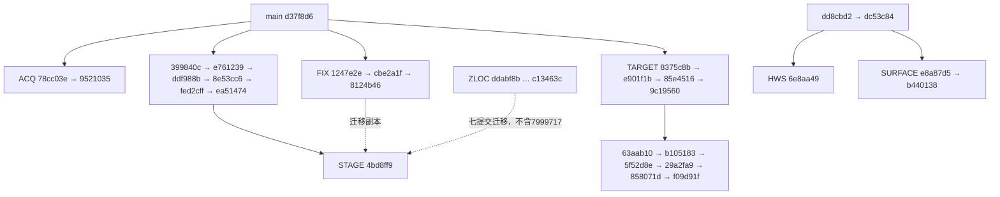

# Demo 导航集成审计与首轮准备（2026-11-11）

阶段：**Integration，软件准备**。来源为 GitHub `qiheiouo/rm2027_nav` 的本次 `ls-remote --heads` 和 `fetch origin`，
覆盖全部 13 个仍存在的远端 head、各自相对共同祖先的文件差异、相关实现/合同/证据，以及两两合并预检。
证据中的 PASS 是原版本记录；本轮实际执行结果单列在末节。没有将历史研究报告作为当前运行合同。

## 1. 决策与仓库状态

- 最新 `origin/main` / 本地 main：`d37f8d6e5ebe53533b7fc62aca8bb84392bee31b`。
- 开始时主工作区为 `codex/three-source-target-arbitration@f09d91f`，工作区及两个子模块干净；原分支保留。
- 已在同一开发工作区从 `origin/main` 新建 **`integration/demo-navigation-validation`**，无额外 worktree。
- 不复用 `STAGE`：已有 20 个分支提交，包含 Z 定位 schema/事务和组合修复，不是干净硬件基线，且与 TARGET 有实质冲突。
- 不复用 `HWS`：它是动态障碍 shadow 的研究基础，基于治理重构前的 `dd8cbd2`，不是导航集成栈。
- 本轮采用 main 既有接口，新增独立 `rm_demo_platform`；**本轮未合并任何候选**。先建立可复现的无硬件软件链路，
  待实际固件、机械标定和相应准入门满足后逐项迁入。没有改 main、push、删除分支、重写历史或修改子模块 pin。
- 此分支仅作实验集成。禁止将整个分支最终直接合入 main；通过验收的功能须整理为独立变更分别评审。

## 2. 全部远端分支快照

`main独有/分支独有` 是相对最新 main 的提交计数，不是功能数。远端引用可能随后变化，以下 SHA 固定本次审计。

| ID | 远端分支（origin/） | 最新 commit | main独有/分支独有 |
|---|---|---|---|
| FIX | `codex/confirmed-software-fixes-20261024` | `8124b4619c2cce05d110e89fd30cd4ccf4ae0f9e` | 0/3 |
| ACQ | `codex/localization-acquisition-provenance` | `952103506379c49962b8a0e4b86575113733ffd6` | 0/2 |
| DEBT | `codex/needs-evidence-closure-20261024` | `82bc20693b34c8de0c4fb7613d72368a28a14b30` | 0/6 |
| STAGE | `codex/rm2027-software-integration-staging-20261024` | `4bd8ff96bf39d5f018ec9565cd10e0b38894d238` | 0/20 |
| TARGET | `codex/three-source-target-arbitration` | `f09d91fe6c0eb506bc9ea8202310d27a874e816f` | 0/10 |
| ZLOC | `codex/zlocalization-upstream-parity-20261024` | `c13463c52963315368294f524496652ca0dab0fe` | 1/8 |
| SURFACE | `experiment/dynamic-surface-members` | `b440138f0f6074669714abee7d6602ed0fc93c23` | 1/3 |
| OMNI | `experiment/omni-chassis-feasible-region` | `d36a2414a60fac58fab22170cc0921771612fe64` | 0/1 |
| LEASE | `experiment/time-bounded-safety-lease` | `216525a9b7145bc4992bf343a272f3e5406e39df` | 0/12 |
| MISSION | `feature/competition-mission-layer-2027` | `f141eef94fab6f5044c2a7c746c5004f7ee1a7f1` | 0/2 |
| POSTURE | `feature/posture-aware-motion-constraints-2027` | `b326341f582f995870c6eda0734709a79e5757a9` | 0/1 |
| HWS | `integration/hws-shadow-substrate` | `6e8aa493d964f9d7b7ece3d90ca1e62c2cdf9080` | 1/2 |
| MAIN | `main` | `d37f8d6e5ebe53533b7fc62aca8bb84392bee31b` | 0/0 |

MAIN 是 FIX、ACQ、DEBT、STAGE、TARGET、OMNI、LEASE、MISSION、POSTURE 的祖先。
ZLOC、SURFACE、HWS 的 merge-base 为 `dd8cbd2390b12119a59eaadcc072881980d36dfc`；
ZLOC 的 `7999717` 是平行文档治理提交，不应重复覆盖 main 的 `d37f8d6`。
不存在 `integration/demo-navigation-validation` 的远端分支。
本地另有事件重规划、LIO health、correction/rebase、life-authority 中间分支，都是 TARGET 的祖先；
它们不是仍存在的独立远端 head。旧 Gitee 中的 ramp/full-terrain/hot-BT 等名字不能冒充本次 GitHub 远端分支。

## 3. 依赖图与重复/替代关系



- 图中的 STAGE 虚线是 cherry-pick 来源，不是 Git 祖先。`git cherry` 证实 FIX 三提交均有 STAGE 等价副本：
  `1247e2e→6cddf78`、`cbe2a1f→e15d08e`、`8124b46→a5354ca`。不能重复导入。
- DEBT 与 STAGE 共同到 `fed2cff`；DEBT 末端 `82bc206` 是追加证据，不包含 STAGE 后续修复。
- MISSION 的 `7be5dc6→f141eef` 在旧清债链迁为 `e761239→8e53cc6`。TARGET 是后续另一条实现线，
  patch-id **不等价**。其三来源仲裁在功能上取代旧 radar-only 主路径，但旧 temporary supply/recovery/special
  服务增量并不因此自动存在于 TARGET；需要时单独评估，不能宣称整条 MISSION 已完全 superseded。
- HWS/SURFACE 共享 `dc53c84`；后者是增量实验，末端文档补丁等价。只选择一条，不双重导入同 tracker。
- `LEASE@216525a` 包含 state-time、terminal-recourse、persistent/preacquired backup、certificate、mode-aware 等前序研究。
  最新结论 Stop；不因有代码和测试而重新投入导航控制。
- main 已有直接 `GimbalState` 输入。本 Demo 明确有相对 Yaw，因此旧“无机械角度时由 heading 推导 gimbal”的路线
  对 Demo 主路径已不适用；它不是直接输入链的前置依赖。Full-base heading 求解器仅在 `research_snapshots/`，被 COLCON_IGNORE 隔离。

## 4. 已实现能力、候选证据与 main 准入条件

每项准入都要求：来源固定、受影响软件回归、Demo 对应阶段证据、默认开关/owner 清晰；
进入 main 后还要对应 main 回归。下表附加的硬件门不能用本轮 mock 结果代替。

| 功能 | 真实代码位置/来源与现状 | 证据及限制 | 合并 main / 启用条件 |
|---|---|---|---|
| FAST-LIO / LIO adapter、单 MID360 | main `rm_lio_bringup`、`rm_localization_adapters`；FAST gitlink `9aa8c79`，Livox `ffb5c72` | 已有 bundle、TF quarantine、单雷达 launch；默认 YAML 有占位外参和第40帧 delayed zero-start，不能直接作为 Demo 标定 | 固定云台真实原始数据、稳定 raw epoch、正确 IMU/LiDAR 原点、负载/丢流记录；修复先于实机导航 |
| 固定云台 / full-base SE(3) / 动态杆臂 | main `canonical_odometry.cpp::compute_base_transform`、lio_adapter 时间 TF FIFO | `T_O_B=T_O_S inverse(T_B_S)` 已是完整 SE(3)；first_source_sample 已实现；无需重新开发一个 full-base 节点 | 完整机械链和源时间；固定初值、倾斜启动、运动与重启正反例；covariance/twist 另验 |
| chassis-heading LIO | main `compute_base_transform_from_chassis_heading` | 实际 `setRPY(0,0,base_yaw)`，丢弃 roll/pitch；不满足坡道要求。不能由文档名称判断为 Full-base | Demo 只作平地诊断对照，不作为坡道主路径；若以后需要独立算法变更再审 |
| 动态 gimbal / TF | main `gimbal_state_adapter` → JointState → RSP | 直接相对角度、valid/online/时间；main Phase2A 未转发 gimbal_use_input，配置会被默认 false 覆盖（AUD-060） | Demo 独立组合显式 use_input=true；硬件采样时间、wrap、多圈、丢流/重启验证，不派生 world-yaw 差 |
| Full-base heading research | main 隔离快照及 `docs/research/full_base_*`；不是 GitHub 独立候选分支 | 条件 Simulation Go；需要共同时间、gravity/home/epoch，存在不可观测时间错配与歧义 | 保持隔离；直接相对角度已可用时不把旧求解器作为必选依赖 |
| 单雷达 startup/GICP producer/速度路由等软件清债 | `399840c + ddf988b`，完整旧组合到 `ea51474` | 记录 single 45输入/44 canonical输出跨40帧无跳；GICP合成误差<2mm、smoother唯一出口等。完整旧组合还含旧 Mission | 采用对应最终修复、完整协方差尺度门、云帧/producer条件；不要只 pick 初版；与 TARGET 差异局部适配 |
| AMCL / GICP | main `rm_relocalization_bridge`、`rm_gicp_relocalization`；互斥 backend | AMCL旧车证据不等于Demo；generic GICP registered cloud/AUD-061 尚需上述修复 | 实际 approved 或明确实验 candidate bundle、独立初始位置/landmark、错误地点拒绝与恢复、canonical唯一owner |
| LIO 输入健康/隔离 | TARGET `85e4516` | 单元/ROS/Gazebo故障注入；无独立运动证据时同时冻结不可观测 | 正常运动误报、断流/旧时戳/跳变隔离；真实 FAST-LIO 输出合同和阈值；不得宣称能检测所有慢漂移 |
| 全局修正门/重定位事务 | TARGET `9c19560→b105183` | 等旧action终态、costmap fence、显式提交、epoch；Software Go，仿真退出仍 Modify | LIO health 在前；真实全局修正/时间与raw epoch；错误恢复不复权，成本图更新与终态完整 |
| Nav2 全局规划、MPPI | main `rm_nav_config`；已有 Omni 与仿真配置 | 主线功能已存在，暂无此 Demo 参数。旧车高速参数不适用250mm平台 | 实测轮突出包络、速度/加速度/制动、障碍云与MiniPC周期；无需重复合并已有算法 |
| 事件驱动全局重规划 | TARGET `8375c8b→e901f1b` | 真实Nav2仿真 blocked/removed/no_route 等；与Mission会话/取消耦合 | 移除障碍后恢复、无路有限重试、取消无遗留目标；失败次数不等于绝对任务deadline |
| 三来源、取消/替换/撤权/重仲裁 | TARGET 最新 `f09d91f`，祖先含 `5f52d8e/29a2fa9/858071d` | 代码 `TargetIntent`/arbiter与runtime测试；上一系统裁决 Software Go、Simulation Modify、Hardware Blocked；no_route是deadline假设缺陷，S12退出仍未归因 | Operator/Radar/Local真实producer的frame/TTL/boot/seq；最大1目标、等旧终态、life/localization换代隔离；末端物理停车独立验收 |
| 最小 Mission 临时任务 | MISSION `f141eef`；DEBT/STAGE有迁移副本 | S1–S14及仲裁软件证据，非TARGET等价副本 | 按实际任务需求选择性移植，保留新仲裁owner/终态合同；地图绑定临时任务点 |
| 动态 BT 重载 | main/TARGET都只在构造中 createTreeFromFile，未找到 reload 接口；全部远端差异无可复用热重载实现 | 修改XML或启动树选择不等于动态重载 | 当前标“未接入”；需要时定义hold→旧action终态→校验新树→原子切换/失败保留的合同，再单独实现验证 |
| Nav2内部cancel/迟到goal、LIO首点补偿 | FIX `1247e2e/cbe2a1f/8124b46` | 历史14/14 CTest；需完整Nav2 Humble overlay及重建所有相关插件；FAST pin `8fb3296` | 确认选定ROS/Nav2版本适用与依赖可恢复，回归真实取消/迟到终态；不可把外层Mission取消代替内部修复 |
| 动态障碍 | main反应式costmap/MPPI；HWS/SURFACE仅shadow tracker | 表面成员仍Research/WIP，未迁原始证据；标准MPPI不消费未来轨迹 | 先实测反应式检测/标记清除/遮挡/丢流；shadow只观测，不接运动许可。预测控制需独立价值与安全证据 |
| 动态安全租约等 | LEASE及其祖先 | 最新负结果、Stop，非部署候选 | 不纳入本轮；新硬件证据本身也不自动推翻算法负结果 |
| 坡道/全地形tracker与路由 | main只有特定地图坡面filter/仿真；旧 `1525bb5e` 仅被TARGET审计引用，当前GitHub无该head | 历史bag/replay，修复后主动实车复验0%；没有完整可接受全地形候选 | 单独恢复固定源码、许可/依赖、坡上障碍保留、真实坡面主动复验；不得直接清除未知坡面障碍 |
| Z-Localization | ZLOC；STAGE含七提交及session/covariance组合修复 `e89c596/a252578` | parity/事务软件证据；shutdown S03和真实prior/map M11仍未接受 | 只作为备选shadow；与TARGET两套session schema需统一设计；不是第一阶段AMCL/GICP必需依赖 |
| 六姿态约束 | POSTURE `b326341` | S1–S12软件，参数尚未硬件化；独立于旧Mission | Demo是否具实际姿态机构先确认；无机构时不引入六态测试参数 |
| 全向轮可行域 | OMNI `d36a241` | 17项数学测试、Stage1/2 synthetic证据；FROZEN_WAIT_CHASSIS_PARAMETERS | 实际轮径/轮序/安装角/减速比/速度界，MCU轮级约束与整车响应；不是四轮布局的猜测值 |
| 时间采集溯源 | ACQ `78cc03e→9521035`，Livox pin `24e989f` | 8个定向CTest，原始源时间/回调/发布/MCU offset记录；Instrumentation Go | 优先在正式物理采集前迁入；诊断开启吞吐、bag完整关联、真实时钟误差；时间记录不等于时钟同步 |
| MiniPC / STM / 停车 | main Docker Humble及V2 guard | 宿主目前仅知24.04/26.04待确认；同STM板不证明同固件。V2 production owner缺失，非test模式始终disabled | 真实固件commit/抓包、完整合同、独立MCU watchdog/ESTOP、host死亡和串口拔出停车计时；这是运动前硬门 |

证据入口按分支读取：FIX `docs/validation/confirmed_software_fixes_20261024.md`；DEBT
`software_debt_closure_20261024.md`、`needs_evidence_closure_20261024.md`；STAGE
`software_integration_staging_20261024.md` 及 JSON（末端另有修复，不能沿用旧P1/P2未修状态）；TARGET
`event_replanning_port_20261027.md`、`lio_input_health_port_20261028.md`、`localization_correction_gate_port_20261028.md`、
`localization_rebase_transaction_20261028.md`、`competition_mission_arbitration_system_20261029.md`、
`mission_life_authority_20261029.md`、`no_route_forensics_20261030.md`；ACQ
`docs/operations/localization_raw_acquisition.md`。这些文件存在于各自固定 SHA，不假定已经进入此 Demo 分支。

## 5. 合并冲突：实际预检结果

用 `git merge-tree --write-tree --name-only A B` 对13个head的78个组合预检；对象写临时目录，未修改index/工作树/refs。
**50组clean，28组冲突，0工具错误**。`C`=文本冲突，`.`=文本可合，`—`=自身；文本可合不证明运行兼容。
矩阵对照上节ID，下面列出关键语义冲突。正式选择提交后还须对顺序集成结果再检，不能把两两结果当累积结果。

| |FIX|ACQ|DEBT|STAGE|TARGET|ZLOC|SURFACE|OMNI|LEASE|MISSION|POSTURE|HWS|MAIN|
|---|---|---|---|---|---|---|---|---|---|---|---|---|---|
|FIX|—|.|.|.|.|C|.|.|.|.|.|.|.|
|ACQ|.|—|.|.|.|C|.|.|.|.|.|.|.|
|DEBT|.|.|—|C|C|C|C|.|.|C|C|C|.|
|STAGE|.|.|C|—|C|C|C|.|.|C|C|C|.|
|TARGET|.|.|C|C|—|C|C|.|.|C|C|C|.|
|ZLOC|C|C|C|C|C|—|.|C|C|C|C|.|C|
|SURFACE|.|.|C|C|C|.|—|.|.|C|.|.|.|
|OMNI|.|.|.|.|.|C|.|—|.|.|.|.|.|
|LEASE|.|.|.|.|.|C|.|.|—|.|.|.|.|
|MISSION|.|.|C|C|C|C|C|.|.|—|C|C|.|
|POSTURE|.|.|C|C|C|C|.|.|.|C|—|.|.|
|HWS|.|.|C|C|C|.|.|.|.|C|.|—|.|
|MAIN|.|.|.|.|.|C|.|.|.|.|.|.|—|

- STAGE↔TARGET：25个路径，含 `LocalizationStatus.msg`、Mission C++/配置/测试、`map_odom_from_global_pose.cpp`、
  adapter/Nav2构建文件与合同。两种定位session事务和旧/新仲裁都有语义差异，禁止“选ours/theirs”整体覆盖。
- MISSION↔TARGET：14个路径，含Mission实现、interfaces、pursuit、树入口及合同；临时任务不能借冲突解决静默丢失。
- DEBT↔TARGET：18个路径；清债中的独立定位/启动/速度修复需与新链分别核对，不能整体回退新仲裁。
- MAIN↔ZLOC：17个文档路径冲突，主要是平行治理历史；STAGE已记录七提交迁移方法。代码无文本冲突也不消除会话语义问题。
- HWS/SURFACE↔TARGET主要是topic合同冲突；并不证明tracker可直接接到controller。
- FIX、ACQ分别与TARGET无文本冲突；二者与STAGE也可文本合并，但FIX已存在等价副本。

外部依赖本轮只读核对：Livox `24e989f` 已由远端ACQ head公布；FAST `8fb3296` 不在本次公布head列表，
本地也非已公布 `ae5bef29` 的祖先。旧STAGE记录其发布门未关闭；此处不能仅由head列表断言对象绝对不可获取，
采用FIX前须验证从远端可恢复目标gitlink。没有为审计而vendor或改pin。

## 6. STM 合同：复用与实际缺口

权威基础：[serial](../contracts/serial_protocol_2027.md)、[competition_v2](../competition_v2_protocol.md)。
旧 `hpm_crc_v1` 已知41字节反馈只有yaw等状态，没有相对云台角、采样序号/时间和完整姿态；不能假定足够。
V2已有字段足够承载直接相对Yaw，**不新增Demo协议**；但仍需下位机确认实际协议/firmware，且完整chassis attitude缺失。

| 信息 | 既有合同 / 需确认内容 |
|---|---|
| 相对云台Yaw | V2 `0x82`：float32 relative_yaw、同采样rate、uint32 sample_sequence、uint32 mcu_time_ms、valid/online；rad/rad·s⁻¹，零点对base +x，绕base +z逆时针正，[-π,π)；Demo两IMU解算/正式编码器共用这一语义 |
| chassis heading | V2 `0x85`：yaw/rate、seq/tick/reset_counter；ROS补heartbeat boot_id。仅世界参考yaw，不是完整姿态或机械Yaw |
| chassis IMU / attitude | **现有V2没有完整载荷**。需双方确认未来也可沿用的扩展：quaternion顺序/参考世界与gravity定义、IMU→base标定、rad/s角速度、m/s²加速度及是否含重力、valid/online、采样seq/tick/boot/reset。本轮不占用新type编号、不猜字节布局 |
| 输出速度 | V2 `0x01` vx/vy m/s、wz rad/s，base x前/y左/z逆时针，enabled；轮级解算归STM，不新建Demo底盘协议 |
| 编码/校验 | 小端IEEE754；V2包头52 4d、version2、type、长度、uint16包序号；CRC16/Modbus 0xA001/0xFFFF，version到payload，低字节先。与HPM payload-only CRC不可混用 |
| 时间 | header必须代表源采样时刻。现有host用heartbeat接收时间估算offset，不是已验收同步；MCU wrap/重启、USB排队、ROS跳时、LivoxPTP/GPS/fallback都要采集验证 |
| 频率/超时 | 现有host命令100Hz、命令0.2s、gimbal/heading0.2s、connection0.75s；mock gimbal50Hz/heading100Hz；这些不是STM已承诺频率。按误差/延迟预算确认实测值 |
| 停车 | production V2 guard当前缺正授权owner；test lease仅dry-run，不能用它开实物。host零帧不等于停车；MCU必须在独立watchdog/ESTOP/manual-disable下停止，SIGKILL/USB拔出也有效，并拒绝恢复旧命令 |

底盘roll/pitch必须保留。若直接相对Yaw来自两IMU，下位机也必须用相对旋转及已知机械轴解算，
不能在坡道上简单减两个world Euler yaw。角度来源不同不改变上层GimbalState合同。

## 7. 三维定位与owner方案

记 `F=T_base_axis`、`K=T_gimbal_sensor`，均为实测固定SE(3)，则：

```text
B(t) = F · Rz(theta_relative(t)) · K
T_odom_base(t) = T_odom_sensor(t) · inverse(B(t))
```

对 sensor-initial raw parent，main已有 `first_source_sample`：冻结
`A=B(t_ref)·inverse(raw(t_ref))`，输出 `A·raw(t)·inverse(B(t))`。
这定义首帧base参考，**不自动证明odom重力对齐**；倾斜启动需要独立接受参考方向，不能把它称作已通过坡道世界姿态。
backend保持数值基准（禁delayed zero-start），重启backend/adapter成套处理。
平移杆臂在上述乘法中随局部轴转动，不能只减世界yaw或只改child_frame。
`T_odom_sensor`的估计质量/deskew不由坐标变换保证。

唯一owner：RSP负责base→gimbal→LiDAR/IMU；lio_adapter负责odom→base与canonical odom；
map stub仅软件夹具，真实重定位由既有global bridge负责map→odom，AMCL/GICP不发该TF；
Mission是任务goal owner；serial只传输/最后授权边界，不发布TF/goal。所有动态机械TF用source stamp，失效不补零角/最新角。

## 8. 集成次序与需要的文件

1. **本轮** main + 独立Demo bench：真实生产adapter/串口codec与mock输入联合运行，复核倾斜姿态、非零角度/杆臂及失效暂停；安全默认零节点。
2. **物理采集准备** ACQ，落实firmware/时钟/实测模型，先串口zero-disabled和MID360被动采集；可复用其bag QoS与metadata。
3. **Phase1固定云台** 选择清债链中的最终startup、gimbal参数透传、GICP producer、source lease/协方差/速度路由修复；
   FIX是否必需取决于确认的FAST/Nav2版本，先关闭依赖门。固定机械角并独立实测，不用软件placeholder冒充锁定。
4. **Phase2直接角度** 测准同一完整SE(3)链、源时间和杆臂；不导入平面heading推导主路径，先无运动输出观察，再受控运动。
5. **Phase3** 顺序采用TARGET前序链：事件重规划→LIO health→correction/rebase→Mission/life→三来源；
   复核每步接口/单owner/终态及硬件末端，不一次merge整个候选集合。
6. 其余Z、posture、omni、dynamic shadow、ramp tracker按需各自加入；Stop研究不纳入。热BT无现成实现，独立立项。

本轮文件：`src/rm_demo_platform/{CMakeLists.txt,package.xml,README.md,launch/demo_bench.launch.py,
config/bench.yaml,urdf/bench.urdf,scripts/check_bench.py,scripts/run_bench_container.sh}`；
本报告为单一审计/方案/结果记录，runtime_profiles和文档地图只加索引。
后续仅在数据齐备时添加 `demo_measured.urdf.xacro`、真实机械YAML、MID360 IP/IMU外参、
Nav2/MPPI小车配置、硬件launch和session记录；不先复制整套正式车配置或虚构生产参数。
250mm圆仅图纸中心底盘，轮突出尺寸未知，**不能直接用0.125m robot_radius授予运动**。

## 9. MiniPC 与证据采集

复用项目 `rm2027_navigation:humble`（本机现有image ID `81b325bebf2f`），容器内Ubuntu/ROS由Dockerfile固定；
宿主Ubuntu24.04/26.04尚待确认，无需宿主ROS与容器同版。宿主内核/NIC/PTP/USB驱动、udev权限、
CPU架构/内存/散热/调度仍影响运行；MiniPC确切型号/资源本仓未提供，不编造。
本轮bench脚本无网络、私有IPC、不映射设备、非root、源码只读；输出到独立忽略目录，不source现有Jazzy install。
后续真机配置按已知硬件给出稳定`/dev/serial/by-id`、baud、设备最小权限、专用NIC/IP/PTP、
独立ROS_DOMAIN_ID、地图/bag数据挂载和磁盘预算；不默认privileged或开机自动运动。
Jazzy/Harmonic仿真与Humble硬件栈分容器/域，不混source；确认最终控制软件版本后再做MiniPC负载验收。

物理session至少记录：源branch/commit与实际dirty diff、firmware、机械标定版本、容器/ROS版本、地图bundle、
平台与操作人、急停/watchdog结果、source/receipt时间和seq/boot/reset、启动姿态/home、试验动作与结果。
bag白名单按阶段选Livox原始CustomMsg/IMU、源时间诊断、Gimbal/Heading/未来chassis IMU、
raw/canonical odom、TF/TF_static、localization status、cmd_vel与serial/guard、Mission/actions。
原始采集可包含canonical用于对照，但**回放前必须过滤原canonical TF/odom与命令**，不能向真机重放。
bag/重复日志不进Git，只保留小结、关键配置与必要最小证据；长数据外部保存引用。

## 10. 分阶段测试清单与判定

### Phase 1 固定云台

- [ ] 固件/profile/CRC/单位/方向核对；通信读取、zero-disabled、独立急停、host退出/断联watchdog，先证明可停。
- [ ] MiniPC稳定环境、单MID360 IP与原始云/IMU速率、源时间与连续bag；chassis IMU参考/valid/reset可观测。
- [ ] 实测模型、机械固定角、TF唯一owner；raw parent/zero-start、LIO无输入/失效行为明确。
- [ ] 真实FAST-LIO初始化、建图、长时漂移、平地/坡道固定云台与倾斜启动；候选地图人工检查后按实验policy使用。
- [ ] AMCL/GICP分别从不同初位与误seed重定位，错误/退化/数据丢失不复权；只一个map→odom。
- [ ] 独立台架验证直行/侧移/自转/组合/停车；随后低速Nav2与Omni MPPI、真实footprint/障碍/到点/资源记录。

### Phase 2 旋转云台

- [ ] 相对Yaw零点/符号、wrap/多圈、有效性、时间序号/boot；两IMU解算与物理角对照。
- [ ] 静止底盘旋转云台时base位姿不绕杆臂画圈；底盘转/云台固定、两者联合运动分别验。
- [ ] roll/pitch/yaw全旋转、非零外参/杆臂、平地/上坡/下坡/坡顶坡底快速变化与倾斜启动。
- [ ] 精确源时间TF配对、队列超时/丢角/陈旧角/boot/reset拒绝，禁止用最新yaw填补；LIO deskew质量独立评价。
- [ ] 先被动录制/离线分析通过，再进入低速受控动态导航；hardware与software结果分别记录。

### Phase 3 自主导航与系统

- [ ] 反应式动态障碍、遮挡/丢点/地图残影；重规划阻断→移除→到点、规划失败恢复、无路有限重试。
- [ ] Mission模式/BT、取消/替换/迟到接受、旧action终态交接；Operator/Radar/Local优先级/过期/撤权/重新仲裁。
- [ ] 定位异常→停止、显式恢复→新session、旧消息/结果不复权；成本图屏障和移动/静止目标分别验。
- [ ] 热BT仅在实现与切换合同存在后执行；目前列缺项，不能勾通过。
- [ ] 串口故障/节点SIGINT/SIGKILL/MCU重启、物理停止与恢复拒旧命令；长时CPU/内存/温度/周期/漂移/bag容量。

停止条件：重复owner、时间语义不明、错误方向、缺急停/授权、停止不受控、失效仍运动、关键输入造假/过期。
通过阈值由已测平台、任务尺度与硬件误差预算确定并在测试前记录；不从历史旧车或软件fixture复制成实车标准。

## 11. 验收边界与本轮结果

单MID360不验收双雷达融合/外参/同步/遮挡互补/失效冗余。正式车仍须重验动力学/质量惯量、
高速/制动/坡道/振动、双雷达、绝对编码器角度、裁判完整联动与比赛硬件链路。

本轮可运行目标为 **无硬件输入的软件集成bench**，不是FAST-LIO实测、真实MiniPC验收、导航实车闭环或Hardware Go。
真实固件、机械、完整chassis attitude、最终运动授权仍是明确缺口；不能在未知合同下把零授权守卫关闭来制造“可动”。
执行入口：`src/rm_demo_platform/scripts/run_bench_container.sh check`。复用上述Humble镜像，
五个相关包（interfaces、description、localization_adapters、serial_driver、demo）独立构建，
Debug、2CPU/3GiB、构建并行上限2，不使用工作区原有Jazzy产物。

| 本轮实际执行 | 结果 |
|---|---|
| 五包局部构建 | PASS；首次完整构建约2min29s，修正测试编排后的增量构建1.78s；不是性能benchmark |
| 既有数学/codec回归 | 4个CTest target：canonical_odometry、protocol、competition_v2_protocol、competition_v2_reference；colcon汇总49 tests，0 errors/failures/skipped |
| 默认launch | PASS：零节点，正常退出；检查域内只有checker |
| 相对Yaw→TF→SE(3) | PASS：365条canonical样本，base=(1,2,0.3)m、RPY=(0.12,0.22,0.4)rad，非零安装姿态/杆臂，frame正确 |
| TF边界 | PASS：5条期望边，/tf恰为stub/adapter/RSP三个publisher，/tf_static仅RSP，canonical odom单publisher；无driver/Nav2/Mission。Humble回调不提供逐消息GID，边的责任结合既有节点源码核对，不伪称逐边DDS来源追踪 |
| 相对Yaw断流 | PASS：374条joint样本后停止；稳定观察末尾joint与canonical已暂停>1s，raw odom仍新鲜；不以停止全部节点伪装失效隔离 |
| 命令与CRC | PASS：注入非零generic cmd_vel后，1336个V2 chassis帧仍为CRC有效的zero-disabled；未开启test lease或任何真实串口 |
| 生命周期 | PASS：launch进程正常响应SIGINT、返回0；测试容器退出。没有物理IO或真实运动 |
| 文件检查 | Python/shell语法、XML/YAML解析、新文档相对链接、diff空白检查通过 |

首次验证**不计通过**：colcon test未给源码发现路径导致0 packages/0 tests；随后checker使用了Humble不支持的
双参数订阅回调而失败。补齐base-paths、改为图API检查publisher集合后，以上同范围验证完整通过；
没有改生产算法、放宽源超时或删除关键断言。原始与复跑日志在忽略目录
`build/demo_bench_check.log`、`build/demo_bench_check_rerun.log`、`build/demo_validation/`；长期必要结论保留本节即可。

最终裁决：**SOFTWARE_BENCH_PASS；真实FAST-LIO/STM/Nav2自主运动链路仍待硬件合同与标定，不授予Hardware Go。**
当前包只准备软件基础，不声称20项候选已经集成或三阶段已验收。新增内容作为一个本地提交保留，未推送；
来源仍为本节和第2节固定的main/候选快照。无需清理worktree，本轮未新建worktree；忽略的构建输出可按需保留。
