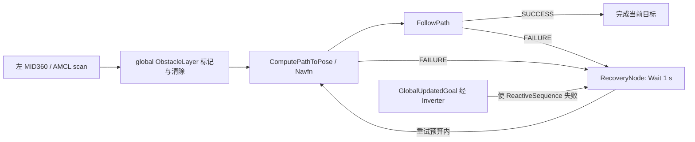

# 事件重规划选择性迁移与旧车遗漏能力审计（2026-10-27）

阶段：Integration。基线 `8375c8bdf98fbae323c18949a45db86f722fbe5f`，
分支 `codex/event-driven-global-replanning-port`；审计比较对象固定为
`main@d37f8d6e5ebe53533b7fc62aca8bb84392bee31b`。没有合并、修改或推送 main。
本报告不把历史 `main-new-car` 审计表中的“当前”沿用为今天的事实。

## 旧实现的实际语义

只读恢复 `fix/old-car-global-dynamic-replanning@9b608b9dcd0c3c2d736be4a9841fafe4780d13fe`，
并确认它是旧 `main-old-car@82017945` 的祖先。权威入口是该提交的
`src/rm_nav_config/behavior_trees/old_car_replan_on_follow_failure.xml`、三个 STVL YAML、
`test/test_old_car_global_dynamic_replanning.py` 和
`docs/validation/old_car_global_dynamic_replanning_20260806.md`。

- `Sequence(ComputePathToPose, FollowPath)` 在 FollowPath RUNNING 时保留第一次的路径。
  FollowPath FAILURE 向 Sequence、ReactiveSequence、外层 RecoveryNode 传播；Wait 成功后
  再从 ComputePath 开始。规划失败也走同一条恢复边。不是“障碍出现立刻主动发第二个目标”。
- `number_of_retries=6`，`Wait=1 s`；没有另一个 cooldown timer。没有周期 RateController、
  IsPathValid、Spin、BackUp 或清 costmap。路径被挡但控制器尚未失败时不会立即重算。
- **首次条件细节**：Nav2 的 GlobalUpdatedGoal 首 tick 返回 SUCCESS，Inverter 因而失败。
  原 XML 会先走一次 Wait，并消耗一次 recovery 额度；目标更新也走此边。本轮 Jazzy
  实际执行日志复现了这个行为。旧结构测试没有检查该语义，不能把“6 次重试”简单当作
  “每次目标必有 7 次 ComputePath”的实测结论。
- 原 PoseProgressChecker：4 s 内平移 0.15 m **或**旋转 0.50 rad；目的是避免 5 cm / 10 s
  旧判据被障碍前小摆动持续续期。这些数值属于旧车调参，不进入新车候选。
- global costmap 是非 rolling 的全图 static + obstacle + inflation；动态层订阅
  `/localization/scan`，marking/clearing、`inf_is_valid=true`，持久 2 s、预期间隔 .2 s，
  近距 .45 m、远距 6 m。local STVL 与全局动态层不是同一个输入配置。
- 实车正例依赖默认 AMCL 左 MID360 链和严格 SE(3) 去畸变投影。双雷达组合的 global scan
  仍来自左侧；右侧融合点云主要进入局部地图，所以“仅右雷达看见”不保证全局绕行。
- 历史“7 项通过”是 colcon 汇总口径。对应 pytest 有 **6 个测试函数**：三 profile 的
  动态全图层；保留 Navfn/矩形 footprint；进度判据；BT 失败重试且无周期/运动恢复；
  水平无限远清除 scan；默认 AMCL/左雷达入口。它们是配置/结构合同，不是 7 个实车场景。
- 历史现场有一次受控障碍阻断 → 停止 → 新全局绕行路径 → 绕过的正向反馈；不等于
  任意障碍、双雷达所有遮挡、全场比赛或新车硬件通过。

此前新 main 没有它的原因是重建基于冻结的新车主线并按清单选择资产，未整体迁入旧车
运行源码。[迁移来源记录](../migration_provenance.md)明确只保留相关历史证据。
在 `d37f8d6` 中核对：无此 BT 文件/安装目录，统一仿真尚未存在，Nav2 YAML 没有这套
事件策略；`8375c8b` 的统一仿真仍只加载 static/inflation。

## 实际迁移及所有权

迁入通用的 plan-once/follow/failure/wait/recompute 语义与 local/global 动态障碍参与。
Jazzy 候选配置为平移进度 .10 m / 3 s、Wait 1.5 s、3 次 recovery；Mission 外层目标
尝试为 1。耗尽后必须新意图或显式操作重新启用，不自动重置整个 BT 无限循环。
采用 5 cm 地图两格的平移进度，纯旋转不续期；参数仅是本次软件候选，不是硬件定值。

用户另行批准后，从已有 `feature/navigation-intent-arbitration-2027@7be5dc62` 选择性引入
Mission 的取消终态交接、原子 PursuitCandidate、对应 planner/组合入口与回归。
没有合并该分支，也未复制 legacy 组合入口的策略变更。新增 session 撤销与结果检查：
新 epoch 即使 producer 相同也允许 sequence 重启；取消旧 action，迟到 SUCCEEDED
只释放旧事务，不推进旧巡逻；终态前不发送替代目标。详见
[唯一仲裁合同](../contracts/navigation_target_arbitration_2027.md)。

移除旧 GlobalUpdatedGoal 判断：新目标由 Mission 的 cancel → terminal → replace
处理，BT 无第二个 NavigateToPose client。Nav2 的内建 goal_pose self-client 是框架内部
入口，已重映射并移除 RViz GoalTool；实测外部 action client 只有 Mission。

明确没有迁入旧 footprint、外参、左/右雷达布局、旧话题/范围、20 Hz、高速 hold、
serial_task、整套旧 YAML 或其他审计候选。沿用本分支 CAD footprint、车体、物理接触、
Navfn、MPPI、TF 与最终 smoother owner。Humble BT.CPP 3/Jazzy BT.CPP 4 采用按发行版依赖；
本轮仅在 Jazzy 实测。

感知使用 **同位置水平 Gazebo 扫描夹具**，不是把 3D MID360 的某条倾斜线冒充水平 scan。
地图动态层在该夹具下实际标记/清除。定位状态也是显式 truth fixture，不能作为真实 LIO
健康证据。启动方法与完整脚本见 [统一仿真操作](../operations/simulation.md#事件重规划候选)。

## 本轮执行结果

8/8 受影响构建包成功；根目录发现 22 个源码包，无重复，8 个安装 prefix 与资产检查通过。
下表所有物理场景均退出干净（无节点异常、无残留）；重规划数指**同一个 NavigateToPose
内部初次规划之后的 ComputePath 次数**，不把 Mission 合法替换目标记为内部重规划。
时间为探针观测的墙钟时间，每个场景是一次受控运行，不是统计可靠性试验。

| 场景 | Navigate / Compute / Wait 次数 | 内部重规划数；原因 | 结果 |
| --- | --- | --- | --- |
| normal static | 1 / 1 / 0 | 0；无 failure | 到达，误差 .128 m，无初始伪 recovery |
| global path blocked | 1 / 2 / 1 | 1；FollowPath FAILURE | 观察到停止；失败后 1.628 s 新路径；绕行到达，误差 .093 m |
| no alternative route | 1 / 4 / 3 | 3；4 次 FollowPath FAILURE | 封闭目标无物理出路；耗尽后 goal_retry_limit；再观察 5 s，所有 action 数不再增长 |
| obstacle removed | 1 / 2 / 1 | 1；FollowPath FAILURE | recovery 等待时移除实体；1.728 s 得新路径并到达，误差 .131 m |
| dynamically local avoidable | 1 / 1 / 0 | 0；无 failure | 初始路径生成后插入小障碍，MPPI 实测侧移 .450 m，通过且到达，误差 .051 m |
| repeated FollowPath failures | 1 / 4 / 3 | 3；4 次 Failed to make progress | 显式注入不可能满足的进度条件；耗尽后保持，无 storm |
| session during recovery | 2 / 2 / 1 | 0；旧 recovery 被取消 | 新 session 独立规划到达 .091 m；旧结果拒绝计数 1 |
| return-home during recovery | 2 / 2 / 1 | 0；Mission home 抢占 | 旧目标 CANCELED 后才发送 home，到达 .123 m |
| safety during recovery | 1 / 1 / 1 | 0；定位测试证据停止续租 | safety gate closed、取消、末段速度为零；保持 5 s 无新规划 |
| new goal during recovery | 2 / 2 / 1 | 0；track ID / pose 替换 | 旧目标终态先于替代目标，新目标到达 .116 m |

无路场景的遮挡使全局地图仍给出候选路径，实际 FollowPath 4 次失败；这验证有限失败
终止，**不是**“扫描能识别所有隐藏封闭面”的证明。session/home/new-goal 的旧 CANCELED
与新 goal 首次观察时间分别是 15.612→15.680、16.756→16.834、15.815→15.894 s。
替代规划在本次观测中已属于新 action，旧 action 的 Wait 不再继续执行。

阻断路径最小证据（单位 m，map frame）：初始路径 199 点，`(-3,-3) → (2,-3)`，
y 范围 `[-3.000,-2.997]`；新路径 228 点，y 范围 `[-4.968,-3.000]`，
抽样 `(-1.45,-3.05) → (-1.45,-4.01) → (-1.08,-4.81) → (-0.22,-4.81) →
(0.53,-4.23) → (1.26,-3.63) → (2,-3)`。障碍为中心 `(-.4,-3)`、尺寸 `.5×2.4×1 m`
的实体，初始路径生成后才加入世界，没有改静态地图或预先放置假占用格。

额外必要回归：

- 真实 Mission + 模拟服务器仲裁测试通过（1 个组合测试，33 个目标、30 次取消，最大活动
  目标数 1）；包含安全 veto、HP/home 优先级、目标抖动/身份替换、晚接受、待取消成功不推进。
  新增同 producer/new epoch/sequence 重启两次，pending 与 active 的迟到 **SUCCEEDED**
  均丢弃，stale counter=2，巡逻索引不变。该测试是故障注入，不冒充物理验证。
- 既有三点 Mission/Spin 配置与运行回归：7 passed。
- 默认 baseline 统一 smoke 再次通过：地图/点云/TF owner/controller odom/behavior 路由、
  导航（误差 .129 m）与 clean shutdown；事件选项没有改变原默认导航入口。
- 本轮不重新测试 GUI，不运行全仓 Humble/硬件矩阵。

可复现命令：`tools/build_simulation.sh`；source 后运行
`python3 src/rm_new_car_simulation/scripts/validate_event_replanning.py --scenario <name> --output /tmp/<run>`。
仲裁/Spin 使用 `python3 -m pytest` 执行 `src/rm_competition_mission/test/` 对应三个文件，
设置 `RM_COMPETITION_MISSION_SOURCE_DIR` 为该包源码绝对路径。
当次完整临时记录目录：`/tmp/rm2027-event-v2-{normal,blocked,no_route,removed,repeated,session,home,safety,new_goal}/result.json`，
局部场景使用 `/tmp/rm2027-event-v3-local/result.json`；仲裁日志
`/tmp/rm2027-arbitration-cooperative.txt`；默认回归 `/tmp/rm2027-event-baseline-regression/result.json`。
2026-10-28 恢复收尾时，上述 `/tmp` 日志与 JSON 已不存在；本轮结果依据此前实际执行与
工具回读记录。版本资产保留本表、路径摘要、实现与复现脚本，不把临时路径视为持久证据。
当日另已核对无 Gazebo/Nav2/Mission 残留进程。

观测来自真实 Gazebo 物理模型、Nav2 controller/planner/BT 与 Mission。记录 action UUID、
状态转移、BT failure、全局路径点列、odom、Mission 状态及进程退出。`repeated` 使用显式
进度失败注入；其余物理场景使用正常进度阈值。没有直接发送第二个 NavigateToPose 的测试器。

第一次阻断探针同步运行 Gazebo 创建命令，导致自身 candidate 续租暂停，触发 Mission
取消/重发；该次“绕行成功”已判为无效事件重规划证据。修正为创建障碍期间继续处理 ROS，
并要求同一个目标内出现 FollowPath FAILURE。另发现并修复 GlobalUpdatedGoal 初次消耗
重试额度、Python 信号在 pybind 取消息时触发退出异常。最终证据使用这些修复后的版本。

仲裁 fake server 的同步 sleep 在 Jazzy Python executor 中造成健康输入饥饿；改成合作式
等待后，既有优先级回归及延迟 session 结果回归通过。没有放宽任何生产安全租约。

## 定向遗漏能力表

A = Validated omitted capability；B = Mature but evidence incomplete；
C = Research / shadow only；D = Superseded；E = Old-car-specific。
“没有等价”按当前 main 的源码/接口核对；历史证据按固定旧提交读取，本轮不重跑旧硬件。

| 类别 / 能力 | 分支 / commit | 历史最强证据 | `main@d37f8d6` 状态与缺口 | 推荐动作 |
| --- | --- | --- | --- | --- |
| **A 事件全局重规划** | `fix/old-car-global-dynamic-replanning@9b608b9d` | 受控旧车阻断绕行；6 个配置测试函数，colcon 汇总 7 | 无事件 BT；本候选已选择性迁入，main 未变 | 审阅本候选，随后做新车硬件门 |
| **A LIO 输入健康与坏输出隔离** | `fix/old-car-fast-lio-high-spin@46c521b2` | 真实 native20 包 130.29 s；连续高速 52.751 s、峰值 7.273 rad/s；1303 health 样本 healthy，raw age P99 38.6 ms；同时保留 native50 积压失败 | adapter 有有限值、TF 对齐及 heading reset latch，但没有 OdometryInputHealthGate 的 stale/future/silence 锁存、fresh consensus、post-backlog translation 检查与诊断 | **下一优先 selective port** 通用输入门；独立新车 raw stamp/源时钟/恢复验证；不复制 20 Hz 或旧阈值 |
| **A correction gate / fault latch** | `fix/old-car-amcl-correction-gate@e15b6bda` | 最终现场 4 次错误 correction 被隔离，4 次 recovery completed，人工确认恢复位姿正确；此前低协方差错峰有反例 | 当前 bridge 有时效、epoch、源 odom 近邻对齐，但没有这套可信 correction 创新锁存门 | 选择性迁移可信修正隔离；新车重新定参数，保留错误首次基准/小步漂移边界 |
| **B 自主 reseed / twist debounce** | 同 `e15b6bda`，后续在 `46c521b2` | 软件状态机与短 twist 尖峰回归；现场 4 次恢复，但困难事件需 11 次 reseed | 无对应停车保持、可信预测 reseed、连续一致恢复；普通 lease 恢复不等价 | 与 correction gate 分层迁移；仍缺 ≥10 次独立重复、恢复长尾与最高速结束立即 home，不宣称普适恢复 |
| **B LIO jump / bounded rebase** | `fix/old-car-lio-jump-recovery@51e3b233` | 对 R03 约 10 m LIO 跳变的故障分析，有限播种/重基准软件回归；文档保留 R03 三次主动恢复待验收 | 无 rebase 状态机；当前源时效保护不能修复几何跳变 | 先验证坏 LIO 隔离，再单独决定是否迁重基准；不得把 46c 的健康高速包当作故障恢复验收 |
| **B Ramp shared tracker / full-terrain routing** | `fix/old-car-ramp-live-tracking@1525bb5e` | 123.937 s / 84325 消息真实 bag；修复同包两次 replay；50 s 平地零误删；两管线同 plane 删除帧 4295/2252；软件回归 | main 仅有旧规则 ramp filter；无该共享自动 tracker/入口 | 候选选择性接入前补坡面障碍保留；**修复后主动实车复验 0%**；原包无 cmd_vel/plan，不能证明坡道控制闭环 |
| **B Offline match strategy profiles** | `feature/offline-match-strategy-profiles@f8e3c3c`（后续 ref `2c0620c1`） | catalog、成对 BT/YAML、地图绑定/净空校验/安全默认与切换工具已实现；11 个测试函数源码（含参数化） | main 有单份 mission YAML/树，无 catalog/策略文件校验与赛间离线选择；未找到场地切换闭环证据 | 后续按需求迁移；本轮仅核代码与证据，不把测试源码当作现场验收 |
| **C Navigation Integrity** | `feature/navigation-integrity@64870dc7`（实现 `167f28a6`） | shadow 模块，早期 13 tests + 1 skipped、后续 Linux 接口链；有 field plan | main 无模块；没有该模块自身正常/故障区分的实车接受结果 | 保持 shadow；不能借其他 tracker 的实测冒充 integrity 验收 |
| **C GICP degeneracy** | `feature/gicp-degeneracy-gate@6a38b745`（实现 `9ba73c08`） | 近似 point-plane Hessian、overlap/eigen/condition 单测；后续合成重复场景有 full-rank 错 basin 仍接受反例 | main 有 seeded GICP 基础，无质量增强版本；不是已验证 place correctness | 不迁 production 阈值；Hessian 不是校准 covariance，也不证明地点正确 |
| **C semantic sidecar / 路径与动态净空 shadow** | `feature/semantic-region-path-contract@f60f62ee`；后续 `902261de` | schema/软件链与 Linux mock 测试；任务消费者未形成正式闭环 | main 无完整 semantic path 消费链；已有地图/狗洞基础不等于此能力 | 保留 research，不误列为已验证漏迁 |
| **C dog-hole semantic / routing 扩展** | `feature/new-car-dog-hole-sim@3e7e0ae3` 及 semantic 路线 | 合成洞口/局部仿真；当前缺 Mission 集成与真实机构闭环 | main 已有 rm_dog_hole 基础，但还是互斥 action owner 的仿真候选 | 不追加第二个 owner；扩展保持 research |
| **D 旧 Bool 有效性与基础 TF 对齐** | 上述旧定位分支的通用旧接口 | 曾有旧车闭环；Bool 本身没有生产者租期 | main 的 LocalizationStatus 已具 producer/epoch/sequence/source deadline/steady lease，bridge 有源时刻对齐与过期拒绝 | 保留新合同，不用旧 Bool/刷新 TF 时间戳覆盖它；不意味着 input-health/correction gate 也已具备 |
| **E 旧车专用运行策略** | `46c521b2`、`9b608b9d`、`feature/old-car-dog-hole-entry-pause@85d5f7d7` | 旧 MID360 20 Hz、左 scan、旧 footprint/外参、高速 correction hold、HPM/serial_task、入口暂停均依赖旧硬件或协议 | 新车布局/固件/授权合同不同 | 不照搬；仅保留历史边界和后续硬件问题清单 |

定位证据参见已保留的
[高自转输入健康报告](old_car_fast_lio_high_spin_validation_20260903.md)、
[修正门现场总结](old_car_high_spin_localization_engineering_report_20260825.md)、
[坡道 tracker 报告](old_car_ramp_live_tracking_report_20260830.md)。
审计未实施任何表中其他能力。

## 决策与硬件剩余门

**Go — Software / Simulation Go, awaiting new-car hardware validation。**
适用范围是显式 event_driven 统一仿真候选、声明的感知/定位测试夹具和本表受控场景；
不授权部署，不宣称真实传感器或新车 Hardware Go。默认 baseline 继续保留。

旧车证据证明旧硬件/旧传感器/旧架构下机制能工作；本轮证明新软件架构在声明的仿真
条件下接线与行为。新车仍需：确认真实传感器选型、外参/点时序与 scan 投影；各方向
（特别是单侧可见/遮挡）标记清除覆盖；真实定位失效/session 切换下停车与旧目标取消；
新 footprint/速度/制动下的阻断绕行、无路、移除与局部可绕行；真实 Mission/V2 最终授权
链的抢占、急停、恢复。只有在这些单独验证后才能讨论 Hardware Go。
