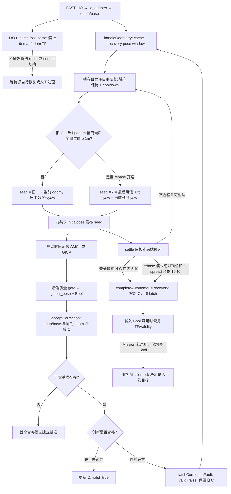
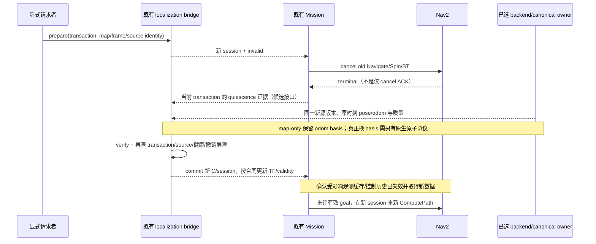

# Localization Recovery Chain Audit

2026-10-28；只读机制与集成边界审计。基线为 `9c1956065863efbf71df814c4cf4bf0a23f0ad1c`，
分支 `codex/localization-recovery-chain-audit`。**本轮只新增本报告，不修改生产代码、不运行恢复。**
前序 Software / Simulation Go 仍只适用于各自已验证合同；本报告不新增 Hardware Go。

**推荐 Option B：下一项只补 R3 的显式大修正提交事务。** 范围限于既有 bridge/Mission
之间的撤销完成、commit 和新会话再规划边界；不搬旧车“最后可信 XY 回锚”算法，不实现
自动 reseed、多源恢复策略或 FAST-LIO 原点重置。原因是这部分存在可从源码确认的独立
软件缺口，且可用合成输入验证。R2 自动 seed 的价值/来源资格和真正的 raw-basis rebase
应等待新车证据。下面的两个 Candidate 合同均是提案，不是当前实现或执行授权。

## 1. 检查对象与复核入口

旧仓只读：`/home/qihei/.local/share/Trash/files/rm2027_navigation`。使用 Git 对象读取，
没有切换或修改旧工作区。搜索了旧 main、correction/jump/high-spin、AMCL/GICP 相关
refs 的源码、launch、config、tests、scripts、reports，并检查当前链与独立 Z 候选。
未取得并重放原始 bag；历史现场数值来自固定版本报告，不伪装成本轮实测。

| ID | 固定对象 / 路径 / 源码入口 | 用途 |
| --- | --- | --- |
| O0 | 旧 `origin/main-old-car@82017945`；`src/rm_relocalization_bridge/src/map_odom_from_global_pose.cpp` | 没有 correction latch/autonomous reseed/rebase；旧 main 不能代表修复分支 |
| O1 | `origin/fix/old-car-amcl-correction-gate@e15b6bda`（08-25）；同文件 `publishAutonomousRecoveryPose/updateAutonomousRecovery/acceptCorrection` | 已有可信预测 seed、驻车、settle、5 帧恢复；没有 rebase 分支 |
| O2 | `origin/fix/old-car-lio-jump-recovery@51e3b233`（09-02）；同文件 `evaluateAutonomousRebase`；旧车 YAML；`test_map_odom_autonomous_recovery.py` | 新增回锚/有界 seed 次数、位姿窗口；合成与负向回放证据 |
| O3 | `origin/fix/old-car-fast-lio-high-spin@46c521b2`（09-03）；同文件 L355、415、484、562、755、778、805、872；`old_car_2026_competition.launch.py` L251–257 | 最后组合：LIO Bool interlock、3 帧异常确认、高角速度 hold；源码事实主体 |
| O4 | O1 的 `docs/validation/old_car_high_spin_localization_engineering_report_20260825.md` §8–11 | 四次恢复原表、软件测试、未关闭项 |
| O5 | O2 的 `docs/validation/old_car_runtime_robustness_validation_20260901.md` R03 | 16 次长尾、24 次失败、rebase 回放的真实含义 |
| O6 | O3 的 `docs/validation/old_car_fast_lio_high_spin_validation_20260903.md` §1.1–1.2 | 单帧误锁存、3 帧确认、高速 hold；并非 rebase 成功证据 |
| O7 | `origin/feature/old-car-gicp-integration@41526b77`、`origin/feature/gicp-degeneracy-gate@6a38b745`；旧 main 的 `docs/phase2j_3d_relocalization.md` L79–108、`docs/validation/old_car_navigation_status_and_roadmap_20260720.md` L34–39 | GICP 真算法合成 smoke；未作为 fresh03 实车运行后端 |
| N1 | 当前 [bridge](../../src/rm_relocalization_bridge/src/map_odom_from_global_pose.cpp) L169、261、361、561；[quality gate](../../src/rm_relocalization_bridge/src/amcl_pose_gate_node.cpp) L63 | prepare、源 epoch、健康前提、accept；准入 reset 不等于算法 reset |
| N2 | 当前 [LIO health](../../src/rm_localization_adapters/src/odometry_input_health.cpp) L58–98；[adapter](../../src/rm_localization_adapters/src/lio_adapter.cpp) L534、824 | fault watermarks、锚点内恢复、twist reset；没有任意新原点恢复 |
| N3 | 当前 [Mission](../../src/rm_competition_mission/src/competition_mission_node.cpp) L296、517、613、775；[事件 BT](../../src/rm_nav_config/behavior_trees/event_driven_replanning.xml) | session 撤销、旧结果拒绝、terminal-before-replacement；没有 commit 回执给 bridge |
| N4 | 当前 [GICP](../../src/rm_gicp_relocalization/src/gicp_relocalization_node.cpp) L135、301、328；[pursuit](../../src/rm_pursuit/README.md#radar-and-research-input-policy) | seed/reset/cache 的真实区别；radar target 不是本车定位 |
| N5 | [上轮报告](localization_correction_gate_port_20261028.md)、[物理验证脚本](../../src/rm_new_car_simulation/scripts/validate_correction_navigation.py) L45–61、[节点夹具](../../src/rm_relocalization_bridge/test/test_correction_runtime.py) L87–98 | 大修正节点测试与无大跳物理导航测试是两种证据 |
| Z1 | `codex/zlocalization-upstream-parity-20261024@c13463c`；`src/rm_localization_adapters/src/session_canonical_input.hpp` 的 `boundary/process`；`src/rm_competition_interfaces/include/rm_competition_interfaces/localization_session.hpp` | 独立 native opt-in 已有原子 frame/session、旧工作 ticket、twist/reference 清理；本链未包含 |
| Z2 | 同 ref 的 `docs/zlocalization_upstream_parity_20261024.md` F14 和 `docs/validation/zlocalization_software_closure_20261024.md` | 软件事务记录；整体仍 Software Modify（S03/M11 未关闭），不能据此开启新链 |

复核旧对象的方法（不需要 checkout）：

```bash
git -C /home/qihei/.local/share/Trash/files/rm2027_navigation show \
  46c521b2:src/rm_relocalization_bridge/src/map_odom_from_global_pose.cpp
git -C /home/qihei/.local/share/Trash/files/rm2027_navigation show \
  51e3b233:docs/validation/old_car_runtime_robustness_validation_20260901.md
git show c13463c:src/rm_localization_adapters/src/session_canonical_input.hpp
```

## 2. 真实旧 pipeline：不是 LIO→AMCL→GICP 自动切换

O3 的实际调用/状态关系如下；O1 没有 rebase、三帧确认和高速 hold。



图外两条重要支路：

- O3 高速 hold 在**未锁存且已有可信 C**时忽略全部高角速度候选、保持 C；它是保护
  而非 recovery，不调用 seed。旧 LIO false 只控制输出与清 pending，不自动置 correction
  latch，也不执行 FAST-LIO reset；true 后还可能续用旧 C，没有现代 fresh-global/session 门。
- 手工 `/initialpose` 同时到 backend 和 bridge。bridge 用“与自身最近 seed 完全相同 stamp”
  识别自发消息，否则清 baseline/latch；没有事务身份或 backend ack。其回调甚至不先验证
  seed frame/finite。reset service 也只清 bridge 基准；均不是算法与导航的原子事务。

## 3. R1 — Candidate Acquisition 与 source authority

“当前”指 9c19560 依赖链；没有任何源因本审计获得 RM2027 production / Hardware Go。

| Source | 历史真实使用与精度/硬件证据 | 当前状态与候选权限 | canonical commit 权限 |
| --- | --- | --- | --- |
| FAST-LIO | 旧车实际主 odom，静止/移动/导航有现场记录；09-01 存在约 10 m 自然跳变反例 | 当前 raw source，经 adapter health/isolation；可供局部运动预测，不能把健康标志当独立全局定位真值 | 不能直接改 map→odom；adapter 独占 odom→base。global correction 不能覆盖 LIO invalid |
| AMCL | 旧车选中后端；人工初值后导航成功，四次恢复有 raw pose/log/目视确认；无独立恢复误差真值，存在低 covariance 错峰 | 可显式启用；是局部/粒子分布收敛来源，不是任意未知位置可靠召回。候选必须经过 selected quality status 与 correction gate | 无；`tf_broadcast=false` |
| GICP | 真 PCL 算法+522 点合成 PCD smoke 成功；有 seeded 与退化质量门分支；没有找到 recovery 实车成功证据，fresh03 未使用 | 当前实现已有 fitness/收敛/相对 guess jump 门；原始 covariance 为 score 派生代理。旧退化门不在当前链，属于另项遗漏，不在本轮补回。手工 seed 才能局部注册 | 无；只发布 pose/quality。不是 AMCL 失败后的自动 fallback |
| radar localization | 检查范围内未发现本车 global pose producer、reset 或恢复案例；文件名中的 radar 可能指 LiDAR 安装说明 | 当前只有 `/radar/target_track` 的目标追踪候选接收器，README 明确真实 radar-link producer 尚缺；没有本车定位候选资格 | 无；敌方目标坐标不得拿来提交本车 pose |
| Z-Localization / ZLIO | 不是旧车四次恢复的组成部分；独立分支有软件/合成与 native reset 证据，没有 RM 新车硬件精度证据 | Research / 显式 feature-gated；legacy 和 native reset 能力不同。Z1 native 原子事务可供未来复用评审，但不在当前依赖链 | 上游 TF quarantine；仍由既有 canonical adapter/bridge commit，不另建 owner |
| manual initial pose | 旧 AMCL 实车启动/恢复兜底真实使用，正确性包含操作者判断 | 可提供 map/base 初值或显式事务请求；不是可跳过质量门的传感器真值 | 无。当前只发 initialpose 不清 correction latch；需既有显式事务 |
| 旧 C + odom 预测 / 最后 XY | 内部预测/先验，不是新增独立观测；LIO 错误会污染预测，最后 XY 假设车辆未真实迁移 | 可作为有资格的 seed 建议，不能单独作为恢复成功证据 | 无；不得以自己生成的 seed 与自己一致就授权 |

AMCL/GICP 在 launch 用 `relocalization_backend=none|amcl_2d|gicp_3d` 固定互斥选择，
不是按优先级自动运行。强行共启会共享 `/initialpose`、global pose 等接口，旧 Bool/pose
缺 source identity，存在混源风险；受支持 launch 无此共启。当前 selected status pin 能
阻止普通候选绕过选定后端，但也不是多源仲裁器。

## 4. R2 — Reseed 的真实效果与必要性

| 操作 | 确切对象/效果 | 未做到的事 |
| --- | --- | --- |
| 旧 autonomous reseed | bridge 发布 planar `/initialpose`，主要给已选 AMCL；旧 C×当前 odom 或最后 XY 作为均值，人工指定先验 covariance | 没有 ResetFrontend、没有 FAST-LIO 滤波器/地图清理，没有全局 source 优先级或新 epoch |
| AMCL 接 initialpose | [Nav2 Humble 上游 `handleInitialPose`](https://github.com/ros-navigation/navigation2/blob/humble/nav2_amcl/src/amcl_node.cpp#L506) 调 `pf_init` 重建粒子分布/初始状态；可补偿 seed 时刻到当前的 odom 变化 | 该路径不清地图，也不提供 RM transaction ack；未发现该函数显式清 scan filter 队列。上游源码用于语义核实，未恢复当年部署二进制的精确 Nav2 pin |
| GICP initialpose | 本地 `handleInitialPose` 转为 map/odom guess，`has_initial_guess=true`、`last_registered_generation=0`、registration valid=false | 保留 prior PCD 和 latest cloud；既有旧 cloud 可能再次参与求解，不是清空算法/输入队列 |
| GICP reset_gicp | 清 `has_initial_guess`，记录当前 cloud generation，registration valid=false | 不重置 FAST-LIO、bridge 或 canonical session；随后 seed 又把 last_registered_generation 置 0，不构成完整观测 epoch |
| 当前 quality gate reset_session | 新 admission epoch、清 accepted pose、建立源时间 cutoff | 不给算法 seed、不清后端内部历史状态、不证明 reset 完成 |
| Z native warm/cold reset | 独立 gated 原生协议，可关联 frontend session/frame；Z1 清 canonical pending/reference/twist | 不能通过改 topic 名把同样能力赋予 legacy FAST-LIO；Z legacy 不支持原生 ResetFrontend |

旧 R2 **在 AMCL 陷入错误峰、LIO 仍可信时有实际用途**；正常观测自行收敛、短异常已被
隔离时没有必要重复 seed。旧 16 次/33.88 s 长尾显示过频 seed 可能打断收敛；LIO 已偏移
时，旧预测 seed 会把 AMCL 带往错误区域，不能用于救活 LIO。

缓存/迟到边界：旧 bridge 没有 post-seed measurement cutoff、严格 source sequence 或
algorithm ack；settle 是时间等待，不能证明所有队列已清。重复合格候选也可能累计计数。
AMCL `/initialpose` 与 scan/DDS 队列无 RM 事务身份。当前 quality gate 会拒绝 cutoff
以前的真实源 stamp，但挡不住旧计算被重打新 acquisition stamp。GICP 当前默认互斥
callback/单线程执行，不能臆称已有并发注册 race；**保留旧 cloud**与缺版本化协议仍是事实。

### Reseed Contract Candidate（未实现）

1. 单一受控请求者提供 transaction ID、backend/producer、map revision、原始 seed 时间、
   map/base frame、seed 来源/不确定度；seed 是先验，不计入验证帧，也不证明恢复成功。
2. 先撤销当前定位/导航授权；只对选中的 backend 请求 seed。普通 AMCL reseed 要求 LIO
   和基准仍可信；LIO INVALID/RECOVERING 时不允许据其预测启动此路径。
3. 区分 `set_initial_guess`、`reset_distribution`、`reset_frontend/basis`，声明清了哪些
   状态、保留哪些地图。没有原生 ack 的 backend 只能受控排空/重启并验证源 provenance，
   不允许把 gate reset 的 success 冒充算法完成。
4. 后端 ack/新源 epoch 和 observation cutoff 绑定；旧 queue、pending TF、旧回调不能跨入。
   超时、撤销、source 变更后旧请求永久失效；retry 必须有预算并清楚定义终态。
5. 使用真实新观测、质量与时空一致性确认候选，交现有 bridge commit；只有 commit 后才
   由 Mission 重新评估目标。不得因为 seed 已发就改 TF、LIO health 或恢复速度授权。
6. 本候选不包含 AMCL→GICP→radar 自动选择策略，不规定新车最终数值。

## 5. R3 — 旧“rebase”究竟改了什么

O2/O3 的 `publishAutonomousRecoveryPose` 比较 `C_old * O_current` 与最后可信 map/base。
偏移 ≥1 m 时保留**最后全局 XY**，使用当前预测 yaw，压平 z/roll/pitch 后发 initialpose；
`evaluateAutonomousRebase` 要求候选在 seed 的 0.75 m / 0.75 rad 内，连续 10 帧 C spread
在普通 0.35 m / 0.35 rad 门内，然后 `completeAutonomousRecovery` 一次赋值：

`C_new = T_map_base_candidate * inverse(T_odom_base_current)`。

因此它是 **map/odom correction 重建**，不是 odom 原点、FAST-LIO IMU 状态或点云地图
真正重基准。没有改 odom/base owner，没有 reset adapter twist estimator，也没有修改
Nav2 path/costmap、等待 action terminal、创建 localization epoch 或恢复完成 RPC。
Mutex 只保证 bridge 进程内 C 更新一致；跨节点 TF/status 发布不是同一原子包。

| 问题 | 历史 / 当前判断 |
| --- | --- |
| 大 pose change 在哪里 | 旧只改 map→odom；odom 若已经跳坏，该坏数据此前已经进入 canonical。补 C 不会撤回已传播的 odom/twist |
| 双 TF owner | 正确 launch 中 AMCL TF 关闭、GICP 不发 TF、stub 互斥，rebase 不切 owner；未发现此路径主动启用双 owner。缓存中的旧 TF 不等于第二 publisher |
| old path/action | 旧 bridge 无 action 调用；旧 Mission 只读 Bool，取消后立即放弃 handle，不等 terminal。旧现场 R03 明确 Mission disabled；不能证明自动接续任务 |
| 当前 action 隔离 | 新 Mission 保留 handle 到 terminal，并拒绝旧 session 结果；已覆盖 terminal-before-**replacement** |
| 当前 commit 边界 | N1 `acceptCorrection` 只验证健康/源/质量/一致性即写 C，未消费 Mission terminal 或停稳 ack；不能推出 terminal-before-**commit** |
| twist | map-only C 改变不应重新差分 map/base 去制造速度，保持 odom/base twist；若真改 raw/odom basis，必须清差分历史/reference/heading 对齐，当前 legacy chain 不支持任意基准恢复 |
| costmap/planner | 旧/当前 bridge 均无事务化的 observation buffer 清理/重建确认；现有 BT 取消后重算 path，但不能证明大跳后旧地图观测缓存已一致 |
| goal | 同一 map/revision 的 patrol/home 意图可重新评估并重发，旧 path 不保留；实时追踪需重新验证源 lease。换 map/frame 必须转换或拒绝旧 goal，不能原坐标盲目重发 |

必须区分三类：①同一 frame 下渐进 drift correction，普通 gate 可接受累积变化；②真实
relocalization，允许 map/base 大变但 odom 基准可以不变；③raw/odom/map frame 定义变化，
属于坐标合同和 canonical reference 换代。旧“当前位置离最后 XY 远”无法区分真实移动、
kidnap、累计漂移与 LIO 原点突跳。把所有情况拉回旧 XY 会误拒真正的新位置。

当前证据边界：N5 的 +20.1→−15 m 是节点级合成大修正；物理 C14 使用连续真值 map pose，
测试新 session 的取消/替换，没有向真实 Nav2 注入同幅度大 pose change。不能把两项
拼接成“大修正时 old controller/path/costmap 全部已事务化”。这是本轮的新增审计发现，
不是宣称旧 smoke 失败。本轮不注入、不修复该边界。

### Rebase Transaction Candidate（未实现）



- “原子”首先指逻辑代次不可混合，不承诺两个独立 TF topic 有物理原子发布。map-only
  路径只替换 C，保留唯一 odom owner；涉及 basis change 时需像 Z1 的原子 frame/ticket
  协议，不能简单复用 unversioned Pose/Odometry 拼接。
- commit 必须绑定当前请求、backend epoch、同源时刻 odom、freshness、质量及撤销完成；
  取消/终止缺失时保持 invalid，不以超时当成功，不重启第二个 TF owner来绕过。
- 速度授权的暂停/恢复仍归现有运动授权 owner；Mission terminal 不等于实车已停稳，
  实机停稳证据必须独立满足。不得为本事务另造 cmd_vel publisher。
- 按实际 layer/frame 决定失效或刷新哪些 costmap observation buffers/控制历史，不默认
  无差别清整张地图。恢复规划前取得新会话合格数据；失败则停留 invalid/hold。
- intent 可保留但需重评 map revision 与源 lease；旧 path、BT recovery 与迟到 result
  一律不能越过新会话。中止后不自动回滚旧 C 并授权，也不自动尝试另一个 source。
- 最小后续软件门：延迟/拒绝取消、迟到旧结果、commit 前再失效、同图大平移/yaw、
  障碍缓存与新路径、twist 无跨 jump 差分。先证明当前缺口，再做最小补齐；不扩成 R4。

## 6. R4 — 有局部状态机，没有完整恢复策略

| 项目 | 旧实现事实与权限边界 |
| --- | --- |
| owner | bridge 内有明确的 correction-latch→seed→verify 局部状态机；完整运动/定位恢复跨 AMCL、adapter、Mission、readiness 的 topic 松耦合，没有全链协调 owner |
| trigger | correction 创新锁存且 autonomous 开关；不是任意 LIO fault |
| source priority | 无 runtime 排序/选择；launch 固定后端。AMCL 失败不会自动切 GICP/radar |
| retry | O1 cooldown 2 s、无限尝试；O2/O3 旧车 cooldown 5 s、最多 6 次发布 seed；有有效 streak 时抑制重播种 |
| timeout | settle 0.5 s 只是最早评估时刻；没有整体 recovery deadline，部分 streak 后无新候选可无限等待 |
| fallback | 旧 rebase 是同源 seed 先验的替换，不是新传感器 fallback；失败靠人工 initialpose/reset |
| success | 普通旧 C 门内 5 帧，rebase 双门 10 帧，stationary+settle；没有独立真值验收或车辆状态确认 |
| attempt exhaustion | 源码只停止更多 seed，`recovery_has_reseeded` 仍 true；`evaluateAutonomousRebase/acceptCorrection` 不检查耗尽位，后续合格候选仍可完成。日志“until explicit reset”不能当终态保证 |
| cancel / stale callback | 无 recovery request ID、取消 RPC、source epoch；自身 initialpose 只按 stamp 识别；旧 source/duplicate 可影响计数。不能原样迁入新会话合同 |
| resume | bridge 恢复 Bool/TF；若 Mission 开启则在自己的 tick 重新执行意图，无 recovery commit→resume ack。R03 现场 Mission disabled，不证明任务自动恢复 |

当前只有显式准入和有效性下游交互，不存在通用自动 R4。Z native 协调 reset 是特定
backend/frontend 协议，也不等于“AMCL→GICP→radar”的恢复选择器。

## 7. 证据分级与“四次恢复”拆账

沿用本轮口径：A 多次实车主动验证；B 单次/少量实车成功；C 实车自然故障；D bag replay；
E software/simulation；F only code/docs。等级可并列；负向证据也保留。不能把单次会话内
四个事件升级成每层独立的重复验收。

| 层 | 等级与已证明部分 | 未证明部分 |
| --- | --- | --- |
| R1 acquisition | AMCL 恢复相关 B+C，旧受控导航另有多次运行记录；GICP E（真实算法合成）；manual B；radar localization 未发现实现/证据 | 新车 accuracy、无 seed 全局召回、多源互相独立性 |
| R2 reseed | B：AMCL 收到自动 initialpose，随后四次恢复；C：16 次长尾、24 次失败；E：运动抑制、0.6 m 预测种子、4/5 仍 invalid 等旧测试 | 与“等候算法自行恢复”消融相比的独立因果收益；LIO invalid 下 seed 有效性；真实 reset/session 隔离 |
| R3 rebase | E：合成 odom x=5、global x=0，得到 C=-5；候选锚点和 4 帧测试。D：旧故障 bag 错峰被拒绝、没有恢复 | 没有找到实车正向 rebase 成功；四次恢复早于该功能；真实 Nav2 大跳/成本图/twist 事务 |
| R4 orchestration | 局部 bridge 流程 B+E；完整多源/任务接续仅设想 F，所查源码没有该实现；重试失败 C | 独立 A 级全链重复验收、优先级/取消/超时终态、失效至真实停车和自动恢复 Mission |

四次事件均在 O1（08-25），O2 的 rebase 到 09-02 才加入：

| 事件 | seed 次数 | 首次 seed→恢复 | 首次拒绝→恢复 | 每次能证明的范围 |
| --- | ---: | ---: | ---: | --- |
| 1 | 11 | 21.803 s | 35.864 s | seed 消息到达 AMCL，前 10 次 seed 后候选仍未过旧 C 门，最终 5 帧合格；有长尾 |
| 2 | 1 | 1.058 s | 5.743 s | 同一局部流程成功，恢复位姿由操作者确认 |
| 3 | 1 | 1.095 s | 17.460 s | 同上；较长前段包含继续运动/停车等待 |
| 4 | 1 | 1.052 s | 86.318 s | 同上；不能用约 1.1 s 声称整个故障耗时 |

四次共同没有证明：重建 LIO 滤波器/地图、odom basis reset、rebase、GICP fallback、
旧 action terminal 与物理停稳屏障、costmap 事务、自动 Mission resume 或新车精度。
原记录也没有精确停车时间和外部真值，不足以归入每层的 A。

O5 反例比成功次数更能限定迁移：09-01 约 10 m LIO 跳变时 seed 漂到错误区域，24 次
仍失败；O2 对同片段回放，seed 留在 `(1.562,-3.370)`，旧 AMCL 输出距锚点
12.6–13.0 m，全部拒绝。回放 AMCL 不响应新 seed，**只证明不误恢复，不证明能收敛**。
O6 的 7.273 rad/s 高速 hold 包没有触发需要完成的 rebase，不能给它补上现场证据。

## 8. 对照当前链：覆盖、遗漏、仅接线、已不适用

A=已有覆盖；B=仍缺机制/合同；C=已有确定合同但缺实现；D=只缺生产接线；E=旧机制不适用。
这些分类与证据 A–F 是不同维度。

| 能力 | 分类 | 当前结论 |
| --- | --- | --- |
| LIO 输入健康、坏输出隔离、有限锚点恢复 | A | 已有；保护本地输出，不是任意原点/真实位姿恢复 |
| unified validity、lease、source/session、水位、单 TF owner | A | 已有；替代旧 Bool-only 连线，不重建另一套 |
| 普通 correction、连续异常 latch、人工事务准入 | A | 已有；默认 gate 关闭、fixture 显式开启 |
| Mission 旧会话结果拒绝、terminal-before-replacement、事件 BT | A | 已有；supersede 旧取消后立刻遗忘 handle 的做法 |
| AMCL/GICP 手工 seed 接口 | A；部署有 D 项 | 可调用，但真实源/地图资格未接受；不能把自动 reseed 说成仅差 wiring |
| 单源 autonomous reseed 策略与算法 ack/旧观测清理 | B，局部后端动作已有实现 | 新车触发和 seed 来源不确定；需先关闭 provenance/取消/失败终态合同 |
| 大 map correction 的 terminal-before-commit、缓存/控制状态一致性 | B→C（须先接受候选合同） | 当前未实现/未证明；下一步最有价值的纯软件层，不需要先加自动策略 |
| raw/canonical basis reset | B；Z1 有旁支限定实现 | 当前 unversioned legacy 不支持；原生 Z transaction 可复用评审，不复制第二套框架 |
| 旧最后 XY 回锚、旧驻车数字、共享 initialpose stamp 自识别 | E | 依赖旧车场景且不区分真实移动与错误漂移；不原样迁移 |
| AMCL→GICP→radar 优先级与自动 resume | B | 旧源码也没有完整实现；不是“历史能力丢了只要接线” |
| 新车默认 production enable | 非单纯 D | source/map/clock/uncertainty/motion gate 数据不足；禁止用 wiring 名义启用 |

独立 Z1 的 reference/twist/ticket 清理是可复用知识；其 schema、owner 模式和真实 reset
前提与当前链不同，尚有 S03/M11 限制。不能因为别的 branch 有实现就把本链写成已支持，
也不应在当前链重新发明一套同义 session 框架。

## 9. RM2027 价值、推荐与停止边界

比赛需要的是失效时撤销运动授权、恢复后可信地重新定位和继续有效任务；不必拥有旧车
每一种自动恢复启发式。当前没有自动 reseed 时，correction latch 会保持 invalid/hold，
等待显式重定位；LIO 大跳超出恢复锚点则持续隔离、需要受控处理。这牺牲比赛时间，
但不能用错误恢复换取表面连续运行。真实底盘能否及时停仍是独立 Hardware Blocked。

自动 seed 的潜在收益是减少健康 LIO 下 AMCL 错峰的人为介入；它不能修复失效 LIO、
错误地图、缺乏全局观测或坐标重定义。无新车数据时继续移植旧驻车/回锚/重试参数，
收益不确定且容易误恢复；**不推荐 A 或 C，不新增 R4**。

**唯一推荐：Option B，限定为显式 map-only 大修正事务。** 先针对 terminal-before-commit
与大跳后的旧 path/costmap/控制历史做最小软件反例；若现有机制已足够则停止补实现，
只记录证据。确认缺口后复用 bridge/Mission 与现有会话经验，不增加候选 source、自动
trigger 或另一 authority。当前不是 D（缺口不只是 wiring），也不是 F（R2/R3 有真实
用途但旧策略不能整体迁）。有明确的软件边界可研究，所以无需把全部工作归为 E 等硬件。

必须继续 Hardware/Data Blocked：新车定位准确度和失效分布、真实 seed 来源/误差、
AMCL/GICP 收敛和错误峰概率、动态外参/时钟/heading、停稳/制动与最终运动授权、地图与
costmap 现场一致性、raw-basis 改变后的传感器重初始化。重试上限/驻车窗口/收敛阈值
不得用旧车 5 s/6 次/1 m/0.75 m 等数值直接定稿。

是否继续这条线：**有限继续 R3 的显式事务边界；停止把旧 recovery 整块搬回。**
R2 自动化和 R4 多源编排在有新车故障/源资格证据后重新决策，不在本轮默认进入开发。

## 10. 本轮验证与 Git 边界

本轮完成源码/报告/测试断言的交叉阅读、固定 Git 对象可解析检查、图与矩阵的来源核对、
本地文档链接与 diff 空白检查，以及审计分支相对 9c19560 的变更范围检查。
没有编译、运行 ROS/Gazebo、重放 bag 或硬件操作；没有把历史 PASS 当作本轮运行。
只保留这一份报告（内含轻量表格、Mermaid 图和两个 Candidate 合同），不复制历史源码或大资产。

main 保持 `d37f8d6e5ebe53533b7fc62aca8bb84392bee31b`；独立审计分支提交，无 merge/push。
