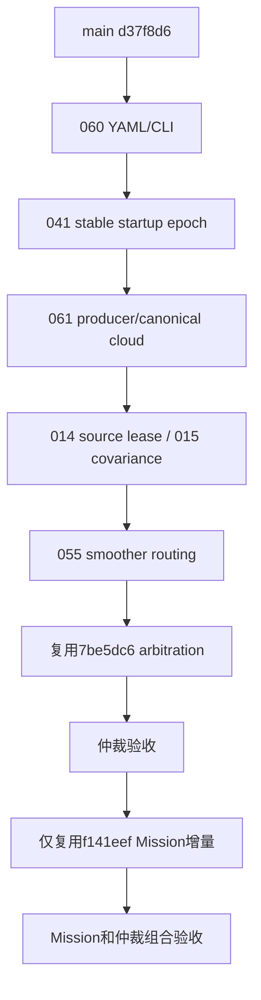

# Software-only debt closure（2026-10-24）

阶段 Integration；基于 main/origin-main d37f8d6；分支 codex/software-debt-closure-20261024。
输入为 historical_debt_round2_20261024 最新未提交对账文件；不修改原工作区。
不 merge main、不接设备、不修改比赛策略。034/044 上轮修复尚未 main 接受，本轮不重复处理。

## 修改前源码复核和依赖图

main d37f8d6e5ebe53533b7fc62aca8bb84392bee31b。
arbitration 7be5dc62bbada643c9472ec93d9880c0256cd177 直接基于 main；
minimal Mission f141eef94fab6f5044c2a7c746c5004f7ee1a7f1 直接基于 arbitration。

源码问题仍在：060 下层 false/topic 覆盖 derived YAML、Phase2A 未转发 CLI；
041 single 第40帧 rebase；061 consumer 默认 cloud 未发布且 raw/canonical 基准混用；
014 readiness 只记接收 now；015 未检查完整6×6对称/PSD；055 behavior 绕 smoother；
002/011/045 main 缓存/立即清 owner/空 cancel 覆盖 Spin 状态。



硬依赖为041→061与仲裁验收→Mission；其余边只表示执行顺序。
复用 main 的 first_source_sample 和后端 body cloud，不重写算法。
posture、硬件门、已关闭AUD、冻结算法不在本轮范围。
环境重启曾清空 /tmp 初始未提交改动和未完成构建；本报告只采用持久目录重跑后的结果。

## 实际结果

所有关闭范围均指本分支软件范围；main 未改变。

| AUD | 修改 / 复用 | 本轮有效证据 | 裁决 |
| --- | --- | --- | --- |
| 060 | YAML保留、显式CLI覆盖；Phase2A转发 | 3组真实launch：derived/关闭/换topic，joint和TF正确 | Closed software |
| 041 | single取消delayed zero-start，复用first_source_sample | 默认配置false；真实adapter45个非identity初值/杆臂源样本，44输出符合解析解，跨40无跳变 | 默认single Closed；旧车/dual仍gated |
| 061 | 复用bundle body cloud；源时间canonical TF；拒绝不支持组合 | 4种非法producer/profile/topic被拒；真实GICP非零杆臂/旋转合成prior smoke，误差<2mm；body入口拒绝odom帧 | generic single软件Closed；外部producer/真实PCD另验 |
| 014 | odom source stamp + steady接收lease | 4 pytest通过（含既有2项）：零/旧/未来/重复、暂停/回退时钟、实际monitor callback | Closed odom软件范围 |
| 015 | 完整6×6对称/PSD检查，复用已有Eigen；阈值不改 | gate和relocalization math两个CTest通过；含非对称/非PSD/3阶反例、相关/秩亏正对照 | Closed数学合法性；不是covariance标定 |
| 055 | 复用上游Nav2 + node-qualified behavior remap | 真实controller/behavior/smoother lifecycle及endpoint；唯一final publisher、输入到平滑输出、无自环 | 当前generic/legacy Gazebo base Closed |

注册组合边界CTest通过（7 pytest）；canonical adapter既有GTest通过。
环境为现有 rm2027_navigation:humble 镜像81b325bebf2f，禁网、私有IPC、无设备、非root、cap-drop ALL，2CPU/2GiB。
只构建受影响包及直接依赖；没有全仓、仿真世界、真实后端传感器输入或硬件测试。
FAST源审查固定main gitlink9aa8c79：body cloud确实由RGBpointBodyLidarToIMU生成；未修改该gitlink。
GICP构建只出现既有PCL pcap/png可选功能警告。

测试编排修正：初次无硬件Phase2A测试缺driver包share，随后仅从源码暴露禁用driver的launch/config资产；
未构建/启动驱动。Humble composition使用Python大小写False。注册测试不再用APPEND_ENV传单一路径，
避免ament拼接冒号。最终注册入口已重新通过，未放宽业务断言。

## 仲裁 gate（在 Mission 增量之前）

复用原候选7be5dc6，迁入为e761239。只处理两处文档尾部冲突，保留双方内容；
生产仲裁、BT顺序、原home阈值、patrol点序、pursuit计算没有另写实现。
在尚无f141eef增量的状态构建interfaces/pursuit/Mission/bringup四包，通过3/3注册CTest：
S1–S10、重复源不续租、planner退出、迟到接受、取消后等终态、ESTOP/guard/chassis失联、
缺home停止、generic研究入口、三点巡逻/Spin。共8 pytest case，另pursuit数学3 case通过。
测试断言所有替代请求晚于旧action终态，同时active最大值=1。

- AUD-002：referee/chassis接收lease、原子pursuit源身份/期限的软件范围Closed。
- AUD-011：pending/active取消保留owner到终态的软件范围Closed。
- AUD-045：补实际MissionState观测，活动Spin连续3个tick保持spin_active；空导航cancel不覆盖状态，Closed。
- 正式2027组合强制radar-only和guard只读否决，默认不启动；不提供AUD-003正授权。

上述软件仲裁 gate 已先通过；此后才允许迁入f141eef。

复核AUD-015又增加尺度反例：z方差1e12不能掩盖xy非法相关块。
初版全局容差实际接受该非法矩阵（已复现失败），改为逐维标准差归一化，
零方差要求零交叉项，normalized symmetry/PSD容差1e-10；保持原variance上限。
最终重跑：gate12项、relocalization math5项、readiness4项全部通过；
包含大方差非法块拒绝及同尺度合法相关矩阵接受。

## Minimal Mission gate

状态：**Software Integration Go，限定minimal Mission合同**。
在8e53cc6状态构建四个直接相关包通过；4/4注册CTest通过（9 pytest case），
另pursuit数学3 case通过，0 failures/errors/skipped。
S1–S14覆盖supply/recovery/special完成、抢占、取消、过期、权限丢失/恢复、
缺配置与非法请求、40Hz幂等命令及home latch；继承仲裁S1–S10和Spin诊断再次通过。
单owner和终态屏障断言通过，临时任务结束恢复原patrol索引；不恢复过期任务。
最终Mission接口生成后，前置7项软件边界注册CTest再次通过。
仲裁已在没有Mission增量时先通过，故此处的软件闭合满足依赖 gate。
迁入原f141eef的增量为8e53cc6；文档尾部冲突保留双方内容。
与f141eef相比，Mission/pursuit/interfaces的生产源码、配置、launch和BT完全一致；
本轮只额外增加Spin诊断断言。没有新写任务框架、自动补给/回血、经济/姿态/地形策略，
不调整home阈值、patrol坐标/点序、pursuit目标计算或控制器参数。
候选已有的return-home latch及显式临时任务语义随候选集成，不能描述成与main行为完全相同。

## 剩余状态（沿用对账；非重新全仓审计）

| 状态 | 仍保留的项目 / 边界 |
| --- | --- |
| Open / Partial | AUD-003：本轮只消费guard否决；真实Mission-to-V2正准入owner/session/profile仍缺，legacy/HPM不继承V2守卫；AUD-029许可需要权利人决策；真实radar producer/time-ID-frame可信入口未实现 |
| Feature-gated | AUD-004/005/006/010/012/013/018/019/021/022/023/027/032/033；未选async/adaptive的030/046余项；041旧车/dual delayed-zero配置；055未受测自定义/namespace/composed profile。未恢复这些功能 |
| Needs evidence | AUD-016/031/040/052/054/056；AUD-008仍仅有各已选profile的定向覆盖，不称所有历史末端/异常均覆盖 |
| Hardware-blocked | 实际机械DOF/轴与home外参、动态heading/full-base标定、source时钟与连续录制、独立prior/query与地图接受、真实雷达/串口/MCU端到端、正授权/物理停止、六姿态和四轮实测约束、目标机负载/感知/导航 |
| 上轮Candidate-only，未重复处理 | AUD-034/044的唯一未提交修复仍在historical-debt-round2工作区，本分支/main不包含它们；采用时单独接受原diff与证据，不重做 |
| 本轮本分支已闭合、main尚未采用 | AUD-002/011/014/015/045/060；041仅default single；055仅generic/legacy Gazebo base；061仅generic single producer/frame软件合同 |

明确Closed的001/007/020/038/050/059没有重新整改；Accepted / Not applicable / Superseded的其余项条件保持。
本轮未迁入Z、acquisition、posture、HWS或冻结算法，未改gitlink。所有hardware gate均未尝试，仍无Deployment Go。

## 复现与证据位置

永久证据为本报告、源码/配置与注册测试；构建/日志/XML不进入Git。
持久本地结果：`/home/qihei/projects/rm2027_navigation_clean/build/software_debt_validation/`。
其中readiness.xml、build/*/test_results、log_arbitration、log_mission保留本轮结果；
初版失败及最终通过以本文说明为准，不把旧报告的数字当成本轮实测。

在现有Humble镜像内，源码挂到`/workspace:ro`、独立结果目录到`/results`，
无网络/无设备、私有IPC、非root，先source `/opt/ros/humble/setup.bash`：

```bash
cd /workspace
export CMAKE_BUILD_PARALLEL_LEVEL=1 MAKEFLAGS=-j1
colcon --log-base /results/log build --base-paths \
  src/rm_competition_interfaces src/rm_localization_adapters src/rm_description \
  src/rm_lio_bringup src/rm_navigation_bringup src/rm_gicp_relocalization \
  src/rm_relocalization_bridge src/rm_pursuit src/rm_competition_mission \
  --build-base /results/build --install-base /results/install \
  --executor sequential --cmake-args -DBUILD_TESTING=ON -DCMAKE_BUILD_TYPE=Release
# GICP在2GiB限制下实际采用 -DCMAKE_CXX_FLAGS_RELEASE='-O0 -g0'；不采集性能结论。
source /results/install/setup.bash
export ROS_LOG_DIR=/results/ros_log
unset RM_COMPETITION_MISSION_SOURCE_DIR
ctest --test-dir /results/build/rm_navigation_bringup --output-on-failure
ctest --test-dir /results/build/rm_localization_adapters --output-on-failure
ctest --test-dir /results/build/rm_relocalization_bridge \
  -R 'test_global_pose_gate|test_relocalization_math' --output-on-failure
ctest --test-dir /results/build/rm_competition_mission --output-on-failure
PYTHONPATH=src/rm_system_monitor:$PYTHONPATH python3 -m pytest -q \
  src/rm_system_monitor/test/test_readiness.py \
  src/rm_system_monitor/test/test_readiness_odom_runtime.py \
  src/rm_pursuit/test/test_pursuit_math.py -o cache_dir=/results/pytest_cache
```

仲裁先验收时停在ddf988b（尚无minimal增量），最后Mission组合在8e53cc6上验收。
不把action fixture的终态当作真实Nav2内部取消SLA或MCU停车；未关闭AUD-016/056。


## 提交与后续合入建议

| Commit | 内容 |
| --- | --- |
| 399840c897ba4028e707e481ed5758a33ea1ca99 | 060/041/061/014/015/055软件整改与定向测试 |
| e76123935fcdbbd796d37c6ccca67bf74d2918bc | 复用7be5dc6仲裁候选 |
| ddf988b120f1535f9983a73b59d85963ead462d7 | PSD尺度修正、045明确证据、仲裁前置gate记录 |
| 8e53cc6dedc16ef09ffb5b1a82f802413bdf82da | 仅复用f141eef最小Mission增量 |
| 本报告所在最终提交 | 汇总组合验收、剩余状态与合入建议 |

**建议后续按此顺序评审后合入main的软件范围**，所有新功能默认关闭。
399840c必须连同ddf988b的最终covariance修正接受；Mission必须带仲裁依赖，不能单独摘取。
不推荐启用硬件/比赛profile；不据此声称真实radar、Mission-to-V2正授权、Nav2内部取消SLA、
MCU/物理停车、实地定位/地图或整车部署完成。
本轮main和原研究/候选分支不变；未push、未merge。
