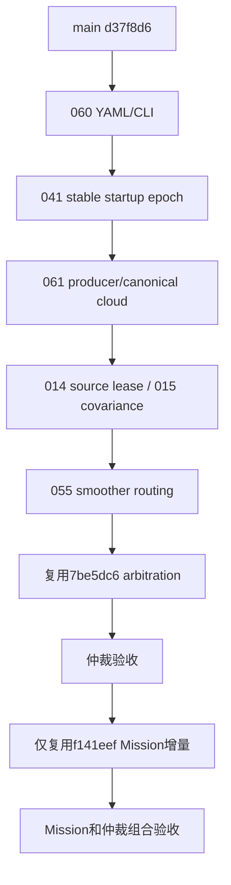

# Software-only debt closure（2026-10-24）

阶段 Integration；基于 main/origin-main d37f8d6；分支 codex/software-debt-closure-20261024。
输入为 historical_debt_round2_20261024 最新未提交对账文件；不修改原工作区。
不 merge main、不接设备、不修改比赛策略。034/044 上轮修复尚未 main 接受，本轮不重复处理。

## 修改前源码复核和依赖图

main d37f8d6e5ebe53533b7fc62aca8bb84392bee31b。
arbitration 7be5dc62bbada643c9472ec93d9880c0256cd177 直接基于 main；
minimal Mission f141eef94fab6f5044c2a7c746c5004f7ee1a7f1 直接基于 arbitration。

源码问题仍在：060 下层 false/topic 覆盖 derived YAML、Phase2A 未转发 CLI；
041 single 第40帧 rebase；061 consumer 默认 cloud 未发布且 raw/canonical 基准混用；
014 readiness 只记接收 now；015 未检查完整6×6对称/PSD；055 behavior 绕 smoother；
002/011/045 main 缓存/立即清 owner/空 cancel 覆盖 Spin 状态。

硬依赖为041→061与仲裁验收→Mission；其余边只表示执行顺序。
复用 main 的 first_source_sample 和后端 body cloud，不重写算法。
posture、硬件门、已关闭AUD、冻结算法不在本轮范围。
环境重启曾清空 /tmp 初始未提交改动和未完成构建；本报告只采用持久目录重跑后的结果。

## 实际结果

所有关闭范围均指本分支软件范围；main 未改变。

| AUD | 修改 / 复用 | 本轮有效证据 | 裁决 |
| --- | --- | --- | --- |
| 060 | YAML保留、显式CLI覆盖；Phase2A转发 | 3组真实launch：derived/关闭/换topic，joint和TF正确 | Closed software |
| 041 | single取消delayed zero-start，复用first_source_sample | 默认配置false；真实adapter45个非identity初值/杆臂源样本，44输出符合解析解，跨40无跳变 | 默认single Closed；旧车/dual仍gated |
| 061 | 复用bundle body cloud；源时间canonical TF；拒绝不支持组合 | 4种非法producer/profile/topic被拒；真实GICP非零杆臂/旋转合成prior smoke，误差<2mm；body入口拒绝odom帧 | generic single软件Closed；外部producer/真实PCD另验 |
| 014 | odom source stamp + steady接收lease | 4 pytest通过（含既有2项）：零/旧/未来/重复、暂停/回退时钟、实际monitor callback | Closed odom软件范围 |
| 015 | 完整6×6对称/PSD检查，复用已有Eigen；阈值不改 | gate和relocalization math两个CTest通过；含非对称/非PSD/3阶反例、相关/秩亏正对照 | Closed数学合法性；不是covariance标定 |
| 055 | 复用上游Nav2 + node-qualified behavior remap | 真实controller/behavior/smoother lifecycle及endpoint；唯一final publisher、输入到平滑输出、无自环 | 当前generic/legacy Gazebo base Closed |

注册组合边界CTest通过（7 pytest）；canonical adapter既有GTest通过。
环境为现有 rm2027_navigation:humble 镜像81b325bebf2f，禁网、私有IPC、无设备、非root、cap-drop ALL，2CPU/2GiB。
只构建受影响包及直接依赖；没有全仓、仿真世界、真实后端传感器输入或硬件测试。
FAST源审查固定main gitlink9aa8c79：body cloud确实由RGBpointBodyLidarToIMU生成；未修改该gitlink。
GICP构建只出现既有PCL pcap/png可选功能警告。

测试编排修正：初次无硬件Phase2A测试缺driver包share，随后仅从源码暴露禁用driver的launch/config资产；
未构建/启动驱动。Humble composition使用Python大小写False。注册测试不再用APPEND_ENV传单一路径，
避免ament拼接冒号。最终注册入口已重新通过，未放宽业务断言。

arbitration / minimal Mission gate 尚待下一提交实际迁入与验收。
